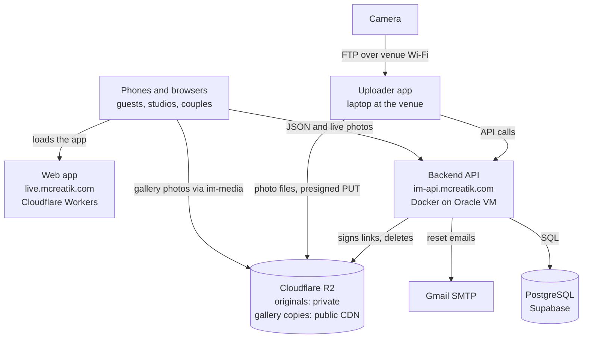
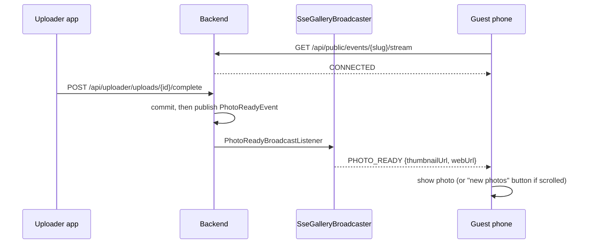

# Architecture

Photo files never pass through the backend server. Uploads go straight to Cloudflare R2 through short-lived signed links, and guests load photos from the im-media CDN. The backend signs links, enforces rules, keeps records and pushes live updates. That is why a 1-CPU server can run a busy wedding.

## System map

## How the parts talk

| Channel | Used for | Code |
| --- | --- | --- |
| JSON over HTTPS with a bearer token | Everything the dashboard, portal and uploader read or change | `web/src/lib/api.ts`, `uploader/.../ApiClient.java` |
| Presigned URLs (signed, short-lived links) | Uploading and downloading files directly to and from R2 | `storage/R2StorageService` |
| Server-Sent Events (SSE) | Pushing new photos to guests' phones | `realtime/SseGalleryBroadcaster`, `gallery/useLiveGallery.ts` |
| CDN | Serving gallery and thumbnail images | R2 media bucket at im-media.mcreatik.com |

## Upload paths

There are three ways a photo enters the system:

| Path | Who | What happens |
| --- | --- | --- |
| Camera uploader, prepared | Uploader app (default) | Laptop makes 2048 px and 640 px JPEGs, PUTs them to R2 media, photo is READY at once |
| Camera uploader, original only | Uploader app (fallback) | Original goes to R2 originals; the server's worker makes the versions |
| Dashboard | Studio in the browser | Browser resizes (`prepareUpload.ts`) and posts both versions; originals optional via presigned PUT |

## Guest gallery and Client gallery

Every photo has a `gallery` value, `GUEST` or `CLIENT` (`photos.gallery`), and so does every category. Camera uploads and compressed dashboard uploads are `GUEST`. Full-quality finals uploaded by the studio are `CLIENT`. Guests are served only `GUEST` photos. On events with `split_galleries = true` the couple's portal, album picks and ZIPs use only `CLIENT` photos; older events keep showing the couple every photo. Uploads are stored even while a gallery is switched off. See the Database and API reference pages.

## Live updates

Events sent to guests: `PHOTO_READY`, `PHOTO_REMOVED`, `EVENT_STATUS`, `GALLERY_CLOSED`. On reconnect, the phone fetches anything it missed with `?after=<cursor>`, and it repeats that as a safety poll every 60 seconds.

## Key design decisions

| Decision | Why |
| --- | --- |
| Direct-to-R2 uploads and CDN delivery | The 900 MB / 1 CPU container never carries image bytes |
| Photos table doubles as the job queue | No extra queue service; jobs can't be lost between a queue and the database |
| Stateless JWT logins | No server sessions; any request can be checked on its own |
| Prepare photos on the laptop | About 1 MB per photo on weak venue internet instead of 10 to 60 MB |
| Lazy-loaded dashboard code | Guests download only the gallery |
| One Docker container, in-memory rate limits and SSE | Simple and cheap; the trade-off is a single instance (see Security) |
