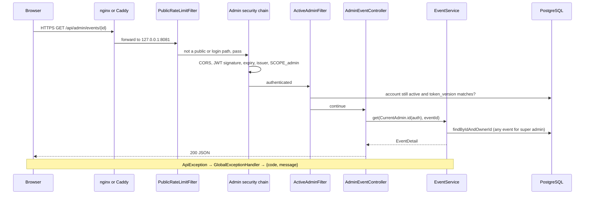
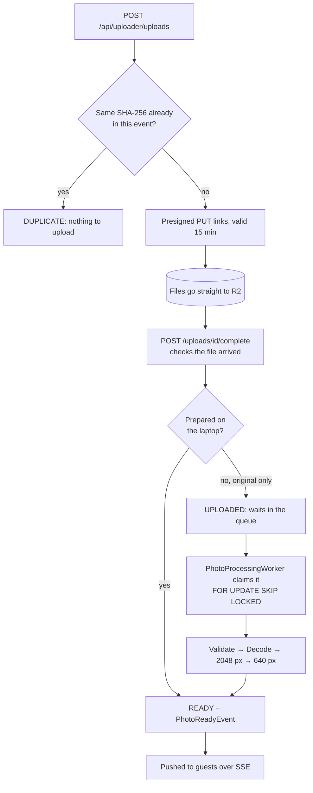

# Backend

The backend (`backend/`) is a Spring Boot 4.1 application on Java 21, organised by feature. A controller receives each request, a service applies the rules inside a transaction, and a repository or `JdbcTemplate` runs the SQL.

## Packages

| Package | Responsibility | Key classes |
| --- | --- | --- |
| `config` | Settings, security chains, rate limiting | `SecurityConfig`, `PublicRateLimitFilter`, `GalleryProperties` |
| `auth` | Logins, accounts, studios, branding, password resets | `AuthController`, `AccountController`, `StudioController`, `JwtService`, `ActiveAdminFilter`, `AdminAccess`, `PasswordResets`, `AdminBootstrap` |
| `event` | Events, the guest gallery API, retention | `AdminEventController`, `PublicGalleryController`, `EventService`, `RetentionJob` |
| `photo` | Uploads, listing, editing | `UploadService`, `AdminPhotoController`, `AdminPhotoSearch`, `PhotoRepository`, `Cursor` |
| `processing` | Making web and thumbnail versions | `PhotoProcessingWorker`, `PhotoProcessingPipeline`, four `*Stage` classes, `ImageOps` |
| `realtime` | Live updates | `SseGalleryBroadcaster`, `PhotoReadyBroadcastListener` |
| `uploader` | Camera uploader API | `UploaderApiController`, `UploaderTokenAuthenticationFilter`, `UploaderAdminService` |
| `album` | Couple portal, categories, album picks | `ClientController`, `AlbumAdminController`, `AlbumService` |
| `download` | Streaming ZIPs | `ZipDownloads`, `ZipDownloadController` |
| `billing` | Plans, allowance, UPI payments | `BillingController`, `BillingService` |
| `analytics` | Anonymous guest activity | `GuestActivityController`, `GuestActivityService` |
| `storage` | R2 (production) or local disk (development) | `StorageService`, `R2StorageService`, `LocalStorageService`, `StorageKeys` |
| `mail` | Email | `Mailer`, `SmtpMailer` |
| `docs` | This documentation: every page for the super admin, the studio guides for studios | `DocsController` |
| `common` | Errors and tokens | `ApiException`, `GlobalExceptionHandler`, `Tokens` |

## Request lifecycle

Example: a studio opens an event dashboard, `GET /api/admin/events/{id}`.

1. **Rate limit.** `PublicRateLimitFilter` keeps a token bucket per IP, but only for `/api/public/**` and the four login and forgot-password paths.
   - Public paths: 600 requests in a burst, then 20 per second.
   - Logins: 10 attempts, then 1 every 10 seconds.
   - An empty bucket returns `429 RATE_LIMITED`.
2. **Security chain.** `SecurityConfig` picks the first chain that matches the path:

    | Order | Paths | Requires |
    | --- | --- | --- |
    | 1 | `/api/uploader/**` | Uploader token |
    | 2 | `/api/admin/**` | JWT with scope `admin` |
    | 3 | `/api/client/**` | JWT with scope `client` (login and forgot are open) |
    | 4 | everything else | Fixed allow-list, then deny all |

    All chains are stateless: no cookies or server sessions, so CSRF protection is not needed.
3. **JWT check:** HS256 signature with `JWT_SECRET`, expiry and issuer `mcreatik-live-gallery`. Startup fails if the secret is shorter than 32 bytes.
4. **`ActiveAdminFilter`** rejects disabled accounts, and tokens whose `ver` claim differs from `token_version`. A password change or a disabled studio takes effect at once.
5. **Ownership** is checked in the service (`EventService.owned`). Someone else's event returns 404, not 403.
6. **Response.** A Java record is turned into JSON. Errors go through `GlobalExceptionHandler`:
   - `ApiException` → its own status and code
   - validation → `VALIDATION_FAILED`
   - malformed JSON → `BAD_REQUEST`
   - anything else → a logged `500 INTERNAL_ERROR` with no internals in the response

## Logins

| Who | Login | Token | Revoked by |
| --- | --- | --- | --- |
| Studio or McreatiK | `AuthController.login` | JWT scope `admin`, `sub` = admin id, `ver` | `ActiveAdminFilter` |
| Couple | `ClientController.login` (takes an optional `eventSlug`; 409 `CHOOSE_EVENT` if one email has several galleries) | JWT scope `client`, `event` claim, `ver` | `ClientController.current()` |
| Camera uploader | `UploaderTokenAuthenticationFilter` | `mku_…`; only its SHA-256 is stored | Rotate or delete the uploader |

- Passwords use BCrypt with a 10-character minimum.
- Client login compares against a dummy hash for unknown emails, so timing reveals nothing.
- `AdminBootstrap` creates McreatiK's account from `ADMIN_EMAIL` / `ADMIN_PASSWORD` on first boot.

**Forgot password** (`PasswordResets`):

- emails a 12-character temporary password
- stores only its hash
- the temporary password is valid for 30 minutes and works alongside the current one
- at most one email per account every 2 minutes
- the response is always 204, and the email is sent in the background so timing reveals nothing

## Photo pipeline

- **Duplicates:** checked per event by SHA-256, backed by a unique constraint. A race between two inserts is caught and the existing photo is reused.
- **`complete`:** confirms the file is in storage with the declared size. It is safe to repeat. It promotes an UPCOMING event to LIVE.
- **Queue:** `processNext()` claims one row with `FOR UPDATE SKIP LOCKED`.
  - Two workers by default (`PROCESSING_WORKERS`).
  - Up to 3 attempts per photo.
  - Rows stuck in `PROCESSING` for 5 minutes are re-queued every 60 s.
- **Events after commit:** workers and guests never see a row that could still roll back.
- **Stages** are Spring beans ordered by `@Order(100…400)`, so a new stage needs no worker change.
- **Decoding** uses subsampling (`ImageOps`) to keep memory low on large originals.

## Live updates

- `SseGalleryBroadcaster` keeps subscribers per event in memory, up to 5,000 per event (`503 TOO_MANY_VIEWERS` beyond that).
- Each send runs on its own virtual thread.
- A heartbeat goes out every 20 s, and connections close after 30 minutes; the browser reconnects and catches up.
- Guest paging uses a keyset cursor on `(ready_at, id)`.

## Scheduled jobs

| Job | When | Purpose |
| --- | --- | --- |
| `RetentionJob.purgeExpired` | 03:17 UTC daily | For events past `retention_until` (`active_until` + 30 days): deletes the photos and every stored file, and archives the event. The event row, payments and charges stay as the record |
| `GalleryLifecycleJob.run` | 04:15 UTC daily | Paying studios only: pauses the couple's gallery of a Main/Quick event still over its storage 14 days after its date; emails 14 days before and on the day a gallery closes |
| `PhotoProcessingWorker.requeueStale` | Every 60 s | Rescues stuck photos |
| `SseGalleryBroadcaster.heartbeat` | Every 20 s | Keeps connections alive |
| `PublicRateLimitFilter.evictIdle` | Every 5 min | Frees idle buckets |
| `ZipDownloads` cleanup | Every 10 min | Drops expired ZIP jobs (3 streams at once, 1,000 photos, 30-minute link) |

## Configuration

`application.yml` reads everything from environment variables. Notable settings:

- `open-in-view: false`
- `ddl-auto: validate` (Flyway owns the schema)
- virtual threads on
- `forward-headers-strategy: framework`
- graceful shutdown
- only `/actuator/health` exposed
- `STORAGE_TYPE` switches between `local` and `r2`

## Tests

The tests are integration tests using MockMvc against a real PostgreSQL (`support/IntegrationTest`), with `Mailer` mocked. They cover auth, uploads, the uploader API, realtime, albums and clients, billing, branding, analytics, ZIPs, gallery switches, password resets and docs.

## Known gaps

- Rate limits, SSE subscribers and ZIP jobs live in memory, so only one instance can run.
- `ClientController` mixes HTTP, SQL and rules.
- Some request records lack `@Valid` limits.
- There is one database lookup per dashboard request.
- An unset `JWT_SECRET` falls back to a random key.
