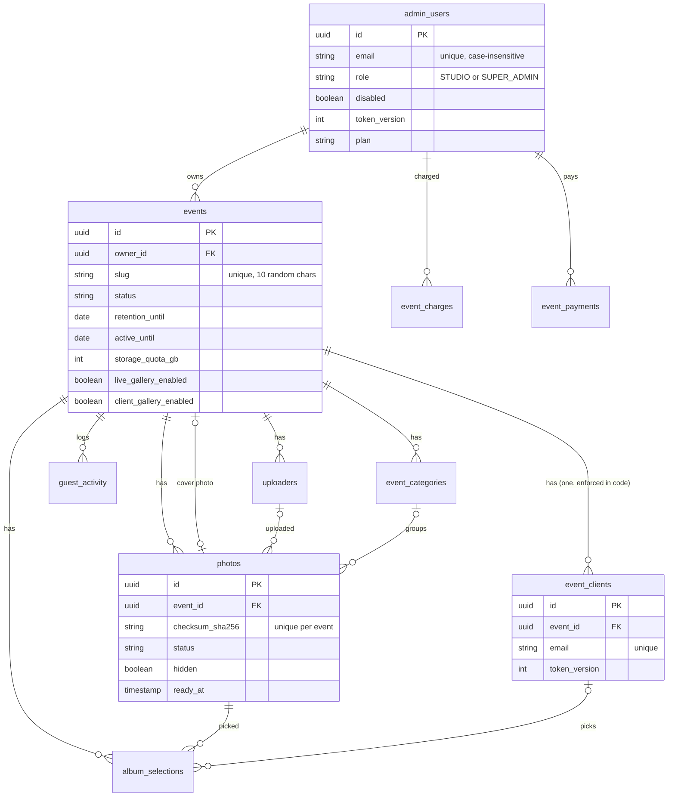
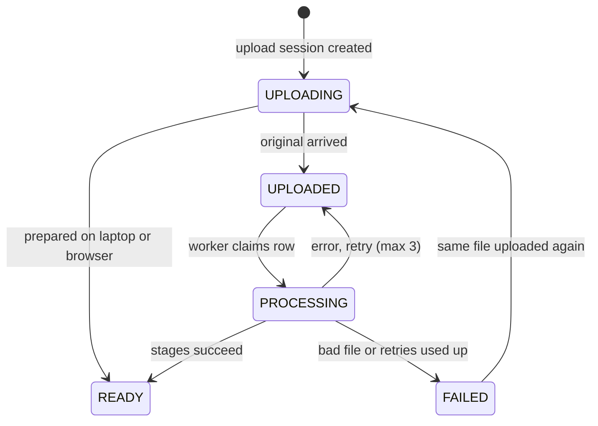

# Database

The database is PostgreSQL on Supabase: 11 tables created by Flyway migrations `V1` to `V13` in `backend/src/main/resources/db/migration`. Hibernate only validates the schema (`ddl-auto: validate`) and never changes it.

> **Warning** Never edit a migration that has already run. Add the next numbered file (`V14__…`) instead.

## Entity relationships

## Tables

| Table | Purpose | Added or changed | Code |
| --- | --- | --- | --- |
| `admin_users` | Studio and McreatiK logins: role, branding, plan, credits, reset fields, `token_version` | V1, V5, V6, V9, V10, V12, V13, V17 (`board_theme`), V18 (`main_credits`, `quick_credits`, `plan_paid_until`, `plan_since`, `plan_reminded_for`), V19 (`client_credits`) | JPA `AdminUser`; SQL in `BillingService`, `PasswordResets` |
| `events` | One wedding or event; `event_type` MAIN / QUICK / CLIENT; `active_until` (open 3 months by default, `billing_settings.active_months`, then deleted 30 days later via `retention_until`), `storage_quota_gb` (5 for live events, 0 for client galleries, plus GB bought), `storage_locked`, `expiry_warned_for` / `expiry_notified_for` | V1, V8, V13, V18, V19 | JPA `Event` |
| `uploaders` | Camera connections (token hash, status, queue counts) | V1 | JPA `Uploader` |
| `photos` | Every photo, and the processing queue | V1 to V4, V8 | JPA `Photo`, `AdminPhotoSearch`, worker SQL |
| `guest_activity` | Anonymous views, downloads, shares | V7 | `GuestActivityService` |
| `event_categories` | Albums inside an event | V8 | `AlbumService` |
| `event_clients` | The couple's login | V8, V11, V12, V13 | `ClientController`, `AlbumService` |
| `album_selections` | Photos the couple ticked | V8 | `AlbumService`, `ClientController` |
| `event_charges` | How each event was covered: `FREE`, `QUOTA` (this month's pack), `CARRY` (last month's unused), `CREDIT` (bought); carry-over is worked out from these rows | V9, V18 | `BillingService` |
| `event_payments` | Every purchase: `item` (MAIN_EVENT, QUICK_EVENT, UPGRADE, PLAN, STORAGE, CLIENT_SETUP, EXTEND), quantity, `event_id`, `plan`; UPI ones wait for review (UTR unique) | V9, V14, V15, V18 | `BillingService`, `OnlinePaymentService` |
| `billing_settings` | One row of UPI details and every price (Main, Quick, the four packs, upgrade, storage per GB, free GB, client setup, active months) | V9, V18, V19, V20 | `BillingService` |

## What happens on delete

| Deleted | Effect |
| --- | --- |
| An event | Its uploaders, photos, activity, categories, client and album picks go too (`ON DELETE CASCADE`). Its charges stay with `event_id` set to null, so billing history survives. `EventService.delete` removes the R2 files first. |
| A photo | Its album picks go; an event using it as cover gets `cover_photo_id` set to null |
| An uploader or category | Photos keep existing, with the link set to null |
| A studio | Not possible while it owns events (no cascade); the app only disables studios |

## Photo status flow

## Design choices

- **Queue in a table:** the partial index `ix_photos_work ON (status, uploaded_at) WHERE status IN ('UPLOADED','PROCESSING')` stays tiny, so claiming the next job is instant.
- **Duplicates blocked by the database:** `UNIQUE (event_id, checksum_sha256)` holds even when two uploads race.
- **Feed index matches the query:** `ix_photos_feed ON (event_id, ready_at DESC, id DESC) WHERE status = 'READY' AND NOT hidden` serves infinite scroll without sorting.
- **Emails ignore case:** a unique index on `lower(email)` for studio logins.
- **Single-row settings:** `billing_settings` has `CHECK (id = 1)`.
- **Privacy at the storage level:** `guest_activity` stores a random visitor ID, type, photo and source, and no name, IP, phone or email.

## Rules enforced in code only

| Rule | Where | Database backup |
| --- | --- | --- |
| One client login per event | `AlbumService` (`CLIENT_EXISTS`) | None; a plain index only |
| Album limit | `AlbumService`, `ClientController.select` | None |
| Client email unique | `UNIQUE (email)` plus lowercasing in code | Case-sensitive constraint |
| Role, plan and payment status values | Java enums and strings | No `CHECK` constraint |
