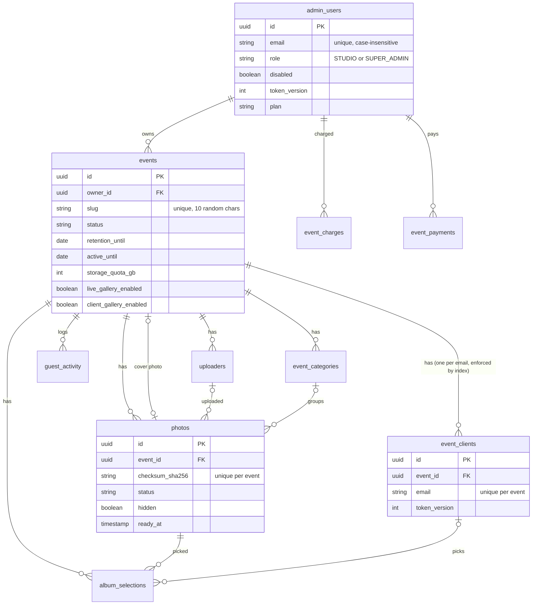
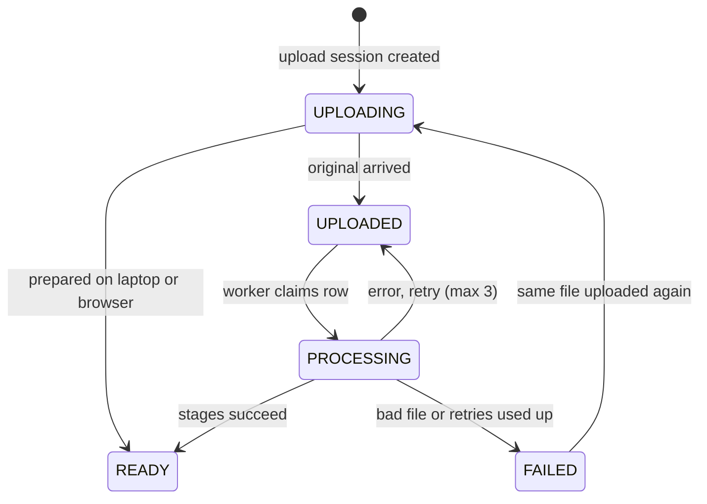

# Database

The database is PostgreSQL on Supabase: 11 tables created by Flyway migrations `V1` to `V26` in `backend/src/main/resources/db/migration`. Hibernate only validates the schema (`ddl-auto: validate`) and never changes it.

> **Warning** Never edit a migration that has already run. Add the next numbered file (`V27__…`) instead.

## Entity relationships

## Tables

| Table | Purpose | Added or changed | Code |
| --- | --- | --- | --- |
| `admin_users` | Studio and McreatiK logins: role, branding, plan, credits, reset fields, `token_version` | V1, V5, V6, V9, V10, V12, V13, V17 (`board_theme`), V18 (`main_credits`, `quick_credits`, `plan_paid_until`, `plan_since`, `plan_reminded_for`), V19 (`client_credits`), V21 (`contact_phone`), V23 (`client_storage_gb`), V26 (`client_months`) | JPA `AdminUser`; SQL in `BillingService`, `PasswordResets` |
| `events` | One wedding or event; `event_type` MAIN / QUICK / CLIENT; `active_until` (open 3 months by default, `billing_settings.active_months`, then deleted 30 days later via `retention_until`), `storage_quota_gb` (5 for live events, 0 for client galleries, plus GB bought), `storage_locked`, `expiry_warned_for` / `expiry_notified_for`; `photos_deleted_at` (when retention removed the photos: the event stays as an archived record) | V1, V8, V13, V18, V19, V26, V27 (`face_search_enabled`: the add-on is on) | JPA `Event` |
| `uploaders` | Camera connections (token hash, status, queue counts) | V1 | JPA `Uploader` |
| `photos` | Every photo, and the processing queue; `gallery` (`GUEST` / `CLIENT`) | V1 to V4, V8, V25, V27 (`face_indexed_at`, `face_attempts`, `face_next_attempt_at`: the face worker's queue state) | JPA `Photo`, `AdminPhotoSearch`, worker SQL |
| `guest_activity` | Anonymous views, downloads, likes (`LIKE` / `UNLIKE`, with a partial index for finding a visitor's like) | V7, V24 | `GuestActivityService` |
| `event_categories` | Albums inside an event; `gallery` (`GUEST` / `CLIENT`) gives each gallery its own list | V8, V25 |
| `hq_requests` | Guests' "Get HD photo" requests: `photo_id`, `contact`, `kind` (`EMAIL` / `WHATSAPP`), `visitor_id`, `done` | V24 | `HqRequests`, `GuestActivityController` | `AlbumService` |
| `event_clients` | The couple's login; one email can log in to several events (`ux_event_clients_event_email` is unique per event and email; `ix_event_clients_email` finds an email's events) | V8, V11, V12, V13, V26 | `ClientController`, `AlbumService` |
| `album_selections` | Photos the couple ticked | V8 | `AlbumService`, `ClientController` |
| `event_charges` | How each event was covered: `FREE`, `QUOTA` (this month's pack), `CARRY` (last month's unused), `CREDIT` (bought); carry-over is worked out from these rows | V9, V18 | `BillingService` |
| `event_payments` | Every purchase: `item` (MAIN_EVENT, QUICK_EVENT, UPGRADE, PLAN, STORAGE, CLIENT_SETUP, EXTEND, STORAGE_EXTEND, FACE_SEARCH), quantity, `event_id`, `plan`, `storage_gb`, `months`; UPI ones wait for review (UTR unique). The V14 and V15 online-payment columns are left over from an earlier design and unused | V9, V14, V15, V18, V23, V26 | `BillingService` |
| `billing_settings` | One row of UPI details and every price (Main, Quick, the four packs and their extra-event prices, upgrade, storage per GB, free GB, client setup, active months, face search Main 999 / Quick 499) | V9, V18, V19, V20, V22, V27 |
| `photo_faces` | The AWS Rekognition face ids of each guest photo (`photo_id`, `event_id`, `face_id`); both foreign keys `ON DELETE CASCADE`. Only ids are stored, never faces or selfies | V27 | `FaceIndexWorker`, `FaceSearchService` |
| `face_search_usage` | Searches per event and day (India time) for the daily cap | V27 | `FaceSearchService` | `BillingService` |

## What happens on delete

| Deleted | Effect |
| --- | --- |
| An event | Only McreatiK can delete one. Its AWS face collection is deleted too (`FaceSearchService.removeEvent`; a nightly check deletes any that were missed). Its uploaders, photos, activity, categories, client and album picks go too (`ON DELETE CASCADE`). Its charges stay with `event_id` set to null, so billing history survives. `EventService.remove` removes the R2 files first. |
| An event's photos (retention) | When retention ends, the daily job removes the files and photo rows and archives the event. The event row, its payments and its charges stay as the record (`photos_deleted_at` is set). |
| A photo | Its `photo_faces` rows and album picks go (its faces are also deleted from AWS by `AdminPhotoController`); an event using it as cover gets `cover_photo_id` set to null |
| An uploader or category | Photos keep existing, with the link set to null |
| A studio | McreatiK can delete it from the Studios page. Its events are removed first (files included), then its login, logo and payment history |

## Photo status flow

## Design choices

- **Queue in a table:** the partial index `ix_photos_work ON (status, uploaded_at) WHERE status IN ('UPLOADED','PROCESSING')` stays tiny, so claiming the next job is instant.
- **Duplicates blocked by the database:** `UNIQUE (event_id, gallery, checksum_sha256)` (V25) holds even when two uploads race. The same file may sit once in each gallery.
- **Gallery split flag:** `events.split_galleries` (V25). `true` for events created from 11 Nov 2026 and for client-only events: the couple sees only `CLIENT` photos. `false` for older events: the couple sees every photo.
- **Feed index matches the query:** `ix_photos_feed ON (event_id, ready_at DESC, id DESC) WHERE status = 'READY' AND NOT hidden` serves infinite scroll without sorting.
- **Emails ignore case:** a unique index on `lower(email)` for studio logins.
- **Single-row settings:** `billing_settings` has `CHECK (id = 1)`.
- **Privacy at the storage level:** `guest_activity` stores a random visitor ID, type, photo and source, and no name, IP, phone or email.

## Rules enforced in code only

| Rule | Where | Database backup |
| --- | --- | --- |
| One client login per event | `AlbumService` (`CLIENT_EXISTS`) | Partly: `ux_event_clients_event_email` allows one login per event and email |
| Album limit | `AlbumService`, `ClientController.select` | None |
| Client email unique per event | Lowercasing in code | `ux_event_clients_event_email` on `(event_id, lower(email))` |
| Role, plan and payment status values | Java enums and strings | No `CHECK` constraint |
