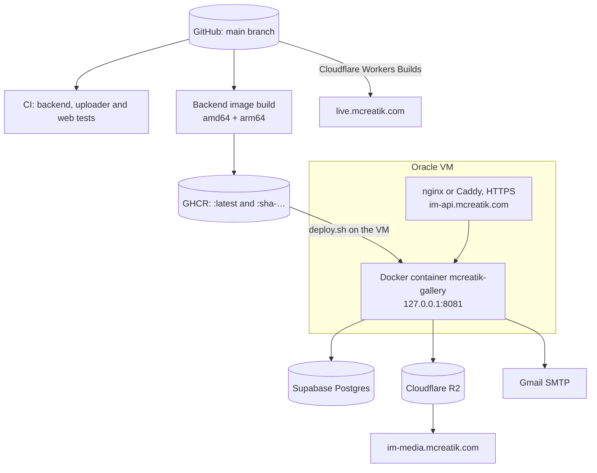
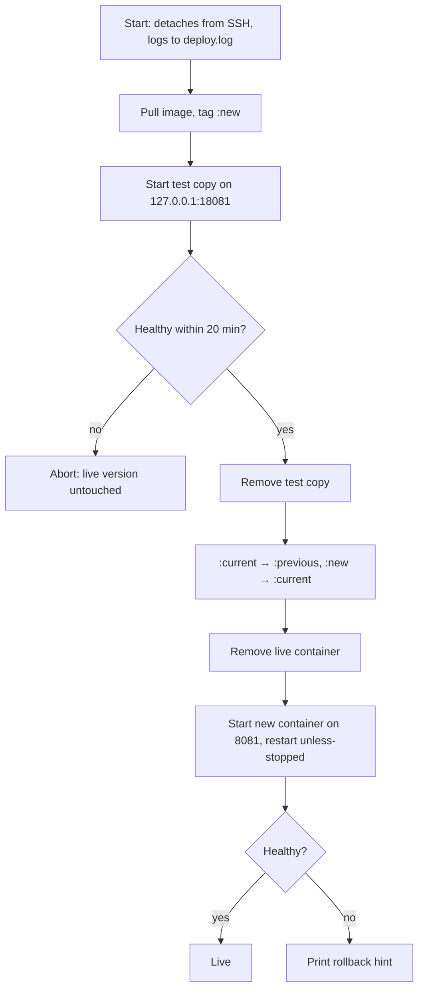

# Deployment

GitHub Actions tests every change and builds the backend image. The owner deploys the backend on the Oracle VM with `deploy.sh`, and Cloudflare builds and serves the web app.

## Production map



Source of each fact:

- **Repo:** workflows, image names, scripts, the 127.0.0.1 binding, Workers hosting and variable names.
- **Earlier setup (not in the repo):** DNS (`im-api` DNS-only, `im-media` proxied), Supabase, and the 1 GB VM.
- **Unknown:** which proxy, nginx or Caddy, is live.

## Continuous integration

`.github/workflows/ci.yml` runs on every push to `main` and on every pull request, as three parallel jobs:

| Job | Steps |
| --- | --- |
| backend | `mvn -B verify` against a real `postgres:16` service |
| uploader | `mvn -B verify` |
| web | `npm ci`, `lint`, `typecheck`, `test`, `build` on Node 22 |

## Backend image

`.github/workflows/backend-image.yml` runs on pushes to `main` that touch `backend/**`. It builds for amd64 and arm64 and pushes `:latest` and `:sha-<commit>` to GHCR, using only the built-in `GITHUB_TOKEN`.

The Dockerfile has two stages: Maven builds the jar, then `eclipse-temurin:21-jre` runs it as user `gallery`. It sets `MaxRAMPercentage=75` and `ExitOnOutOfMemoryError`.

## Deploying the backend

```bash
cd ~/mcreatik-instant-memories && git pull
IMAGE=ghcr.io/mugundhang/mcreatik-instant-memories-backend:latest \
  GALLERY_MEMORY=900m GALLERY_CPUS=1 deploy/oracle/deploy.sh
```



> **Warning** The live container is removed before the new one starts, so the API is down for the length of Java startup, which can take minutes on this VM. Never deploy during a live event.

**Rolling back.** `deploy/oracle/rollback.sh` restarts the image that was live before the last deploy (`:previous`), tags the bad one `:failed`, and waits for the health check:

```bash
GALLERY_MEMORY=900m GALLERY_CPUS=1 deploy/oracle/rollback.sh
```

To go back further, run `deploy.sh` with `IMAGE=ghcr.io/mugundhang/mcreatik-instant-memories-backend:sha-<commit>`.

## Deploying the web app

`web/wrangler.jsonc` holds the Cloudflare build settings:

- root directory `web`
- build command `npm run build`
- deploy command `npx wrangler deploy`
- build variable `VITE_API_BASE_URL=https://im-api.mcreatik.com`

`not_found_handling: single-page-application` serves `index.html` for every route. Automatic deploys on push are an **(assumption)**: that setting lives in the Cloudflare dashboard. Security headers come from `web/public/_headers`.

## Configuration

Values live only in `~/mcreatik-gallery/gallery.env` on the VM; the names are in `deploy/oracle/gallery.env.example`.

| Group | Variables |
| --- | --- |
| Database | `DATABASE_URL`, `DATABASE_USERNAME`, `DATABASE_PASSWORD`, `DATABASE_POOL_SIZE` |
| URLs and CORS | `PUBLIC_GALLERY_BASE_URL`, `API_PUBLIC_BASE_URL`, `CORS_ALLOWED_ORIGINS` |
| Auth | `JWT_SECRET`, `ADMIN_EMAIL`, `ADMIN_PASSWORD` |
| Storage | `STORAGE_TYPE`, `R2_ACCOUNT_ID`, `R2_ACCESS_KEY_ID`, `R2_SECRET_ACCESS_KEY`, `R2_ORIGINALS_BUCKET`, `R2_MEDIA_BUCKET`, `R2_MEDIA_PUBLIC_BASE_URL` |
| Processing and retention | `PROCESSING_WORKERS`, `RETENTION_DEFAULT_DAYS` |
| Mail | `MAIL_HOST`, `MAIL_PORT`, `MAIL_USERNAME`, `MAIL_PASSWORD`, `MAIL_FROM` |
| Web build | `VITE_API_BASE_URL` (public, set in Cloudflare) |

> **Note** Never print or screenshot `gallery.env`. Check a single value's presence with `grep -c '^NAME=' ~/mcreatik-gallery/gallery.env`.

## Deployment findings

| Severity | Finding |
| --- | --- |
| Medium | Every deploy is an outage for the length of Java startup |
| Medium | The image is built even when CI fails; deploy only after CI is green |
| Medium | No uptime monitoring or alerts |
| Medium | No defined backups |
| Low | Docker `HEALTHCHECK` uses `wget`, which may not exist in the image (unverified) |
| Low | `web/vercel.json` and two proxy configs are leftovers |
| Low | `nginx-im-api.conf` listens on port 80 and relies on certbot adding HTTPS |
