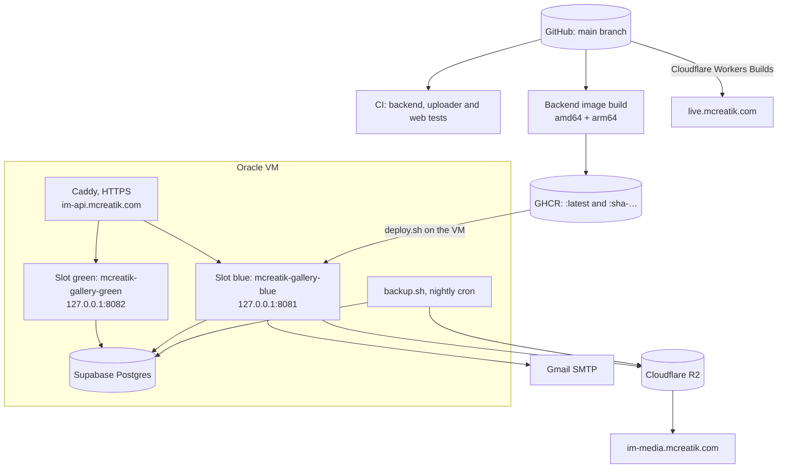
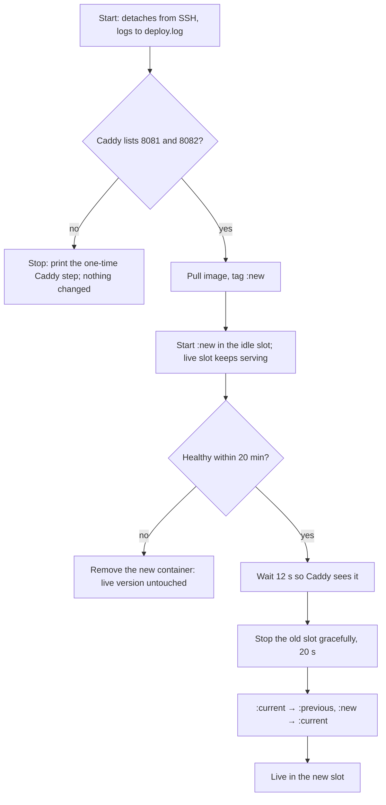

# Deployment

GitHub Actions tests every change and builds the backend image. The owner deploys the backend on the Oracle VM with `deploy.sh`, and Cloudflare builds and serves the web app.

## Production map



Source of each fact:

- **Repo:** workflows, image names, scripts, the 127.0.0.1 binding, Workers hosting and variable names.
- **Earlier setup (not in the repo):** DNS (`im-api` DNS-only, `im-media` proxied), Supabase, and the 1 GB VM.
- **Confirmed 3 November 2026:** Caddy is the live proxy (the API answers with `via: 1.1 Caddy`); `nginx-im-api.conf` is a leftover.

## Continuous integration

`.github/workflows/ci.yml` runs on every push to `main` and on every pull request, as three parallel jobs:

| Job | Steps |
| --- | --- |
| backend | `mvn -B verify` against a real `postgres:16` service |
| uploader | `mvn -B verify` |
| web | `npm ci`, `lint`, `typecheck`, `test`, `build` on Node 22 |

## Backend image

`.github/workflows/backend-image.yml` runs on pushes to `main` that touch `backend/**`. It builds for amd64 and arm64 and pushes `:latest` and `:sha-<commit>` to GHCR, using only the built-in `GITHUB_TOKEN`.

The Dockerfile has two stages: Maven builds the jar, then `eclipse-temurin:21-jre` runs it as user `gallery`. It sets `MaxRAMPercentage=75` and `ExitOnOutOfMemoryError`.

## Deploying the backend (no downtime)

The backend runs in one of two **slots**: blue (`mcreatik-gallery-blue`, 127.0.0.1:8081) and green (`mcreatik-gallery-green`, 127.0.0.1:8082). Caddy sends traffic to whichever slot passes its health check. A deploy starts the new version in the **idle** slot while the old one keeps serving, and stops the old one only once the new one is healthy. Guests never see an error page.

```bash
cd ~/mcreatik-instant-memories && git pull
IMAGE=ghcr.io/mugundhang/mcreatik-instant-memories-backend:latest \
  GALLERY_MEMORY=900m GALLERY_CPUS=1 deploy/oracle/deploy.sh
```



### One-time Caddy step (before the first deploy of this version)

`deploy.sh` refuses to run until Caddy balances across both slots, so a missed step can never cause an outage.

1. `sudo nano /etc/caddy/Caddyfile`
2. Replace the whole `im-api.mcreatik.com { … }` block with the block in `deploy/oracle/Caddyfile.snippet`.
3. Check and apply it: `sudo caddy validate --config /etc/caddy/Caddyfile && sudo systemctl reload caddy`

The current container (`mcreatik-gallery` on 8081) counts as blue, so the first deploy after this goes to green.

> **Warning** Still avoid deploying during a live event. Nothing goes offline, but a ZIP download in progress at the switch has to be restarted, and guests' live streams reconnect (they catch up by themselves).

**Rolling back.** `deploy/oracle/rollback.sh` starts the image that was live before the last deploy (`:previous`) in the idle slot, switches to it the same way, and tags the bad one `:failed`:

```bash
GALLERY_MEMORY=900m GALLERY_CPUS=1 deploy/oracle/rollback.sh
```

To go back further, run `deploy.sh` with `IMAGE=ghcr.io/mugundhang/mcreatik-instant-memories-backend:sha-<commit>`.

## Backups

The Supabase project is on the **free plan, which keeps no restorable backups**, so `deploy/oracle/backup.sh` makes them.

- It runs `pg_dump` in a `postgres:17-alpine` container and saves `~/mcreatik-gallery/backups/db-YYYY-MM-DD.dump`, keeping 14 days.
- It uploads each dump to the **private** originals bucket under `backups/`.
- Settings are read from `gallery.env` and never printed.

**Set it up once:**

1. Run it by hand to test: `deploy/oracle/backup.sh`. You should see "Saved …" and "Uploaded …".
2. Schedule it. Run `crontab -e` and add this line (02:45 IST; Oracle servers run on UTC):
   ```
   15 21 * * * $HOME/mcreatik-instant-memories/deploy/oracle/backup.sh >> $HOME/mcreatik-gallery/backup.log 2>&1
   ```
3. Optional: in Cloudflare → R2 → the originals bucket → Settings → Object lifecycle rules, delete `backups/` objects after 30 days.

**Restore** into an empty database, for example a new Supabase project. Put `PGPASSWORD=<password>` in a file that only you can read, then:

```bash
docker run --rm -i --env-file <that file> -v ~/mcreatik-gallery/backups:/b postgres:17-alpine \
  pg_restore --no-owner --no-privileges -h <host> -p <port> -U <user> -d postgres /b/db-YYYY-MM-DD.dump
```

A warning that the `public` schema already exists is expected. Then point `DATABASE_URL` in `gallery.env` at the new database and deploy.

**Photos** are not in the dump. They live in Cloudflare R2, which is designed for 99.999999999% durability, and studios also keep their cards and laptop copies. A second copy of the originals isn't worth the cost at this stage.

## Monitoring (UptimeRobot, free)

1. Sign up at **uptimerobot.com** (free plan: checks every 5 minutes) and install its phone app for push alerts.
2. **Add New Monitor → Keyword:** URL `https://im-api.mcreatik.com/actuator/health`, keyword `UP`, alert when the keyword is **not** found.
3. **Add New Monitor → HTTP(s):** `https://live.mcreatik.com`.
4. **Add New Monitor → HTTP(s):** a real gallery link, for example a demo event.
5. Alert contacts: your email and the mobile app. Test one alert.

When an alert fires:
- Check Caddy with `docker ps` and `systemctl status caddy`.
- Read the logs with `docker logs --tail 100 mcreatik-gallery-blue` (or `-green`).
- If the last deploy is the cause, run `rollback.sh`.

## Server access (don't lose it)

Updates need SSH. Keep two ways in:

1. **Back up your key.** On your laptop, `ssh -G mcreatik-im | grep -i identityfile` shows which key file the shortcut uses. Store a copy of that file in a password manager (as an attachment) or on an encrypted USB drive. Never paste it in a chat.
2. **Add a second way in, from the browser.**
   - Open Oracle Cloud and the **Cloud Shell** (`>_` at the top right). Run `ssh-keygen -t ed25519` (press Enter at every question), then `cat ~/.ssh/id_ed25519.pub` and copy the line it prints.
   - On your laptop, run `ssh mcreatik-im`. On the server, run `echo '<the copied line>' >> ~/.ssh/authorized_keys`.
   - Test from Cloud Shell: `ssh ubuntu@<server IP>`.

## Deploying the web app

`web/wrangler.jsonc` holds the Cloudflare build settings:

- root directory `web`
- build command `npm run build`
- deploy command `npx wrangler deploy`
- build variable `VITE_API_BASE_URL=https://im-api.mcreatik.com`

`not_found_handling: single-page-application` serves `index.html` for every route. Automatic deploys on push are an **(assumption)**: that setting lives in the Cloudflare dashboard. Security headers come from `web/public/_headers`.

## Configuration

Values live only in `~/mcreatik-gallery/gallery.env` on the VM; the names are in `deploy/oracle/gallery.env.example`.

| Group | Variables |
| --- | --- |
| Database | `DATABASE_URL`, `DATABASE_USERNAME`, `DATABASE_PASSWORD`, `DATABASE_POOL_SIZE` |
| URLs and CORS | `PUBLIC_GALLERY_BASE_URL`, `API_PUBLIC_BASE_URL`, `CORS_ALLOWED_ORIGINS` |
| Auth | `JWT_SECRET`, `ADMIN_EMAIL`, `ADMIN_PASSWORD` |
| Storage | `STORAGE_TYPE`, `R2_ACCOUNT_ID`, `R2_ACCESS_KEY_ID`, `R2_SECRET_ACCESS_KEY`, `R2_ORIGINALS_BUCKET`, `R2_MEDIA_BUCKET`, `R2_MEDIA_PUBLIC_BASE_URL` |
| Processing and retention | `PROCESSING_WORKERS`, `RETENTION_DEFAULT_DAYS` |
| Mail | `MAIL_HOST`, `MAIL_PORT`, `MAIL_USERNAME`, `MAIL_PASSWORD`, `MAIL_FROM` |
| Web build | `VITE_API_BASE_URL` (public, set in Cloudflare) |

> **Note** Never print or screenshot `gallery.env`. Check a single value's presence with `grep -c '^NAME=' ~/mcreatik-gallery/gallery.env`.

## Deployment findings

| Severity | Finding |
| --- | --- |
| Fixed | Every deploy was an outage for the length of Java startup: deploys now switch between two slots behind Caddy (after the one-time Caddy step) |
| Medium | The image is built even when CI fails; deploy only after CI is green |
| Medium | No uptime monitoring or alerts: UptimeRobot steps above (owner) |
| Fixed | No defined backups: `backup.sh` nightly to the private bucket (owner schedules it once) |
| Low | Docker `HEALTHCHECK` uses `wget`, which may not exist in the image (unverified) |
| Low | `web/vercel.json` and two proxy configs are leftovers |
| Low | `nginx-im-api.conf` listens on port 80 and relies on certbot adding HTTPS |
