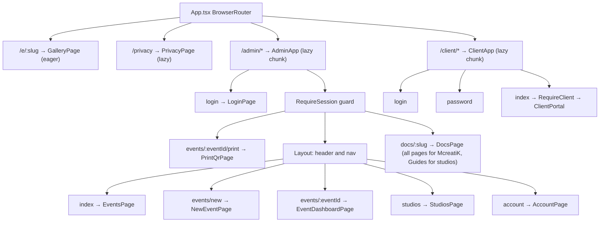
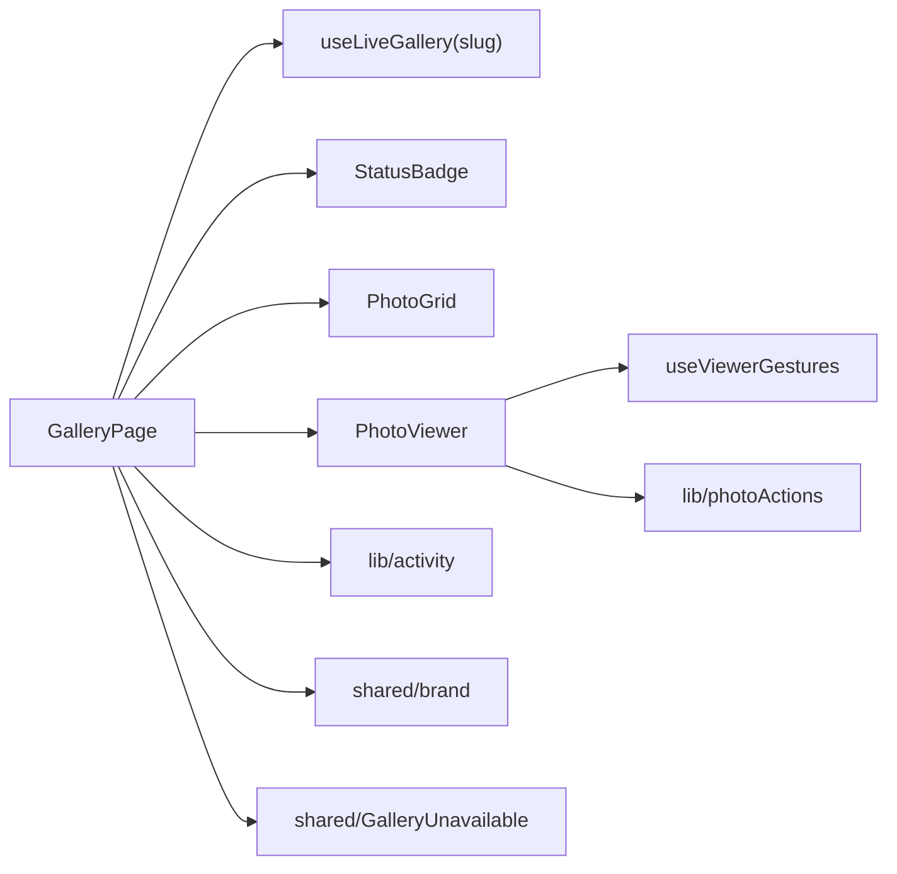

# Frontend

The web app (`web/`) is one React 19 + TypeScript project containing three apps: the guest gallery, the studio dashboard and the couple portal. It uses no state-management or UI library, which keeps the download small for guests on venue Wi-Fi.

## Boot sequence

1. `web/index.html` paints a shutter animation in inline SVG and CSS before any JavaScript loads. It also links the manifest and icons, and sets `noindex`.
2. `src/main.tsx` imports the self-hosted fonts (`@fontsource`, never Google's servers) and `index.css`. In demo builds (`VITE_DEMO=1`) it installs the fake backend. Then it renders `<App />`.
3. `src/App.tsx` sets up routing.

## Routes

- **Lazy loading:** guests never download dashboard or portal code.
- **Guards:** `RequireSession` (in `admin/AdminApp.tsx`) does three things:
  - sends logged-out users to `/admin/login` and remembers where they were going
  - refreshes role and name from `/api/admin/account`
  - forces `/admin/account` while `mustChangePassword` is set

  `RequireClient` does the same for couples.
- **URL as state:** opening a photo sets `?photo=<id>`, so the phone's back button closes the viewer and a single photo can be linked.

## State management

| Pattern | Where | Why |
| --- | --- | --- |
| Local `useState` / `useReducer` | Each page, such as `EventDashboardPage` (`event`, `stats`, `categories`, `eventClients`) | Data belongs to one screen |
| External store + `useSyncExternalStore` | `admin/auth.ts`, `client/clientApi.ts` | Login session readable anywhere without a context provider |
| Pure reducer + custom hook | `gallery/useLiveGallery.ts` | Live gallery logic is testable apart from the network |

**Browser storage:**

| Key | Purpose |
| --- | --- |
| `mcreatik.admin.session` (localStorage) | Studio or McreatiK login |
| `mcreatik.client.session` (localStorage) | Couple login |
| `mcreatik.visitor` (localStorage) | Random anonymous visitor ID for analytics |
| sessionStorage flags | Instagram invite shown once per visit; one visit counted per tab |

## API layer

`lib/api.ts` `request<T>()` handles every call the same way:

- base URL from `VITE_API_BASE_URL`
- JSON body and bearer token
- a 401 signs the user out
- errors become `ApiError(status, code, message)`
- a 204 returns nothing

Calls are grouped as `publicApi` and `adminApi`. `client/clientApi.ts` is a twin of it for couples.

> **Warning** `lib/types.ts` mirrors the backend's Java records by hand, so a backend change that isn't copied here only shows up in tests.

## Guest gallery components

| Component | What it does |
| --- | --- |
| `GalleryPage` | Page behind the QR. Joins live data, analytics, branding and the viewer; footer has privacy and removal links |
| `useLiveGallery` | Loads the event and 40 photos, then SSE. Holds new photos behind a button when scrolled or viewing. Catches up on reconnect and every 60 s |
| `PhotoGrid` | Masonry columns that adapt to screen width; `onNearEnd` loads more |
| `PhotoViewer` | Full-screen viewer with swipe, pinch zoom to 4×, download, share and a once-per-visit Instagram card. Reused in the dashboard and portal |
| `lib/activity.ts` | Batches analytics every 4 s, at most 50 items |

## Dashboard components

| Component | What it does |
| --- | --- |
| `EventsPage` | Event list, plan allowance, Buy events dialog; a three-step first-event guide when a studio has no events |
| `NewEventPage` | Create event; a 402 opens `BuyEventsDialog` (UPI) |
| `EventDashboardPage` | Hub for one event: header (status menu, Copy link, QR) and tabs Overview / Photos / Guests / Couple / Settings kept in `?tab=`. Every tab stays mounted (only hidden) so uploads and ZIPs keep going. Refreshes stats on a timer and passes `refreshKey` down |
| `UploadPhotosPanel` + `prepareUpload.ts` | Browser upload queue; resizes to 2048 / 640 px, reads the EXIF date |
| `PhotosPanel` | Filters and photo tiles (Like and Hide on the tile; Download, Make cover, Download original and Delete under More). Select mode: select all / clear, move to category, Like or Unlike, Hide or Show, Download ZIP, Delete, each one request (`adminApi.bulkPhotos`) |
| `ClientsCard` | The couple's single login, album limit, picks, album ZIP |
| `AnalyticsPanel` | Guest numbers and an hourly chart; refreshes every 30 s while live |
| `GalleryAccessCard` | McreatiK-only guest and couple gallery switches |
| `UploadersPanel`, `QrPanel`, `CategoriesCard` | Camera connections, QR codes, albums |
| `StudiosPage`, `StudioPlan`, `PaymentsToCheck`, `BillingSettingsCard` | McreatiK's studio and billing tools |
| `admin/ui.tsx` | Shared `Button`, `Card`, `Field`, `Stat`, `ErrorText`, status badges |

## Couple portal

`ClientApp` contains `LoginPage` (with Forgot password), `PasswordPage`, `RequireClient`, and a manifest swap so the portal installs as "My Photos". `ClientPortal` has:

- category tabs
- paged photos
- optimistic album ticks, which roll back when the limit is hit
- original downloads and ZIPs with live progress

## Forms, errors and styling

- **Forms:** controlled inputs with native rules (`required`, `type="email"`, `minLength`) plus a few code checks. The server re-checks everything; its message is shown through `ApiError`.
- **Errors:** inline `ErrorText`; full-screen states for not found, unavailable and error with retry; `ShutterLoader` and `PageLoader` while loading.
- **Motion:** short CSS animations in `index.css` (`anim-fade-in`, `anim-pop-in/out`, `anim-dialog-in/out`, `anim-sheet-up`, `anim-drop-in/out`, `lift`), off under `prefers-reduced-motion`. `shared/usePresence.ts` keeps a closing menu or dialog on screen for its exit animation.
- **Styling:** Tailwind CSS 4 with tokens in `index.css` `@theme` (`paper`, `ink`, `muted`, `line`, `live`). Mobile first with `sm:` and `lg:` breakpoints; `resolveBrand()` switches between the McreatiK and studio look.

## Tests

The web app has Vitest + Testing Library tests for the gallery, viewer, live hook, photos panel, uploads, clients, studios, branding, analytics, billing, gallery access, forgot password, client portal and docs. They fake `fetch` (`test/mocks.ts`).

## Known gaps

- There is no top-level error boundary, so a render crash shows a blank page.
- Types are kept in sync with the backend by hand.
- `PhotosPanel` and `EventDashboardPage` are large.
- `lib/api.ts` and `client/clientApi.ts` are near-duplicates.
- The demo mock backend must mirror the real API by hand.
