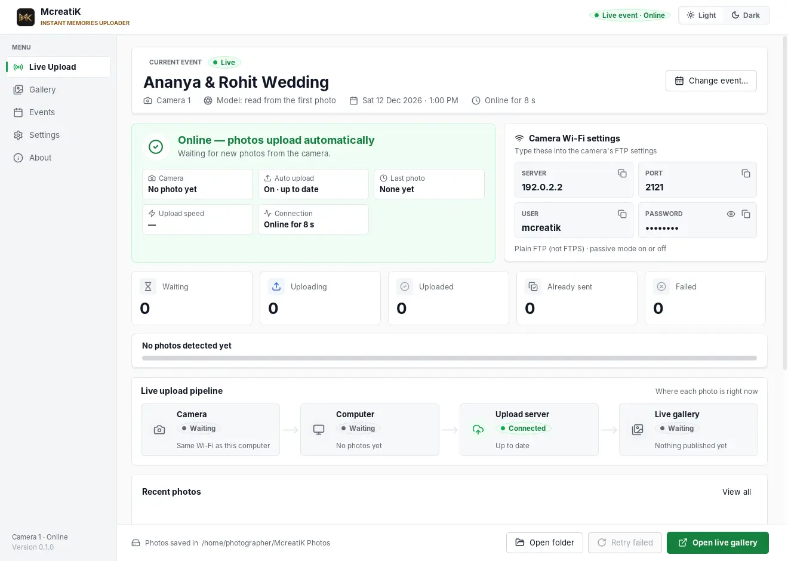
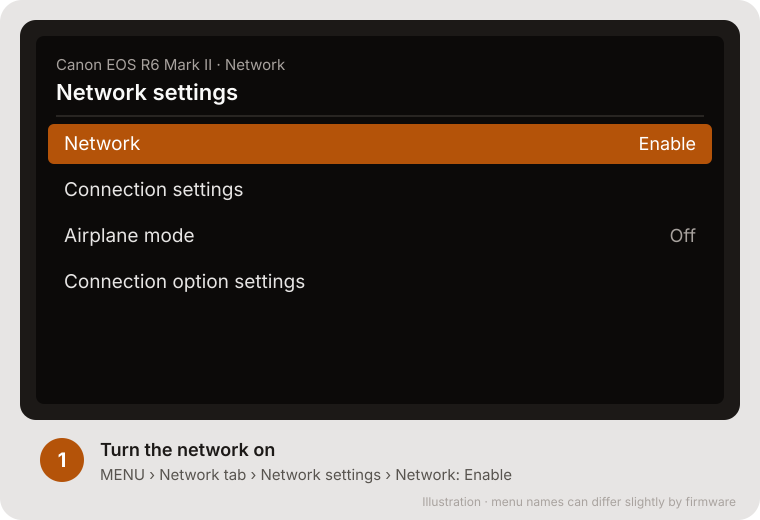
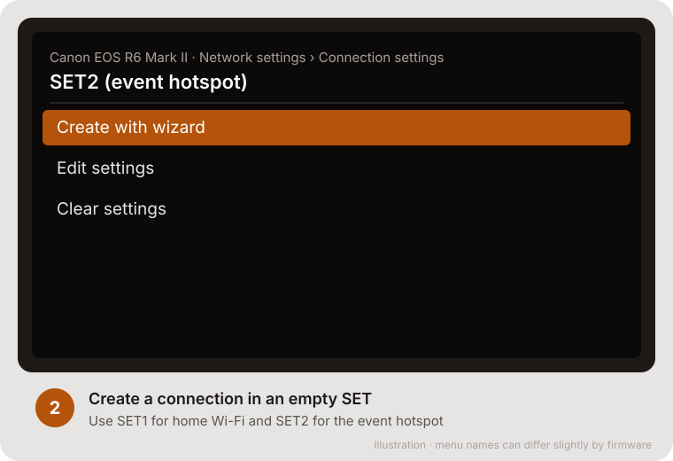
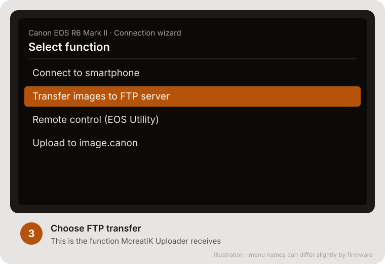
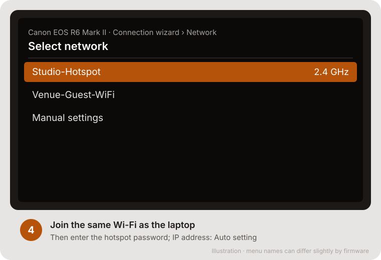
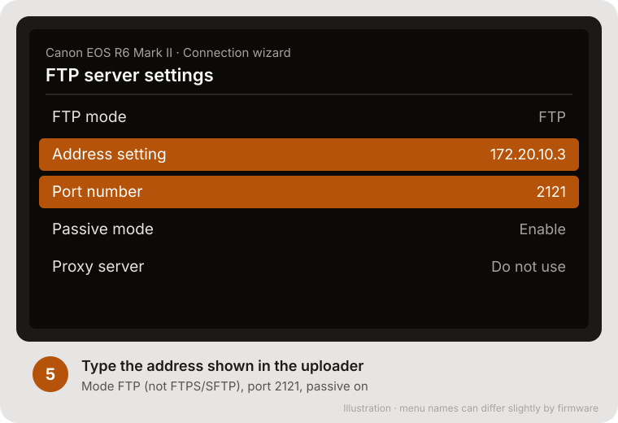
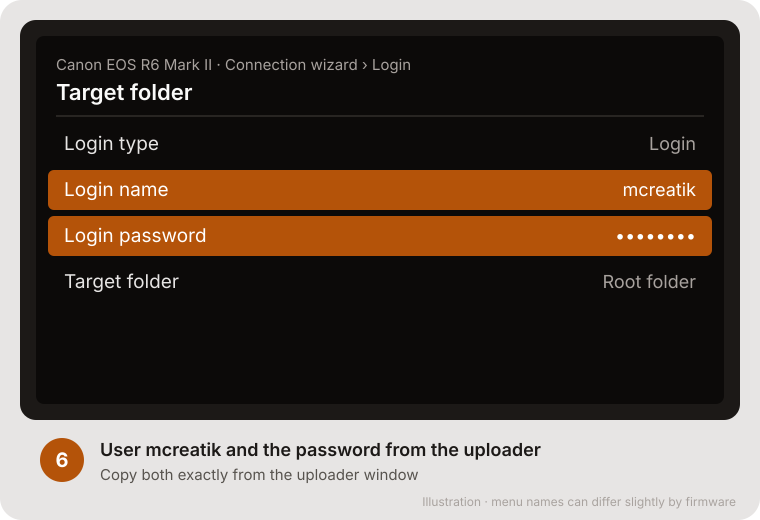
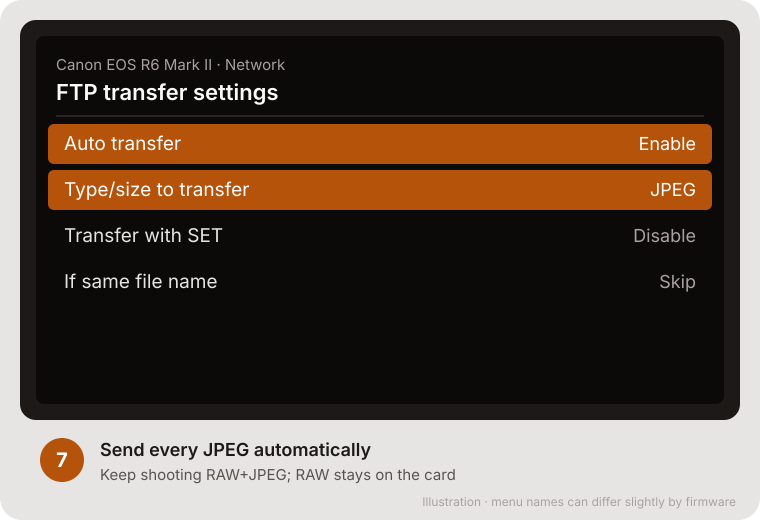
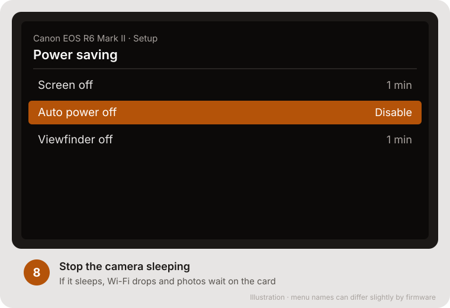
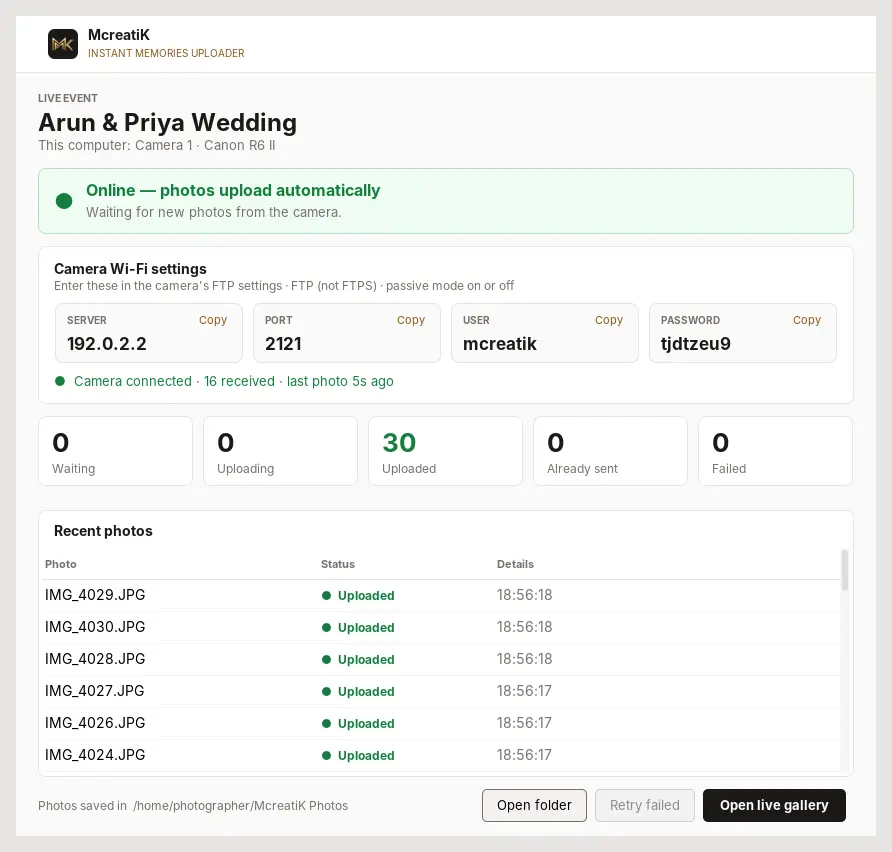

# Canon EOS R6 Mark II setup

This guide sets up the **Canon EOS R6 Mark II** to send every JPEG over Wi-Fi (FTP) to the McreatiK Instant Memories Uploader on your laptop. There's no cable and no extra software. It's **field-tested**: 2–3 seconds from shutter to laptop.

> **Note** The camera screens below are **illustrations** of each step, with the values to choose highlighted. Canon's menu names can differ slightly by firmware. Real photos of the camera screens will replace them later.

## Before you start

- The uploader is running and shows the **Camera Wi-Fi settings** card with Server, Port, User and Password ([Uploader guide](/admin/docs/guide-uploader)).
- The laptop is connected to the **same Wi-Fi or phone hotspot** the camera will join.
- The camera's battery is charged, and you're shooting **RAW+JPEG** (the JPEG goes to guests; RAW stays on the card).

## Setup (once per network, about 10 minutes)

### Step 1: Turn the network on

**MENU → Network tab → Network settings → Network: Enable.**

### Step 2: Create a connection in an empty SET

**Connection settings →** choose an empty **SET** (for example SET2 for the event hotspot) **→ Create with wizard.**

### Step 3: Choose FTP transfer

Select **Transfer images to FTP server**.

### Step 4: Join the hotspot

Choose the same Wi-Fi network or hotspot as the laptop, then enter its password. IP address: **Auto setting**.

### Step 5: FTP server settings

| Setting | Value |
| --- | --- |
| FTP mode | **FTP** (not FTPS or SFTP) |
| Address setting | The **Server** shown in the uploader, for example `172.20.10.3` |
| Port number | **2121** |
| Passive mode | **Enable** (both work; Enable is more reliable) |
| Proxy server | Do not use |

### Step 6: Login and folder

| Setting | Value |
| --- | --- |
| Login type | Login |
| Login name | **mcreatik** |
| Login password | The **Password** shown in the uploader |
| Target folder | Root folder (default) |

### Step 7: Send every JPEG automatically

**Network → FTP transfer settings:**

| Setting | Value |
| --- | --- |
| Auto transfer | **Enable** |
| Type/size to transfer | **JPEG** only |
| Transfer with SET button | Optional |
| If the same file exists | Skip or overwrite. Both are fine; McreatiK ignores repeats. |

### Step 8: Stop the camera sleeping

**Setup → Power saving → Auto power off: Disable**, or the longest time. If the camera sleeps, Wi-Fi drops and photos wait on the card until it wakes.

### Step 9: Test

Shoot 3 frames. Within seconds the uploader shows **3 received this session**, the **Camera** stage turns green (**Receiving**), and the photos are in the gallery.

## Home Wi-Fi and event hotspot

The laptop gets a **different address on each network**. The camera stores the Wi-Fi network and the FTP address together, so keep **one SET per network**:

- **SET1:** home or studio Wi-Fi (for rehearsals).
- **SET2:** the phone hotspot you always use at events.

Always use the **same phone** as the event hotspot. It usually gives the laptop the same address every time, so SET2 keeps working with no setup at the venue.

## During the event

- Keep the laptop and hotspot within a few metres, or carry the phone hotspot on you.
- Out of range for a while? Photos the camera couldn't send are retried when it reconnects. Every photo is still on the card.
- Wi-Fi transfer uses extra battery: carry spares.

## Troubleshooting

| Camera says or does | Fix |
| --- | --- |
| "Cannot connect to FTP server" | Same Wi-Fi as the laptop? Address typed exactly as the uploader shows? Port 2121? Laptop firewall allowed? |
| "Busy" on the first connection | Usually clears after the first transfer. If not: allow Java in the firewall on Private **and** Public networks, check the laptop's address hasn't changed, and toggle Passive mode. |
| Connects, but transfers fail | Toggle **Passive mode**. Check the port is 2121. |
| Worked at home, not at the venue | You're on a different network: pick the hotspot SET, and check its address matches the uploader. |
| Photos stop after a while | The camera slept: disable auto power off. Or the laptop slept. |
| Uploader says "Could not start on port 2121" | Start it with `--ftp-port 2122` and set the camera's port to 2122. |
