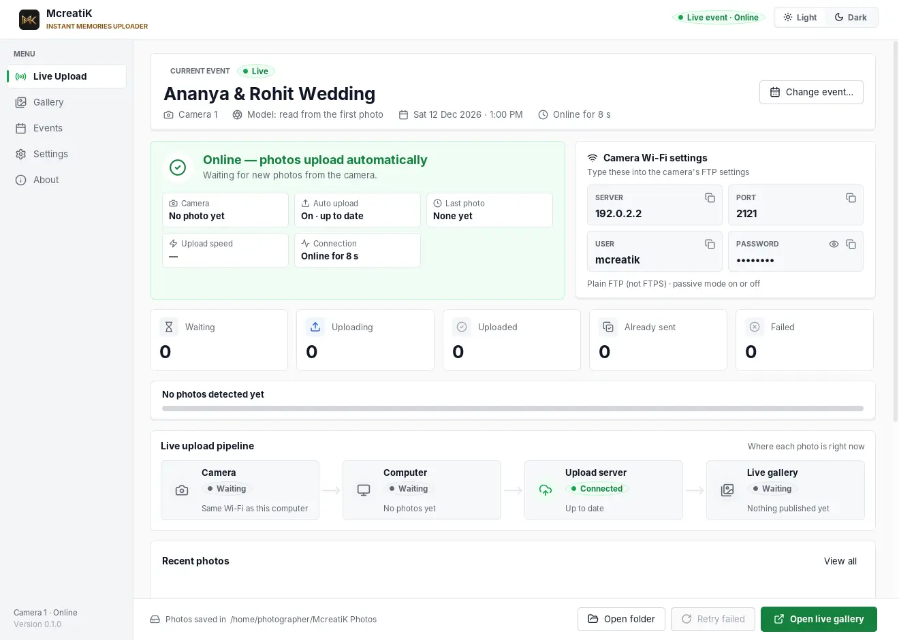
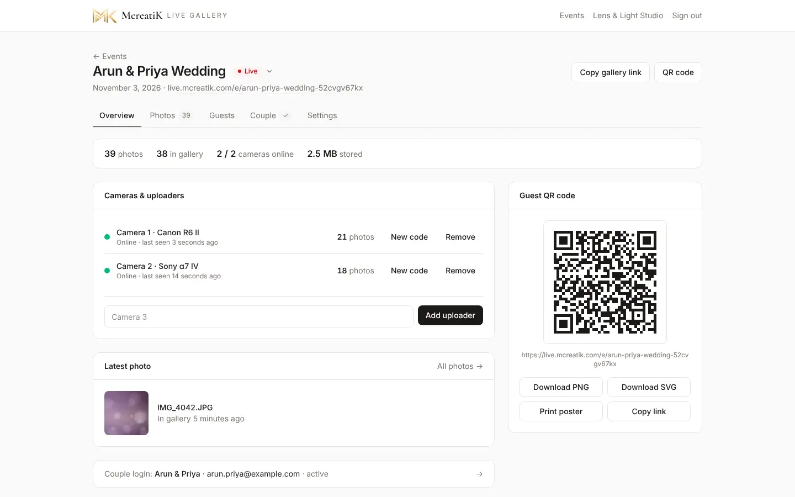
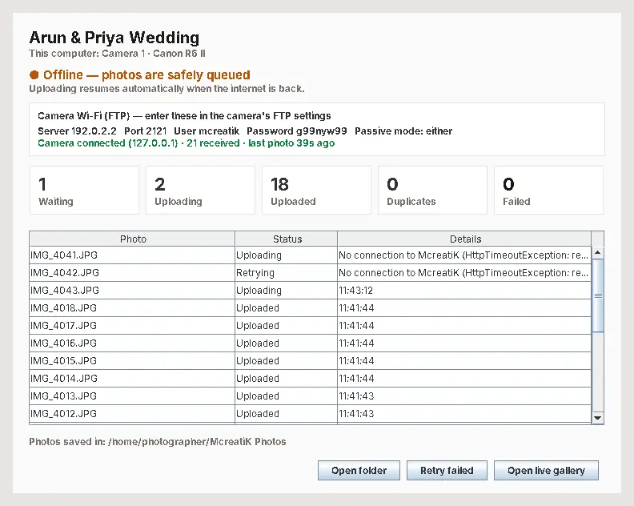
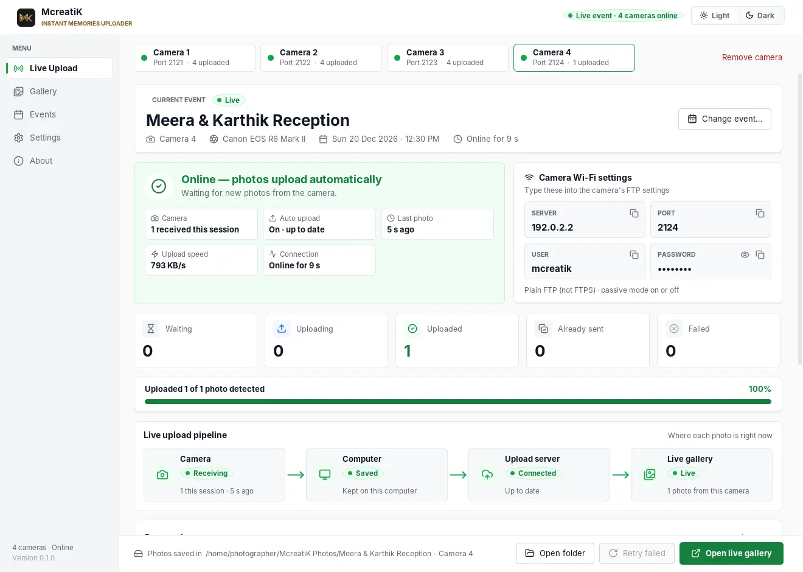

# Event-day problem playbook

Something went wrong at a live wedding? Stay calm. Almost every problem has a short fix, and **your photos are safe**: every photo is saved on the laptop first, and it uploads by itself once the problem is gone.

Use this with the [Event-day checklist](/admin/docs/guide-event-day). Print it, or keep it open on your phone.

> **Rule 1** Keep shooting. The camera sends each photo to the laptop, and the laptop keeps it until it has uploaded. A gallery problem never loses a photo.

> **Rule 2** Don't close the uploader, don't switch the laptop off, and don't delete the uploader's folders during the event. The photo folder, and the settings and queue folder (Uploader → Settings), hold the photos that haven't uploaded yet.

## 1. Before you leave for the venue

Do this at the studio, the day before. It takes about 20 minutes and prevents most problems.

- [ ] **The event is ready.** It exists, its status is **Upcoming** or **Live**, and the name and date are right. (They are printed on the cards and can't be changed afterwards.)
- [ ] **The laptop is ready.** Charged, charger packed. On Windows set it to never sleep when plugged in; on a Mac keep the lid open.
- [ ] **The uploader is installed and up to date.** Open it and check **About** shows the version you expect. To get the latest, press **Install uploader** in the dashboard's top bar. Do this at the studio, not at the venue.
- [ ] **The connection code works.** The uploader shows green **Online** and **this event's name** and the right camera name on the event card. If it shows an old event, press **Change event…** and paste this event's code.
- [ ] **Every camera's FTP profile is saved.** Server, **Port** (2121 for Camera 1, 2122 for Camera 2, and so on), User **mcreatik**, the password, plain FTP. Camera guides: [Canon](/admin/docs/guide-canon) · [Sony](/admin/docs/guide-sony). The Server changes on every new network, so you will retype it at the venue.
- [ ] **A test shot reaches the gallery.** The uploader shows **1 received this session**, and the photo appears in the live gallery within seconds. Hide the test shot afterwards (Photos → Guest gallery).
- [ ] **A phone hotspot is ready as backup internet.** Charged, with enough mobile data. Allow about **1 MB per photo**, so 1,500 photos is about 1.5 GB. iPhone: turn on Maximize Compatibility. Android: use 2.4 GHz.
- [ ] **The board and cards are printed.** The studio board, the event card for its frame, and the table cards (Overview → Guest QR code → **Event & table cards**).
- [ ] **The QR code opens on a phone.** Scan the printed card (or the one on screen) with a phone on **mobile data**, not your Wi-Fi. The gallery should open.
- [ ] **Power and cards.** Spare camera batteries, a power bank, and a memory card with plenty of space. Keep the photos on the card until the event is over.

## 2. Triage: what is broken? (60 seconds)

Ask one question: **is it the camera, the laptop, the internet, or the server?** Look at three places, in this order.

**A. The uploader window, big status card at the top**

| It shows | It means |
| --- | --- |
| Green **Online — photos upload automatically**, and the Camera line says **N received this session** | Camera, laptop and internet are fine. The problem is on the guests' side (cards 10 and 11) |
| Camera stage grey **Waiting** ("Same Wi-Fi as this computer"), or the Camera line says **No photo yet** | The **camera** is not reaching the laptop (card 1 or 2) |
| Red **The camera can't send photos** | The laptop's camera receiver didn't start (card 1) |
| Blue **Reconnecting…**, or amber **Offline — photos are safely queued** | The laptop can't reach McreatiK: **internet** or **server** (cards 3 and 14) |
| Red **Uploading paused** with a message | Read the message: card 6 (event closed) or card 7 (uploader removed) |
| Amber **Paused — photos stay on this laptop** | Somebody pressed **Pause** on that camera (card 2) |

**B. The dashboard: Overview → Cameras & uploaders**

- A green dot and **Online · last seen …** means the laptop is talking to McreatiK.
- **Offline** means the laptop hasn't been heard from for about 45 seconds: it is closed, asleep, or has no internet.
- **N waiting on laptop** is the backlog. A small number that shrinks is normal. A number that keeps growing is card 3 or card 4.
- A red line under a camera is the last error the uploader reported.

**C. A phone on mobile data**

Switch Wi-Fi off, then open the gallery (scan the QR code).

- It opens and shows photos: the **server is fine**.
- It doesn't open ("Something went wrong") while other websites work on the same phone: the **server** may be down (card 14).

**Putting it together**

| What you see | Most likely |
| --- | --- |
| Camera stage grey or red, uploader otherwise fine | Camera |
| Uploader window closed or frozen, laptop asleep, dashboard says Offline | Laptop |
| Uploader Offline, and other websites don't open on the laptop | Internet (hotspot, venue Wi-Fi) |
| Uploader Offline, the laptop opens other websites fine, but the gallery doesn't open on a phone on mobile data | Server: card 14 |
| Everything green, but guests don't see photos | Guests' side: cards 10 and 11 |

> **Note** The uploader can't tell "no internet" from "McreatiK is unreachable": both show as Reconnecting, then Offline. The phone test and the laptop's own web browser tell them apart.

## 3. Problem cards

### 1. The camera won't connect to the uploader

**Symptom.** The camera says it can't connect to the FTP server. The uploader's Camera stage stays grey (**Waiting**) and shows **No photo yet**.

**Most likely cause.** The camera and laptop aren't on the same Wi-Fi, or the Server address typed in the camera is old. The address changes every time the laptop joins another network.

**Fix**

1. Put the laptop and the camera on the **same Wi-Fi or hotspot**. Guest Wi-Fi at venues often stops devices talking to each other, so use your phone hotspot.
2. In the uploader, find **Camera Wi-Fi settings** and compare, one by one, with the camera: **Server** (use **Copy**), **Port** (2121 for Camera 1), **User** `mcreatik`, and the **Password** (press the eye to show it). If the Server says **No Wi-Fi**, the laptop isn't on a network yet.
3. Plain FTP only (Sony: Secure Protocol **Off**). Toggle **Passive mode** in the camera.
4. Check the laptop's firewall. Windows: allow **McreatiK Instant Memories Uploader** on **Private and Public** networks (a phone hotspot counts as Public). Mac: allow incoming connections for it in System Settings → Network → Firewall → Options.
5. Close the uploader, open it again, then turn the camera's Wi-Fi off and on.

**If still broken.** If the uploader shows red **The camera can't send photos** with "could not start on port …", another program is using that port. Close it, or start the uploader with `--ftp-port 2131` and use port 2131 in the camera. Then follow the camera guide's troubleshooting ([Canon](/admin/docs/guide-canon#troubleshooting) · [Sony](/admin/docs/guide-sony#troubleshooting)). Keep shooting, then call McreatiK support. The photos stay on the memory card, and you can add them later with the **Upload photos** card on the event's **Photos** tab.

### 2. The camera is connected, but photos aren't arriving

**Symptom.** The camera says it sent the photos, but the uploader's count stays at the same number and **Last photo** gets older. Or the status card is amber **Paused**.

**Most likely cause.** One of these: the camera or laptop went to sleep, the camera moved out of Wi-Fi range, the camera is set to send something other than **JPEG** (the uploader uploads JPEG and PNG photos only), or the camera is on **Pause**.

**Fix**

1. **Pause?** If the status card is amber **Paused**, press **Resume** for that camera (in the uploader, or in the dashboard's Cameras & uploaders). Photos taken while paused stay in that camera's **Not uploaded (paused)** folder on the laptop and never reach the gallery. Only photos taken after you resume are uploaded.
2. **Camera asleep?** Wake it, and set auto power-off to longer or off. After a battery change the camera joins the Wi-Fi by itself: take a test shot.
3. **Laptop asleep?** See card 5.
4. **Out of range?** Move the laptop or the hotspot closer to where you shoot.
5. **Right file type?** Set the camera to send JPEG. RAW and HEIF files are not uploaded.
6. Take a test shot. The Camera stage should turn green (**Receiving**) and the count should go up.

**If still broken.** Restart the uploader, then the camera's Wi-Fi. The photos the camera didn't send are still on the memory card. Sony: use **FTP Transfer** to send the rest ([Sony guide](/admin/docs/guide-sony#troubleshooting)).

### 3. The uploader says Reconnecting or Offline (venue Wi-Fi drops)

**Symptom.** The status card is blue **Reconnecting…** ("The internet dropped"), and after 2 minutes amber **Offline — photos are safely queued**. In the dashboard, the camera shows **Offline**, or **N waiting on laptop** grows.

**Most likely cause.** The laptop has no internet: weak or dropped venue Wi-Fi, or the hotspot ran out of data or signal. (If the laptop's browser opens other websites fine, it may be the server: card 14.)

**What happens to the photos.** Nothing is lost. The camera can keep sending, and every photo is saved in the uploader's queue on the laptop's disk before any upload is tried, so it survives a closed uploader, a crash or a power cut. The uploader keeps retrying with longer pauses (up to 5 minutes), and **as soon as the connection is back it retries everything at once**, oldest first. You don't have to press anything. Guests' phones then catch up by themselves.

**Fix**

1. Check the hotspot's mobile data and signal. Turn the hotspot off and on.
2. Move the laptop and phone closer, or put the phone where the signal is better.
3. If the venue's Wi-Fi is the problem, join your **phone hotspot** instead. The camera must join the same network. The laptop's address changes, so check the **Server** in the uploader and retype it in the camera.
4. Watch **Waiting** go down after the connection returns.

**If still broken.** Keep shooting and leave the laptop on and plugged in. If it lasts more than a few minutes, call McreatiK support to check the server.

### 4. Photos are uploading slowly, or a backlog is building

**Symptom.** **Waiting** keeps growing, the **Upload speed** is low or shows a dash, and guests see photos late.

**Most likely cause.** A weak internet connection, a burst of shots (normal), or the laptop catching up after an outage.

**Fix**

1. Look at the **Upload speed** on the status card, and at **Waiting** and **Uploading**. After a burst or an outage, the backlog clears by itself, oldest photos first.
2. Improve the connection: hotspot closer, fewer devices on it, move to a better spot.
3. Open **Settings** in the uploader and check it says **Mode: light copies (recommended)**. In that mode each photo is sent as a sharp 2048 px copy plus a thumbnail, about 1 MB. "Mode: originals" is much slower on weak internet.

**If still broken.** If a **Failed** count appears, press **Retry failed** (in the bottom bar). Each failed photo lists its reason. If it says storage is full, see [Studio guide, Troubleshooting](/admin/docs/sop-studio#troubleshooting). Otherwise call McreatiK support with the reason text.

### 5. The laptop sleeps, closes, or the battery runs out

**Symptom.** Photos stop. The dashboard shows the camera **Offline**. The uploader window is gone, black, or the laptop is off.

**Most likely cause.** The laptop went to sleep (lid closed, or a power setting), or the battery ran flat.

**Fix**

1. Plug the laptop in and wake it. Open the uploader if it isn't open. It remembers its event and reconnects by itself.
2. The photos already in the queue upload by themselves. Photos that were received but not yet uploaded return to the queue on restart, and the photo folder is checked again, so nothing is missing.
3. Take a test shot and check that the Camera stage turns green.
4. Stop it happening again. **Windows:** Settings → System → Power & battery: never sleep when plugged in. **Mac:** keep the lid open and the charger in; the app keeps the Mac awake while it is open, but a closed lid sleeps it.

**If still broken.** Photos the camera tried to send while the laptop was off are still on the camera's memory card. Send them afterwards from the camera's FTP transfer menu (Sony: **FTP Transfer**; see the camera guide). If the laptop won't start, use another laptop: install the uploader, then in the dashboard press **Get new code** on that camera and paste it (see card 7 before you do).

### 6. The uploader says "Uploading paused" (event closed)

**Symptom.** A red **Uploading paused** card says the event is closed or archived.

**Most likely cause.** The event's status was set to **Archived**. That is the only status that stops uploads.

**Fix**

1. In the dashboard, open the event and use the **status menu** next to the event name to set it back to **Upcoming**, **Live** or **Completed**.
2. The uploader notices within about 15 seconds and carries on. Photos waiting on the laptop upload by themselves.

**If still broken.** If the status is already right, call McreatiK support.

### 7. The uploader says it was removed from the event

**Symptom.** A red **Uploading paused** card says "This uploader was removed from the event in the dashboard. Use Change event… to connect with a new code."

**Most likely cause.** Someone pressed **Remove** on that camera in the dashboard, or pressed **Get new code** for it. **Get new code stops the old code working at once**, even on a laptop that is running.

**Fix**

1. In the dashboard, open the event → Overview → **Cameras & uploaders**. If the camera is gone, add it again with **Add camera & get code**. If it is listed, press **Get new code**. Then **Copy code**.
2. In the uploader press **Change event…**, then **Paste**, then **Switch event**. The uploader restarts. The Server, Port, User and Password stay the same, so the camera needs no changes.
3. Photos still on the laptop upload after the restart.

> **Warning** **Change event…** refuses to run while photos are still waiting on the laptop (see card 8). If that happens, don't delete anything: leave the uploader and its folders as they are, and call McreatiK support.

> **Tip** On the event day, don't press **Get new code** or **Remove** on a camera that is working.

**If still broken.** Call McreatiK support.

### 8. Wrong event shown, or you need to change the event

**Symptom.** The uploader's event card shows an old event's name, or you are starting a new event on the same laptop.

**Most likely cause.** The uploader remembers its last event, even after it is closed or updated.

**Fix**

1. Wait until **Waiting** and **Uploading** are both **0**. The uploader will not change event while photos are waiting, so no photo from one event can end up in another. If the internet is down, reconnect first and let the queue empty.
2. In the **new** event's dashboard: Overview → **Cameras & uploaders**. Press **Add camera & get code** (or **Get new code** next to the camera), then **Copy code**.
3. In the uploader press **Change event…** (on the event card, or on the **Events** page), **Paste**, then **Switch event**. It restarts and shows the new event's name with the counters back at 0.
4. The camera's settings stay the same. Take a test shot.

**If still broken.** If a few photos went into the wrong event, they stay there: open that event's **Photos** tab and **Hide** them. Then call McreatiK support.

### 9. One camera of several fails

**Symptom.** With 2 to 4 cameras on one laptop, one camera's tab shows a red dot (**Needs attention**), or a blue or amber dot (Reconnecting, Offline or Paused), and the others are fine.

**Most likely cause.** That camera has the wrong **Port**, or its Wi-Fi dropped. Each camera has its own port: Camera 1 uses 2121, Camera 2 uses 2122, Camera 3 uses 2123, Camera 4 uses 2124. The **Server, User and Password are the same** for all cameras.

**Fix**

1. Click that camera's **tab** in the uploader. Its **Port** is shown on the tab and in **Camera Wi-Fi settings**. If another program had a port, the uploader used the next free one: always use the port on the tab.
2. Check the camera's FTP profile uses that port, and the same Server, User and Password.
3. Read the red message on that camera's tab, then follow card 1 (connection) or card 2 (photos not arriving) for just that camera.
4. All cameras share the laptop's Wi-Fi, internet and battery. If **every** camera stops, it is the laptop (card 5) or the internet (card 3).

**If still broken.** The other cameras keep working. Keep shooting on the failed camera and send its photos later.

### 10. Guests say the QR code won't open, or the page is blank

**Symptom.** A guest scans the QR code and sees an error, a message, or a page with no photos.

**Most likely cause.** It depends on what they see:

| They see | Cause | Fix |
| --- | --- | --- |
| "This gallery isn't available" | The link is wrong or incomplete, or the event is **Draft** or **Archived** | Scan the printed card again. Set the event to **Upcoming** or **Live** |
| "This gallery is currently unavailable" | McreatiK switched the gallery off | Call McreatiK support |
| "Something went wrong" and **Try again** | Their phone's connection, or the server | Ask them to press **Try again**. If nobody can open it, see card 14 |
| "The first photos will appear here soon" | No photo has uploaded yet | Check the uploader (section 2) and take a test shot |
| The page opens but photos don't download | Opened inside Instagram or WhatsApp | Open the link in Safari or Chrome, or press and hold a photo → Save image |

**Fix**

1. Test the QR code yourself with your phone on mobile data.
2. If the camera can't read the QR code, the guest can use the link: in the dashboard, Overview → **Guest QR code** → **Copy link**, and send it on WhatsApp. The uploader's **Events** page also shows the **Live gallery link**.
3. Print problem: check the printed card isn't folded, damaged or too small to scan, and print a new one from **Event & table cards**.

**If still broken.** Call McreatiK support with the exact words the guest sees.

### 11. Guests don't see new photos

**Symptom.** The uploader says photos are uploaded, but guests' phones don't show them.

**Most likely cause.** The photos haven't uploaded (check the uploader first), the guest has scrolled down, the camera is paused, or the guest's connection dropped.

**Fix**

1. **Is it uploading?** Check the uploader: green **Online**, and **Uploaded** going up. If photos are in **Waiting**, see card 3 or card 4.
2. **Is the camera paused?** An amber **Paused** (in the uploader or the dashboard) means its new photos are kept on the laptop and never go to the gallery. Press **Resume**.
3. **Are they in the Photos tab?** Open the event's **Photos → Guest gallery**. A photo marked **Hidden** is hidden: press its eye to show it again.
4. **Is the gallery switched off?** Then guests see "This gallery is currently unavailable". Call McreatiK support.
5. **On the guest's phone:** new photos appear on their own while the page is open, and the badge says **Live**. If the guest has scrolled down, a **"3 new photos ↑"** button appears at the top: tap it. If the badge says **Reconnecting…**, their connection dropped: it catches up by itself when it is back. To force it, reopen the link.
6. Photos shot while a camera was paused, or hidden, are not shown to guests. To share paused photos later, upload them yourself from **Photos → Guest gallery**.

**If still broken.** Ask a second phone to open the gallery. If it shows the photos, the first phone's connection is the problem. If neither does, call McreatiK support.

### 12. A photo must be removed right now (privacy)

**Symptom.** A photo shouldn't be shown: an embarrassing moment, a child, a guest who asks you to remove it.

**Fix**

1. In the dashboard, open the event → **Photos → Guest gallery**.
2. Find it: it is the newest, or type the file name (for example IMG_1234.JPG) into **Search file name**.
3. Press the **eye** on the photo to **Hide** it. It disappears from every guest's phone at once. To hide several, press **Select**, tick them, then **Hide**.
4. If it must be gone for good: open the photo's **More (⋯) → Delete**. Delete is permanent, so prefer **Hide** during the event and delete afterwards.

**Stop more of the same.** If that moment is still going, press **Pause** on that camera (in the uploader or the dashboard). The new photos stay on the laptop and never reach the gallery. Press **Resume** when it's over.

**If still broken.** The photo may still be on a guest's phone if they already saved it: Hide can't take it back from there. A guest can also ask by email to connect@mcreatik.com, and McreatiK passes it to you. If the whole gallery must go dark, call McreatiK support: only McreatiK can switch a gallery off.

### 13. The couple or a VIP asks to hide a photo

**Symptom.** The couple, their family or a VIP asks you to hide one photo, or all photos of one moment.

**Fix**

1. Do it quietly, the same way as card 12: **Photos → Guest gallery**, press the **eye** on the photo, or **Select** several and press **Hide**. It disappears from guests' phones at once.
2. Hiding is reversible. Press the eye again, or use the filter **Show → Hidden from guests**, to find it and bring it back later.
3. If they don't want a moment shared at all, **Pause** the camera for that time.
4. The **Client gallery** is separate from the guest gallery. It holds the edited photos you upload, and only the couple sees it. Hiding a photo in the guest gallery doesn't touch it.

**If still broken.** If the couple wants no live gallery at all, McreatiK can switch the guest gallery off while you keep the album selection. Call McreatiK support.

### 14. The server or the site is down

**Symptom.** The uploader shows **Reconnecting…** then **Offline** even though the laptop's internet works (other websites open). The dashboard doesn't load, or a phone on mobile data can't open the gallery ("Something went wrong").

**Most likely cause.** McreatiK's server is down or restarting. This is **McreatiK's** job to fix, not yours.

**What still works.** Everything on your side keeps working:
- The camera keeps sending photos to the laptop, and the laptop keeps saving them in its queue.
- The uploader keeps retrying. When McreatiK is back, it uploads everything, oldest first.
- Guests who already have the gallery open keep their photos on screen. When the server returns, their page catches up by itself.

**Fix**

1. **Keep shooting.** Leave the uploader open and the laptop plugged in.
2. Check it really is the server: open the gallery on a phone on mobile data. If it fails, and the laptop opens other websites fine, tell McreatiK now.
3. **Call McreatiK support** (section 5) and say: the event name, the time it started, and what the uploader shows (**Reconnecting** or **Offline**, and the **Waiting** number).
4. Don't change the event, don't press **Get new code**, and don't delete anything.
5. When it's back, the uploader turns green **Online** and **Waiting** falls to 0 by itself. Then check the dashboard shows the camera **Online**.

**If still broken.** After the event, if some photos are missing from the gallery, they are still in the laptop's photo folder and on the camera's card. Tell McreatiK support, and you can add them with the **Upload photos** card on the event's **Photos** tab.

## 4. Quick rules for the whole day

- **Never** close the uploader or delete its folders to "fix" something. Restarting is fine; deleting is not.
- **Never** press **Get new code** or **Remove** on a working camera.
- **Never** change the event on the laptop while **Waiting** or **Uploading** is above 0.
- Prefer **Hide** over **Delete** during the event.
- Keep the photos on the camera's card until the event is finished and checked.
- Every 15 minutes, look at the uploader. Every 30 minutes, look at the dashboard. See the [Event-day checklist](/admin/docs/guide-event-day).

## 5. Who to call

| Problem | Who |
| --- | --- |
| Camera settings, laptop, firewall, hotspot | The studio's camera operator, using this playbook and the camera guides ([Canon](/admin/docs/guide-canon) · [Sony](/admin/docs/guide-sony)) |
| The uploader's own messages, event status, hiding photos | The studio, using this playbook |
| The server is down, the gallery is switched off, login, payments, anything else | **McreatiK support.** WhatsApp or email: the buttons are on the uploader's **About** page (**Help on event day**), and the email is at the foot of the dashboard. Save the number in your phone before the event |
| A guest wants their own photo removed | The studio first. Guests can also email McreatiK, and McreatiK passes it to you |

When you call, say: **the event name, what the uploader shows, what the dashboard shows, what you already tried**, and the exact words of any red message. That is all McreatiK needs to start.

More: [Event-day checklist](/admin/docs/guide-event-day) · [Uploader guide](/admin/docs/guide-uploader) · [Studio guide](/admin/docs/sop-studio).
