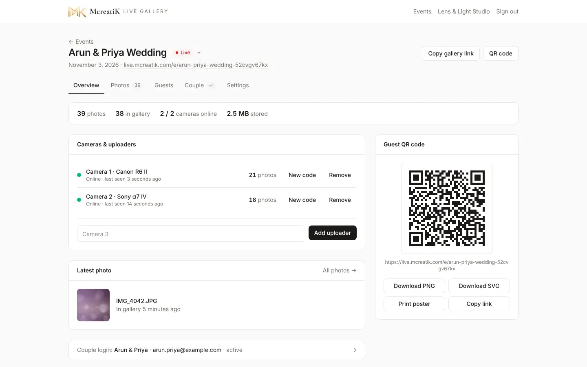
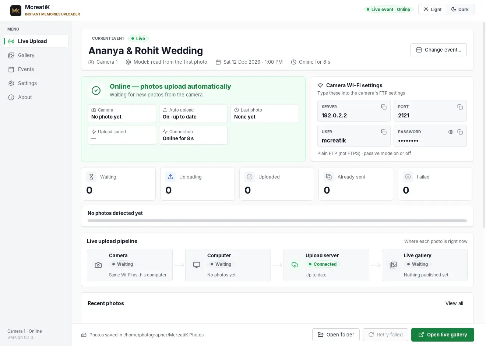
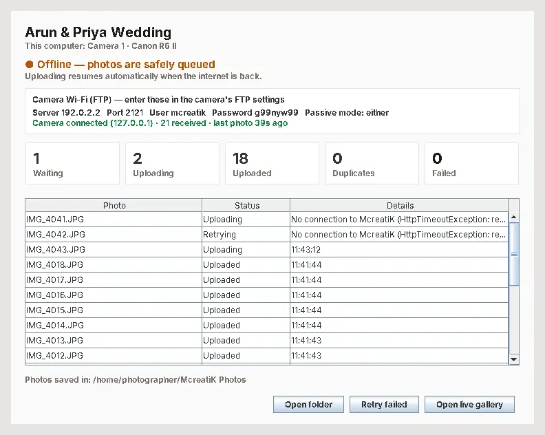

# Event-day checklist and troubleshooting

Use this on the day. Print it, or keep it open on a phone. It works for the studio and for McreatiK support.

## The day before

- [ ] The event exists, its status is **Upcoming**, and the date is right.
- [ ] One **uploader per camera** has been added, and each laptop is connected (it shows the event name).
- [ ] Every camera has been tested at home with a few shots ([Canon](/admin/docs/guide-canon) · [Sony](/admin/docs/guide-sony)).
- [ ] QR posters are printed (Overview → QR code → **Print poster**), at least 3.
- [ ] Laptops and phone hotspot are charged; chargers, a power bank and spare camera batteries are packed.
- [ ] The hotspot phone has enough mobile data. Allow about **1 MB per photo**, so 1,500 photos ≈ 1.5 GB.
- [ ] The couple's login is created, or planned for after the event.

## At the venue (30 minutes before guests)

1. **Hotspot on.** iPhone: Maximize Compatibility. Android: 2.4 GHz.
2. **Laptop:** join the hotspot, plug in the charger, start the uploader (Mac: `caffeinate -dims java -jar …`). Check it shows green **Online**.
3. **Check the address.** Make sure the Server in the uploader matches the one in the camera's FTP settings.
4. **Camera:** turn Wi-Fi/FTP on and take one test shot. The uploader should show **Camera connected · 1 received**.
5. **Phone:** scan the poster's QR code. The test photo should be in the gallery.
6. **Hide the test shot** on the Photos tab if you don't want guests to see it.
7. **Posters out:** entrance, stage side, food area.

## During the event

| Every | Check |
| --- | --- |
| 15 minutes | The uploader is still green, and **Waiting** isn't growing |
| 30 minutes | The dashboard shows all cameras **Online**, and the latest photo is recent |
| Battery change | The camera rejoins Wi-Fi by itself; take a test shot |

- Something shouldn't be shown → **Photos → Hide** (it disappears from every phone at once).
- Never update the server during an event.

## After the event

- [ ] Set the status to **Completed**.
- [ ] Upload edited photos and originals (Photos → upload panels).
- [ ] Sort into categories, and create or send the couple's login.
- [ ] Look at the **Guests** tab and note the numbers for your marketing.

## Troubleshooting: find the symptom

### The camera won't connect

1. Is the camera on the **same Wi-Fi/hotspot** as the laptop? Guest Wi-Fi often blocks devices from talking to each other, so use the phone hotspot.
2. Does the address in the camera exactly match the **Server** in the uploader? It changes when the laptop joins another network.
3. Port **2121**, user **mcreatik**, password exactly as shown, plain FTP (Sony: Secure Protocol **Off**).
4. Laptop firewall: allow Java (Windows: Private **and** Public; Mac: allow incoming connections for java).
5. Toggle **Passive mode** in the camera.
6. Still stuck: restart the uploader, then turn the camera's Wi-Fi off and on.

### Photos reach the laptop but not the gallery

The uploader is amber (**Offline**), so this laptop has no internet. Check the hotspot's mobile data and signal. Photos are safe in the queue and upload by themselves when it's back.

### Photos stopped arriving

- The **camera slept**: disable or extend auto power off.
- The **laptop slept**: keep it plugged in, set "never sleep" (Windows), use `caffeinate` and keep the lid open (Mac).
- Out of **range**: move the laptop or hotspot closer to where you shoot.

### Guests can't open the gallery

| They see | Cause | Fix |
| --- | --- | --- |
| "This gallery isn't available" | Wrong or incomplete link, or the event is Draft or Archived | Scan the poster again; set the status to Upcoming or Live |
| "This gallery is currently unavailable" | McreatiK switched the gallery off | McreatiK: Event → Settings → Gallery access |
| The page opens but there are no photos | No photos uploaded yet, or all are hidden | Check the Photos tab |
| Download doesn't save | Opened inside Instagram or WhatsApp | Open in Safari or Chrome, or press and hold the photo → Save image |

### The dashboard shows a camera Offline

The uploader for that camera is closed, the laptop is asleep, or it has no internet. Open the laptop and check the uploader window.

## Who to call

| Problem | Who |
| --- | --- |
| Camera settings, laptop, hotspot | The studio's camera operator, using these guides |
| Login, gallery access, payments, anything else | McreatiK: WhatsApp +91 99527 58545 · connect@mcreatik.com |
