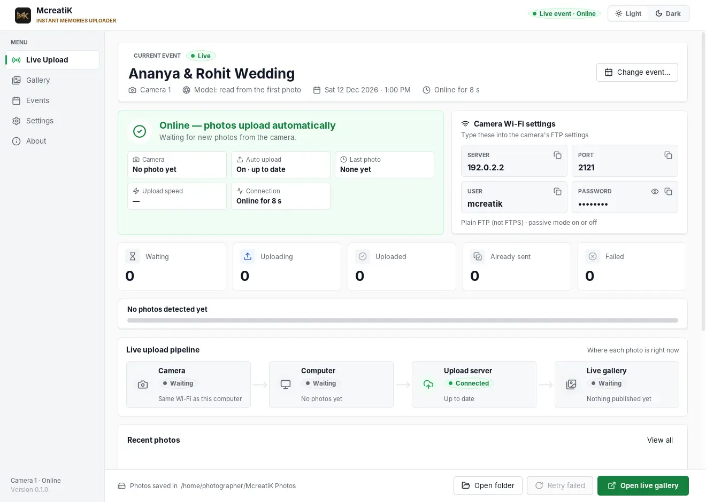
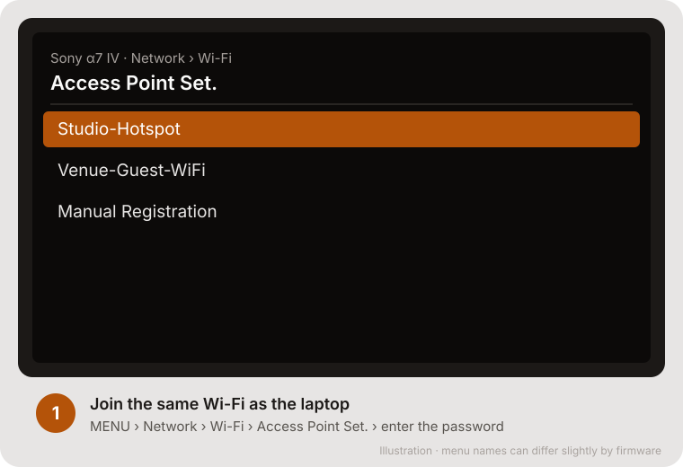
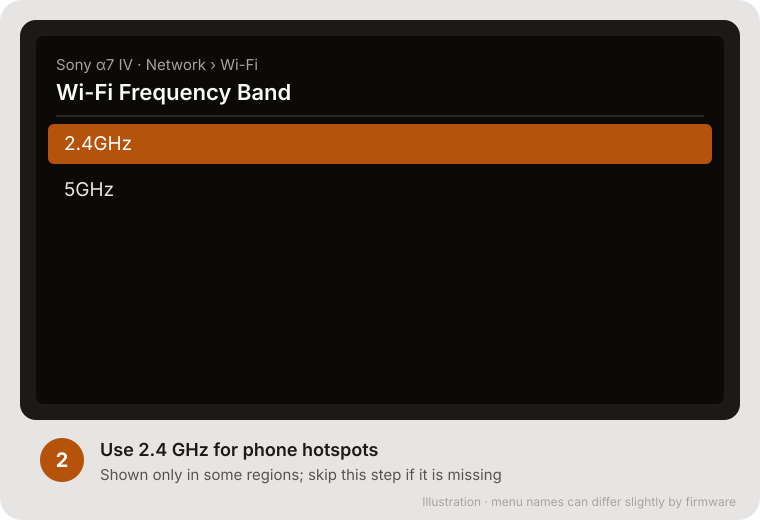
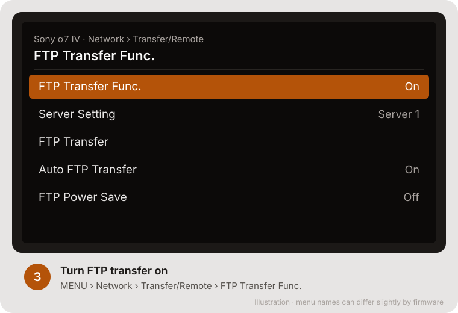
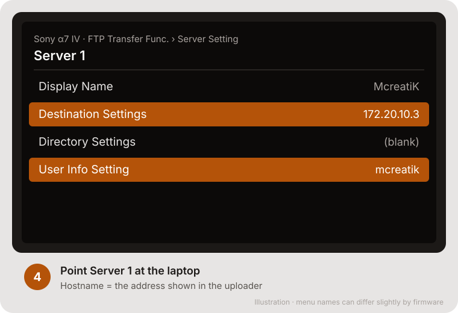
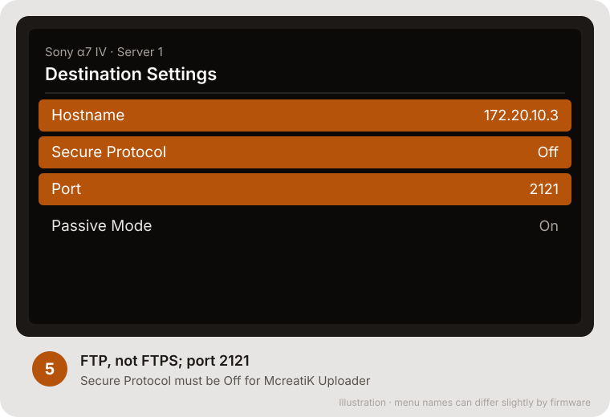
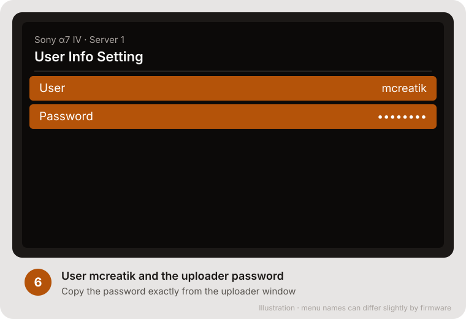
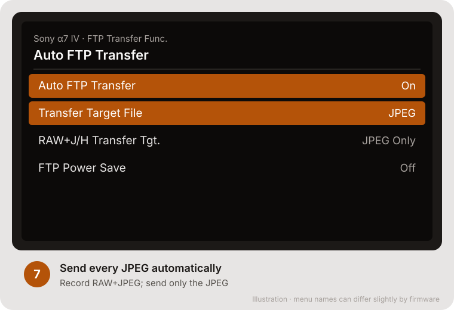
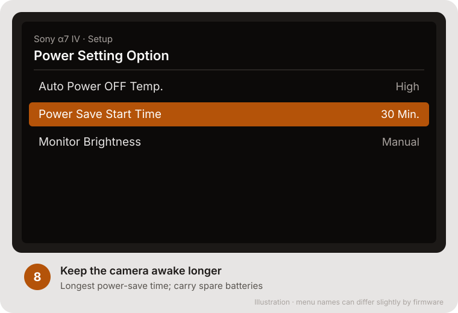
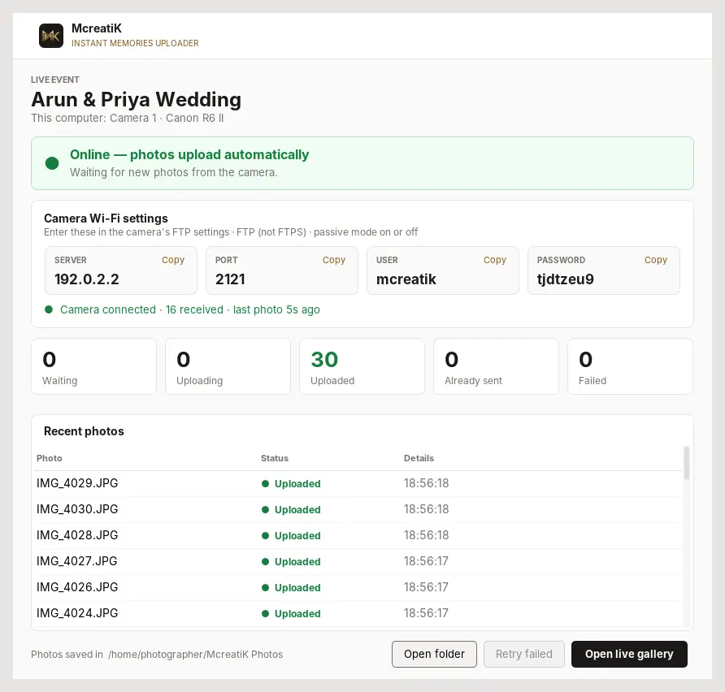

# Sony α7 IV setup

This guide sets up the **Sony α7 IV** to send every JPEG over Wi-Fi (FTP) to the McreatiK Instant Memories Uploader on your laptop.

> **Warning** **Not yet field-tested with McreatiK.** The α7 IV supports FTP transfer, and the uploader speaks standard FTP, but run the [rehearsal](/admin/docs/guide-uploader#8-rehearsal-before-the-first-paid-event) with a real α7 IV before promising it to a studio. Update the firmware first (Sony's site, "ILCE-7M4").

> **Note** The camera screens below are **illustrations** of each step, with the values to choose highlighted. Sony's menu names can differ slightly by firmware. Real photos of the camera screens will replace them later.

## Before you start

- The uploader is running and shows the **Camera Wi-Fi settings** card with Server, Port, User and Password ([Uploader guide](/admin/docs/guide-uploader)).
- The laptop is connected to the **same Wi-Fi or phone hotspot** the camera will join.
- File format is **RAW & JPEG** (Shooting menu → Image Quality → File Format). The JPEG goes to guests.

## Setup (once per network, about 10 minutes)

### Step 1: Join the hotspot

**MENU → Network → Wi-Fi → Access Point Set.** Choose the same network as the laptop, then enter its password.

### Step 2: Wi-Fi band (if shown)

**Network → Wi-Fi → Wi-Fi Frequency Band: 2.4GHz** for phone hotspots. This item exists only in some regions; skip it if it's missing.

### Step 3: Turn FTP transfer on

**Network → Transfer/Remote → FTP Transfer Func. → FTP Transfer Func.: On.**

### Step 4: Server 1

**FTP Transfer Func. → Server Setting → Server 1.** Give it a display name such as "McreatiK", then open **Destination Settings** and **User Info Setting**.

### Step 5: Destination settings

| Setting | Value |
| --- | --- |
| Hostname | The **Server** shown in the uploader, for example `172.20.10.3` |
| Secure Protocol | **Off** (the uploader uses plain FTP on the local network) |
| Port | **2121** |
| Passive Mode | **On** |
| Directory Settings | Leave blank (root) |

### Step 6: User info

| Setting | Value |
| --- | --- |
| User | **mcreatik** |
| Password | The **Password** shown in the uploader |

### Step 7: Send every JPEG automatically

| Setting | Value |
| --- | --- |
| Auto FTP Transfer | **On** |
| Transfer Target File / RAW+J transfer target | **JPEG** only |
| FTP Power Save | **Off** (keeps the connection up) |

### Step 8: Keep the camera awake

**Setup → Power Setting Option → Power Save Start Time:** the longest time. Carry spare batteries, because FTP uses more power.

### Step 9: Test

Shoot 3 frames. Within seconds the uploader shows **3 received this session**, the **Camera** stage turns green (**Receiving**), and the photos are in the gallery. To check the camera's side, go to **FTP Transfer Func. → FTP Transfer** and look at the transfer status.

## Home Wi-Fi and event hotspot

The laptop gets a **different address on each network**. Sony keeps several servers (Server 1, 2, 3…): use **Server 1 for the event hotspot** and **Server 2 for home Wi-Fi**, and select the right one under Server Setting. Use the same phone as the event hotspot every time, so the address stays the same.

## Troubleshooting

| Camera says or does | Fix |
| --- | --- |
| Can't connect / server error | Same Wi-Fi as the laptop? Hostname typed exactly as the uploader shows? Port 2121? **Secure Protocol Off**? Laptop firewall allowed? |
| Connects, but files don't transfer | Toggle **Passive Mode**. Check **Auto FTP Transfer** is On and the target file is JPEG. |
| Only some photos arrive | Photos shot before the camera joined Wi-Fi aren't sent automatically: use **FTP Transfer** to send the rest. |
| Worked at home, not at the venue | Select the hotspot's server under Server Setting, and check its hostname matches the uploader. |
| Photos stop after a while | The camera slept or FTP Power Save is on. Or the laptop slept. |
| Uploader says "Could not start on port 2121" | Another program uses that port. Close it, or start the uploader with `--ftp-port 2131` and set the camera's port to 2131. |
| Several cameras on one laptop | Each camera uses the **Port on its own tab** in the uploader (2121, 2122, 2123, 2124); Server, User and Password are the same for all. |
