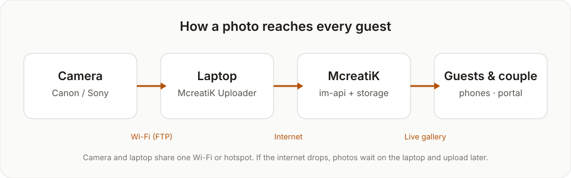
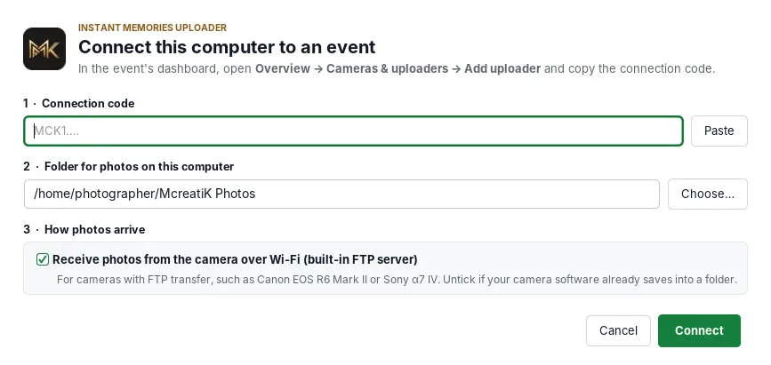
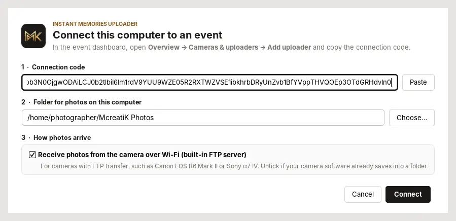
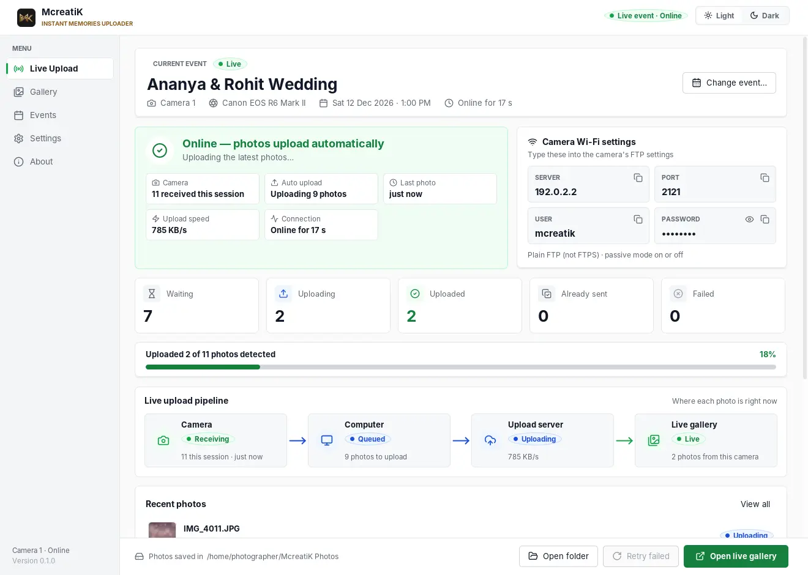
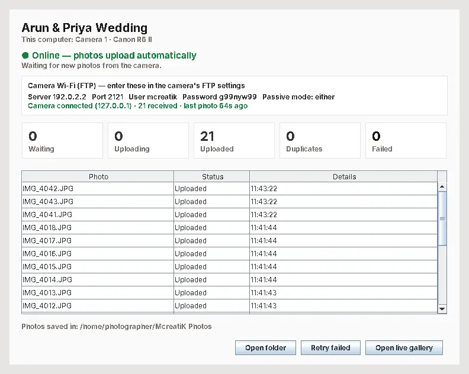

# McreatiK Uploader

The **McreatiK Uploader** runs on a laptop at the venue. It receives each photo from the camera over Wi-Fi (or from a folder), makes a light, sharp copy, and uploads it to the live gallery. If the internet drops, photos wait safely on the laptop and upload by themselves later.



| | Windows | Mac |
| --- | --- | --- |
| Status | Field-tested with a Canon EOS R6 Mark II | **Not yet field-tested**: rehearse first (section 7) |
| Needs | Java 21 | Java 21 (Apple Silicon or Intel, macOS 12+) |
| Start | Double-click, or `java -jar mcreatik-uploader.jar` | `caffeinate -dims java -jar …` in Terminal |

One laptop per camera is simplest. Two cameras on one laptop is possible (section 6).

## 1. Install (once)

1. Install **Java 21**: go to **adoptium.net**, choose **Temurin 21 (LTS)** for your system, then download and run the installer (.msi on Windows, .pkg on Mac).
2. Check it in a terminal (PowerShell or Terminal):
   ```
   java -version
   ```
   It should print `openjdk version "21…"`.
3. Put **mcreatik-uploader.jar** (sent by McreatiK) in a permanent folder, for example Documents → McreatiK.

## 2. Start and connect to the event

**Windows:** double-click the jar, or run:
```
java -jar "%USERPROFILE%\Documents\McreatiK\mcreatik-uploader.jar"
```

**Mac:** in Terminal, run:
```
caffeinate -dims java -jar ~/Documents/McreatiK/mcreatik-uploader.jar
```
`caffeinate` keeps the Mac awake while the uploader runs. Start it from Terminal: double-clicking a downloaded jar may be blocked as coming from an "unidentified developer". Keep the Terminal window open.

The first time, the **Setup** window opens:



1. **Connection code:** paste the code from the event dashboard (Overview → Cameras & uploaders → Add uploader → Copy code).
2. **Camera folder:** where photos are saved on this laptop. The default "McreatiK Photos" in your home folder is fine.
3. Keep **"Receive photos from the camera over Wi-Fi"** ticked for Canon or Sony FTP. Untick it only if your camera software already saves into a folder.
4. Press **OK**.



Next time it remembers the event and goes straight to the main window.

## 3. The main window


| Part | Meaning |
| --- | --- |
| Event name, "This computer: …" | Which event and which camera this laptop serves |
| Green **Online — photos upload automatically** | Connected to McreatiK |
| **Camera Wi-Fi (FTP)** box | What to type into the camera: **Server** (this laptop's address), **Port 2121**, **User mcreatik**, **Password** |
| Waiting · Uploading · Uploaded · Duplicates · Failed | The queue counts |
| Photo list | Each photo's status and time |
| Open folder · Retry failed · Open live gallery | Quick actions |

Now set up the camera: [Canon EOS R6 Mark II](/admin/docs/guide-canon) · [Sony α7 IV](/admin/docs/guide-sony).

When the camera connects, the FTP box turns green: **Camera connected · N received**.




## 4. When the internet drops

The status turns amber: **Offline — photos are safely queued**. The camera can keep sending, and photos wait in the queue on the laptop.


When the connection returns, they upload by themselves, oldest first, and guests' phones catch up. There's nothing to press.



**Duplicates** counts photos the camera sent twice. They're skipped, which is normal. **Failed** photos (rare) retry with **Retry failed**.

## 5. Keep the laptop ready

**Windows**
- When the firewall asks, click **Allow** for "OpenJDK Platform binary" on **Private and Public** networks. A new phone hotspot counts as Public.
- Settings → System → Power & battery: **never sleep when plugged in**. Keep it plugged in.

**Mac**
- When macOS asks "Do you want the application 'java' to accept incoming network connections?", click **Allow**. If you clicked Deny, go to System Settings → Network → Firewall → Options and allow **java**.
- System Settings → Battery → Options: **prevent automatic sleeping on power adapter when the display is off**. Keep the lid open; a closed lid sleeps the Mac.

**Both**
- The camera and the laptop must be on the **same Wi-Fi or phone hotspot**. iPhone hotspot: turn on **Maximize Compatibility**. Android hotspot: use 2.4 GHz.
- The laptop's address changes with each network (iPhone hotspot usually `172.20.10.x`, Android `192.168.43.x`). Always use the **Server** shown in the window.

## 6. Two cameras on one laptop

Start a second copy with its own data folder and FTP port, and its own connection code:
```
java -jar mcreatik-uploader.jar --data-dir ~/.mcreatik-camera2 --ftp-port 2122
```
Enter **2122** as the port in the second camera.

Other options: `--headless` (no window, for advanced use), and `--upload-originals` (send full-size files for server-side processing instead of the light copy).

## 7. Rehearsal before the first paid event

Do this once per laptop, with the real camera, on a test event:

1. `java -version` shows 21.
2. The uploader shows **Online** (green).
3. The firewall prompt was allowed.
4. The camera connects: "Camera connected · N received".
5. 10 single frames appear in the gallery within seconds.
6. 3 bursts of about 20 frames all arrive.
7. Turn the hotspot's internet off for a minute, shoot 5, then turn it back on: the 5 upload by themselves.
8. Quit the uploader, shoot 5, start it again: nothing is missing.
9. 30 minutes with the display off: the laptop didn't sleep.
10. Note battery use per hour.

| Date | Laptop (model, OS) | Camera | Network | Result |
| --- | --- | --- | --- | --- |
| Oct 2026 | Windows laptop | Canon EOS R6 Mark II | Home Wi-Fi, Android hotspot | Passed: 2–3 s shutter to laptop, bursts and reconnects OK |
| _to do_ | Mac | | | |

## Troubleshooting

| Symptom | Fix |
| --- | --- |
| `java: command not found` / "not recognized" | Java isn't installed, or the terminal was open during the install: reopen it and run `java -version`. |
| Setup says the code is invalid | Copy the whole code again from the dashboard (it starts with `MCK1.`). Lost it? **New code** on the dashboard. |
| Amber "Offline" | No internet on this laptop: check the hotspot's data. Photos are safe in the queue. |
| Camera: "cannot connect to FTP server" | Same Wi-Fi? Server address typed exactly as shown? Port 2121? Firewall allowed? |
| "Could not start on port 2121" | Another program uses it: add `--ftp-port 2122` and enter 2122 in the camera. |
| Photos stop after a while | The laptop slept (Mac: start with `caffeinate`, keep the lid open), or the camera slept (extend its auto power off). |
| Dashboard shows the camera Offline | The uploader on that laptop is closed or has no internet. |

More: [Event-day checklist and troubleshooting](/admin/docs/guide-event-day).
