# McreatiK Instant Memories Uploader

The **McreatiK Instant Memories Uploader** runs on a laptop at the venue. It receives each photo from the camera over Wi-Fi (or from a folder), makes a light, sharp copy, and uploads it to the live gallery. If the internet drops, photos wait safely on the laptop and upload by themselves later.


| | Windows | Mac |
| --- | --- | --- |
| Install | `McreatiK-Instant-Memories-Uploader-Windows.msi` | `McreatiK-Instant-Memories-Uploader-Mac-AppleSilicon.dmg` (M1–M4) or `…-Mac-Intel.dmg` |
| Needs | Nothing else: Java is included | Nothing else: Java is included; macOS 12+ |

One laptop can serve **up to 4 cameras** at the same time (section 7).

## 1. Download and install (once)

In the dashboard, press **Install uploader** in the top bar (on a phone: **Menu → Install uploader**). It shows the Windows and Mac downloads, with this computer's first, and the first-open steps:

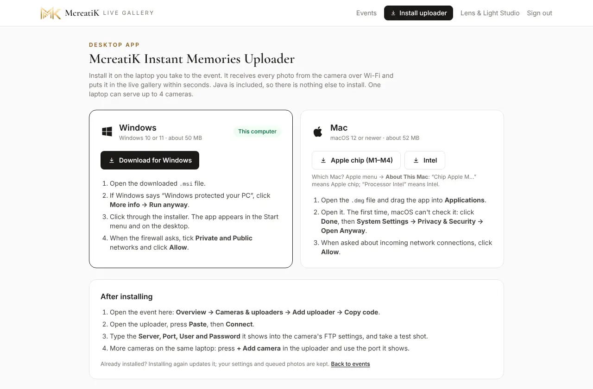

Or use these links:

| Laptop | Download |
| --- | --- |
| Windows | [McreatiK-Instant-Memories-Uploader-Windows.msi](https://github.com/MugundhanG/mcreatik-instant-memories/releases/latest/download/McreatiK-Instant-Memories-Uploader-Windows.msi) |
| Mac with Apple chip (M1–M4) | [McreatiK-Instant-Memories-Uploader-Mac-AppleSilicon.dmg](https://github.com/MugundhanG/mcreatik-instant-memories/releases/latest/download/McreatiK-Instant-Memories-Uploader-Mac-AppleSilicon.dmg) |
| Older Mac (Intel) | [McreatiK-Instant-Memories-Uploader-Mac-Intel.dmg](https://github.com/MugundhanG/mcreatik-instant-memories/releases/latest/download/McreatiK-Instant-Memories-Uploader-Mac-Intel.dmg) |

Not sure which Mac you have? Apple menu → **About This Mac**: "Chip Apple M…" means Apple chip; "Processor Intel" means Intel.

**Windows**
1. Open the `.msi` file. Windows may show "Windows protected your PC" (the app isn't code-signed yet): click **More info → Run anyway**.
2. Click through the installer. **McreatiK Instant Memories Uploader** appears in the Start menu and on the desktop.

**Mac**
1. Open the `.dmg` file and drag **McreatiK Instant Memories Uploader** into **Applications**.
2. Open it from Applications. The first time, macOS says it can't check the app (not code-signed yet): click **Done**, then go to **System Settings → Privacy & Security**, scroll down to McreatiK Instant Memories Uploader and click **Open Anyway**.
3. The app keeps the Mac awake by itself while it runs.

## 2. Start and connect to the event

Start **McreatiK Instant Memories Uploader** from the Start menu (Windows) or Applications (Mac).

The first time, the **Setup** window opens:


1. **Connection code:** copy the code from the event dashboard (Overview → Cameras & uploaders → Add uploader → Copy code), then press **Paste**.
2. **Folder for photos on this computer:** the default "McreatiK Photos" in your home folder is fine.
3. **How photos arrive:** keep **"Receive photos from the camera over Wi-Fi"** ticked for Canon or Sony FTP. Untick it only if your camera software already saves into a folder.
4. Press **Connect**. If something is wrong, the reason appears in red under the form:

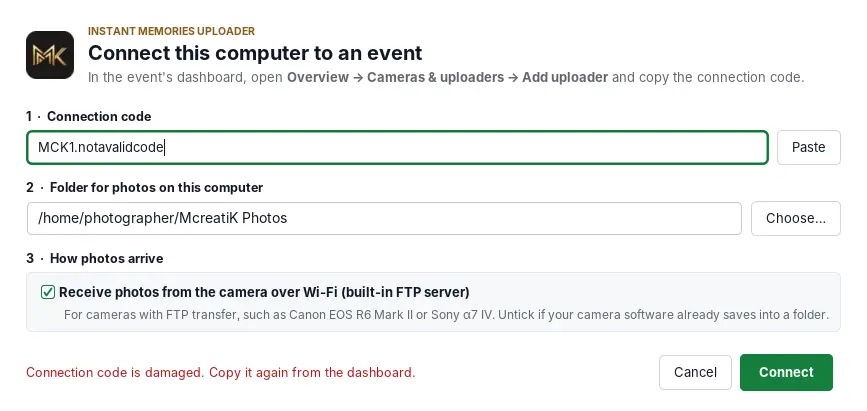


Next time it remembers the event and goes straight to the main window. To use the laptop for a **different event**, press **Change event…** (section 4).

## 3. The main window

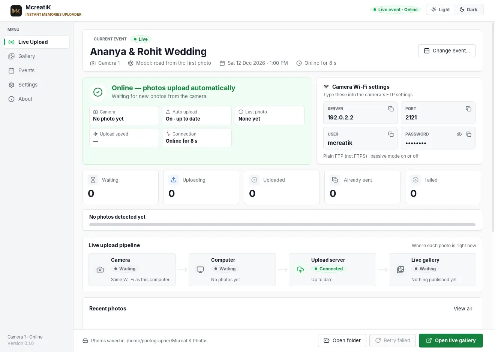

The menu on the left has five pages: **Live Upload** (the event-day screen), **Gallery** (every photo from this camera for the event), **Events** (the current event and Change event…), **Settings** and **About**.

On **Live Upload**, from top to bottom:

| Part | Meaning |
| --- | --- |
| Event card | The event name, the camera (for example "Camera 1"), the camera model (read from the first photo), the event's date and time, and how long the laptop has been connected. **Change event…** is on the right (section 4) |
| Status card | **Online** (green): photos upload automatically. **Reconnecting** (blue): the internet just dropped. **Offline** (amber): no internet for 2 minutes or more, photos are queued. **Error** (red): something needs you, and the reason is shown. Below: photos received from the camera, auto upload, last photo, upload speed and connection time |
| **Camera Wi-Fi settings** | What to type into the camera: **Server** (this laptop's address), **Port 2121**, **User mcreatik**, **Password**. The password is hidden until you press the eye. Each value has a **Copy** button, which shows **COPIED** |
| Waiting · Uploading · Uploaded · Already sent · Failed | The queue counts, with a bar: "Uploaded X of Y photos detected" ("Already sent" means McreatiK already had that photo, so it was skipped) |
| Live upload pipeline | Camera → Computer → Upload server → Live gallery. Green = done, blue = working, grey = waiting, red = needs attention |
| Recent photos | The latest photos with a thumbnail, size, time and status. **View all** opens the Gallery page |
| Open folder · Retry failed · **Open live gallery** | Quick actions (Retry failed lights up only when something failed). The photo folder is shown on the left |

The light and dark look are switched with **Light | Dark** at the top right. The app remembers the choice on this computer.

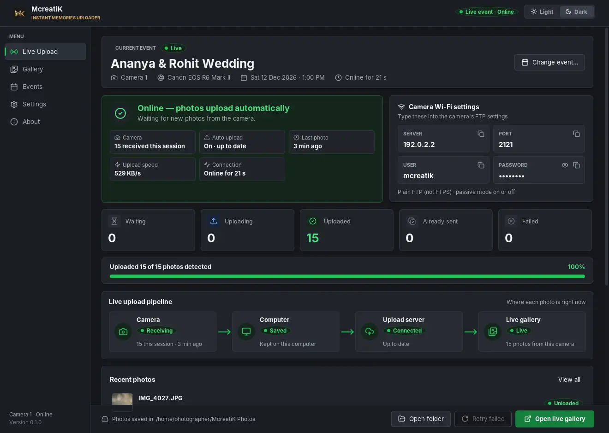

Now set up the camera: [Canon EOS R6 Mark II](/admin/docs/guide-canon) · [Sony α7 IV](/admin/docs/guide-sony).

When the first photo arrives, the **Camera** stage of the pipeline turns green (**Receiving**), and the status card counts the photos received.


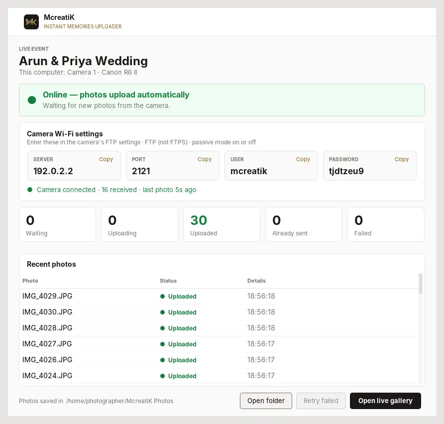

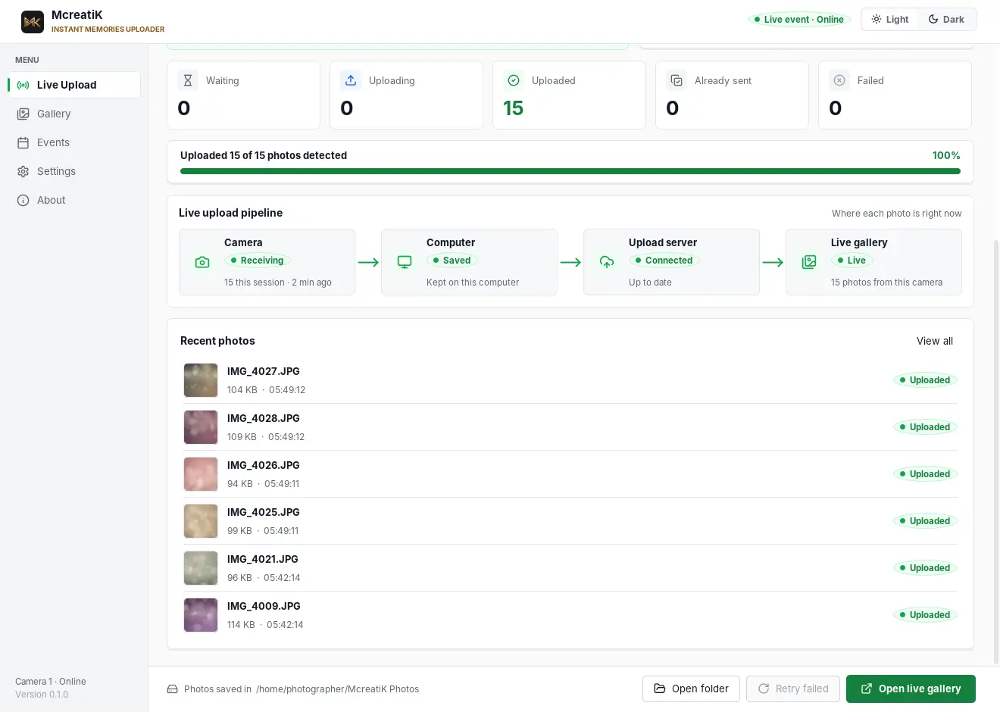

## 4. Switching to another event

The uploader remembers its event, even after you close it or install an update. For each new event, connect it to that event's code:


1. Check **Waiting** and **Uploading** are both **0**, so every photo has reached the event you just shot.
2. In the **new** event's dashboard: **Overview → Cameras & uploaders → Add uploader → Copy code**.
3. In the uploader, press **Change event…** (on the event card, or on the **Events** page), then **Paste**, then **Switch event**.

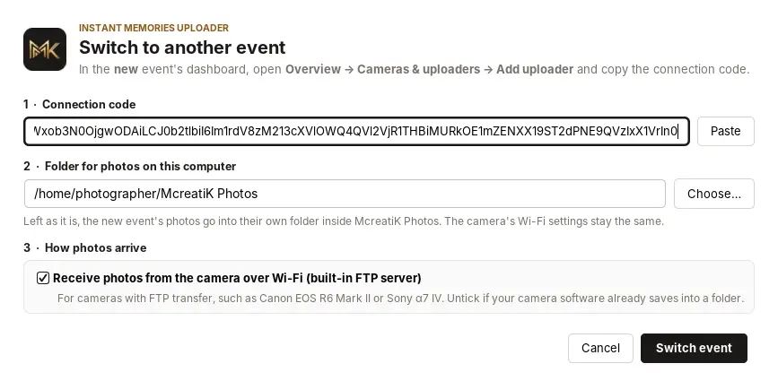

The uploader restarts by itself and shows the new event's name, with the counters back at 0.

- **The camera settings don't change.** The Server, Port, User and Password stay the same, so the camera needs no setup.
- **Each event gets its own folder** inside McreatiK Photos (for example `McreatiK Photos/Kavin & Nila Reception`). If you chose a folder yourself, it's kept.
- **Old photos are never sent to the new event.** The uploader remembers every photo it has already sent.

If photos are still waiting, the uploader asks you to wait first, so no photo from one event can end up in another:

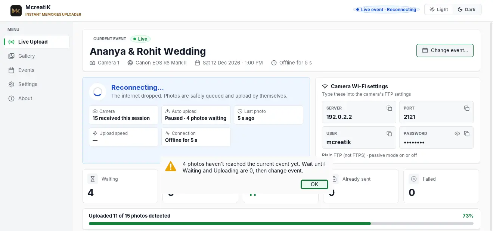

If the internet is down, connect the laptop first and let the queue empty. Then change the event.

> **Tip** A renamed event or camera in the dashboard shows in the uploader within a minute. There's no need to restart.

## 5. When the internet drops

The status turns blue (**Reconnecting…**), and after 2 minutes amber (**Offline — photos are safely queued**). The camera can keep sending, and photos wait in the queue on the laptop.

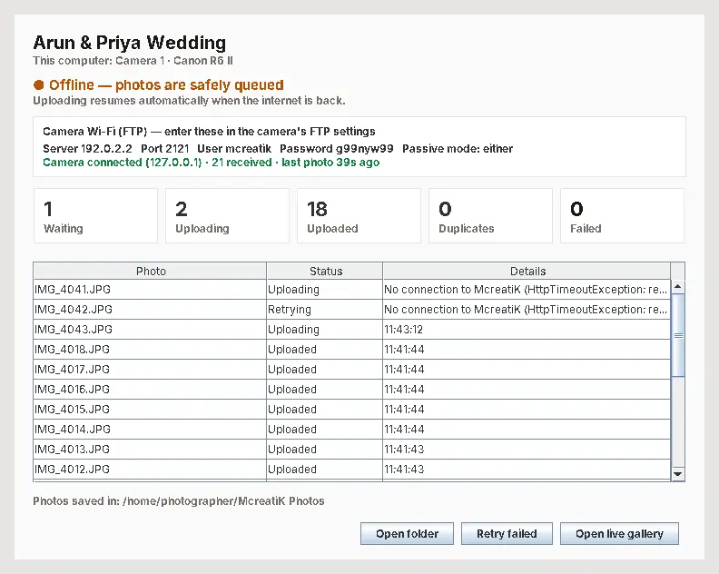

When the connection returns, they upload by themselves, oldest first, and guests' phones catch up. There's nothing to press.


**Already sent** counts photos McreatiK already had (for example the camera sent one twice). They're skipped, which is normal. **Failed** photos (rare) are listed in red with the reason; fix it, then press **Retry failed**.

## 6. Keep the laptop ready

**Windows**
- When the firewall asks, click **Allow** for **McreatiK Instant Memories Uploader** on **Private and Public** networks. A new phone hotspot counts as Public.
- Settings → System → Power & battery: **never sleep when plugged in**. Keep it plugged in.

**Mac**
- When macOS asks whether **McreatiK Instant Memories Uploader** may accept incoming network connections, click **Allow**. If you clicked Deny, go to System Settings → Network → Firewall → Options and allow it.
- System Settings → Battery → Options: **prevent automatic sleeping on power adapter when the display is off**. Keep the lid open; a closed lid sleeps the Mac.

**Both**
- The camera and the laptop must be on the **same Wi-Fi or phone hotspot**. iPhone hotspot: turn on **Maximize Compatibility**. Android hotspot: use 2.4 GHz.
- The laptop's address changes with each network (iPhone hotspot usually `172.20.10.x`, Android `192.168.43.x`). Always use the **Server** shown in the window.

## 7. Several cameras on one laptop (up to 4)

One uploader can receive photos from up to **4 cameras at the same time**, for example a main photographer and a candid photographer. Each camera appears in the gallery under its own name, with its own photo count in the dashboard.

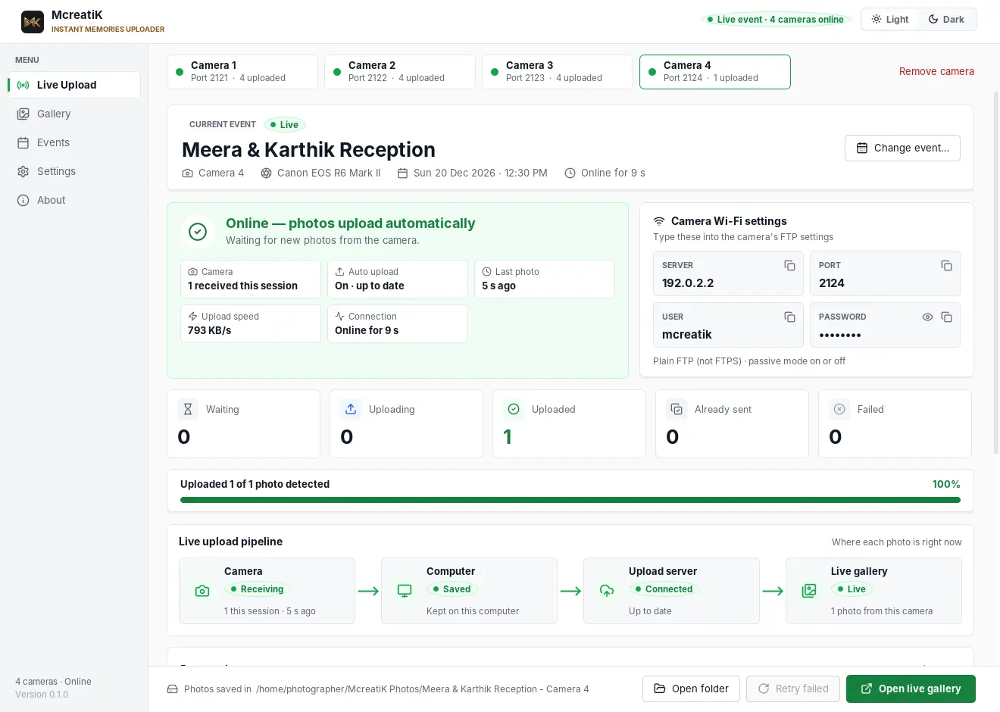

**Add a camera**
1. In the uploader, press **+ Add camera** (next to the camera tabs at the top).
2. **Name the camera**, for example *Candid - Divya* or *Drone*. The name shows on its tab, in the dashboard, and on its photo folder. Leave it as suggested ("Camera 2") if you like.
3. The new camera is created in the same event straight away, with no code needed. A message shows its **port**:

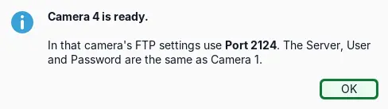

4. In that camera's FTP settings, use the **same Server, User and Password** as Camera 1, and the camera's own **Port**:

| Camera | Port |
| --- | --- |
| Camera 1 | 2121 |
| Camera 2 | 2122 |
| Camera 3 | 2123 |
| Camera 4 | 2124 |

If one of these ports is taken by another program, the uploader picks the next free one and shows it. Always use the port on the camera's tab.

**While shooting**
- Click a camera's tab to see its status, settings, counters, pipeline and photos. The dot on each tab is green when that camera is fine, blue while reconnecting, amber when offline and red when it needs attention.
- The top right shows all cameras together, for example "Live event · 4 cameras online".
- Every event has **one folder**, with **a sub-folder for each camera**, named after the camera:

```
McreatiK Photos/
  Meera & Karthik Wedding/
    Main - Karthik/
    Candid - Divya/
```

  Events set up with an older version keep their folders as they were.

**Rename a camera**
Select its tab and press **Rename**. The new name shows here and in the dashboard straight away (you can also rename it in the dashboard). Its folder keeps its name, so nothing moves while you're shooting.

**Pause a camera (private moments)**
Select its tab and press **Pause** (or press **Pause** next to the camera in the dashboard). While a camera is paused:
- photos that haven't uploaded yet, and **every new photo**, stay on the laptop in that camera's **Not uploaded (paused)** folder;
- **none of them go to the gallery**, even after you resume;
- the tab, the status card and the dashboard show **Paused** in amber.

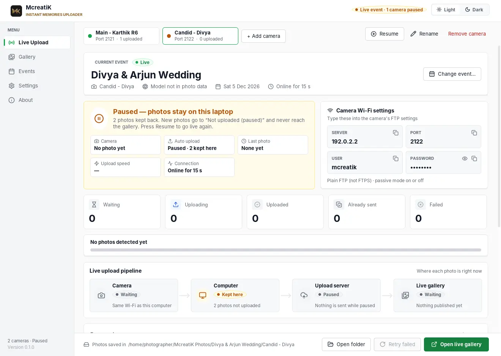

Press **Resume** to go live again: only photos taken after resuming upload. Use it for moments that shouldn't go live, such as the bride getting ready. To share some of the paused photos later, upload them from the dashboard (**Photos → Upload photos**).

**Remove a camera**
Select its tab and press **Remove camera** (Camera 1 can't be removed). It is allowed only when that camera's Waiting and Uploading are 0. Its photos stay in the gallery and in its folder.

**Next event**
**Change event…** moves **all** cameras to the new event. The ports and password stay the same, so no camera needs new settings.

> **Note** All cameras share this laptop's Wi-Fi, internet and battery. Keep it plugged in, close to where you shoot, and on a good hotspot. If the laptop sleeps, every camera stops.

Other options: `--headless` (no window, for advanced use), and `--upload-originals` (send full-size files for server-side processing instead of the light copy).

## 8. Rehearsal before the first paid event

Do this once per laptop, with the real camera, on a test event:

1. The app installs and opens (first-open steps above).
2. The uploader shows **Online** (green).
3. The firewall prompt was allowed.
4. The camera connects: the Camera stage shows **Receiving** and "N received this session".
5. 10 single frames appear in the gallery within seconds.
6. 3 bursts of about 20 frames all arrive.
7. Turn the hotspot's internet off for a minute, shoot 5, then turn it back on: the 5 upload by themselves.
8. Quit the uploader, shoot 5, start it again: nothing is missing.
9. 30 minutes with the display off: the laptop didn't sleep.
10. Note battery use per hour.

Do this rehearsal for every new laptop and every new camera model before a paid event.

## Troubleshooting

| Symptom | Fix |
| --- | --- |
| "Windows protected your PC" / Mac "can't be opened" | The app isn't code-signed yet: Windows → More info → Run anyway; Mac → System Settings → Privacy & Security → Open Anyway. |
| Setup says the code is invalid | Copy the whole code again from the dashboard (it starts with `MCK1.`). Lost it? **New code** on the dashboard. |
| Blue "Reconnecting" or amber "Offline" | No internet on this laptop: check the hotspot's data. Photos are safe in the queue. |
| Red "The camera can't send photos" | The camera receiver couldn't start, usually because another program uses port 2121: close that program, or start the uploader with `--ftp-port 2131` and enter 2131 in the camera. |
| Camera: "cannot connect to FTP server" | Same Wi-Fi? Server address typed exactly as shown? Port 2121? Firewall allowed? |
| "Could not start on port 2121" | Another program uses it: close it, or start the uploader with `--ftp-port 2131` and enter 2131 in the camera. |
| Photos stop after a while | The laptop slept (keep it plugged in and the lid open; the Mac app keeps itself awake), or the camera slept (extend its auto power off). |
| Dashboard shows the camera Offline | The uploader on that laptop is closed or has no internet. |
| It still shows the **old event's name** | The uploader remembers its last event. Press **Change event…** and paste the new event's code (section 4). |
| Red "This uploader was removed from the event" | Someone deleted this uploader in the dashboard. Add a new one there, then **Change event…** with its code. |

More: [Event-day checklist and troubleshooting](/admin/docs/guide-event-day).

## Advanced: the command-line version

For Linux, or special setups: install **Java 21** (adoptium.net → Temurin 21), then run `mcreatik-uploader.jar` (sent by McreatiK). On a Mac, start it with `caffeinate -dims java -jar mcreatik-uploader.jar` so the Mac stays awake. Options: `--data-dir`, `--ftp-port`, `--headless` (no window), `--upload-originals`.
