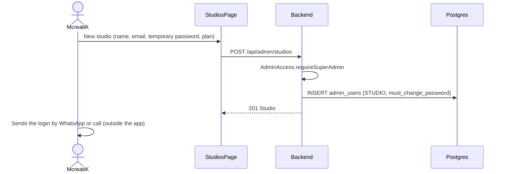
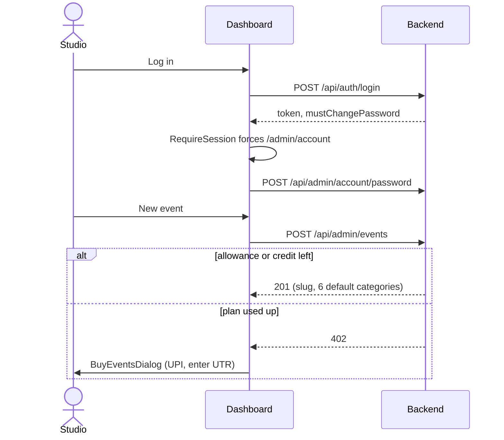
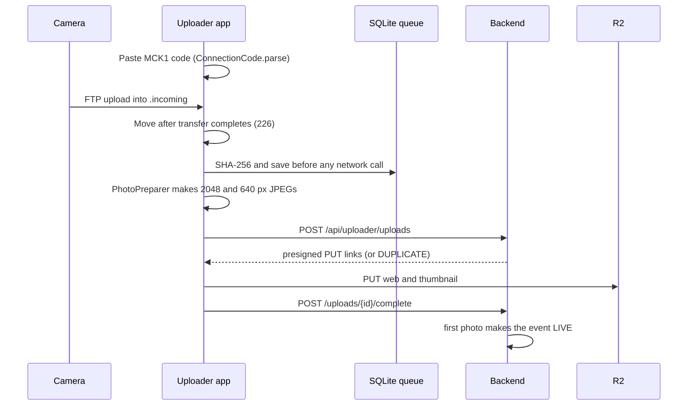
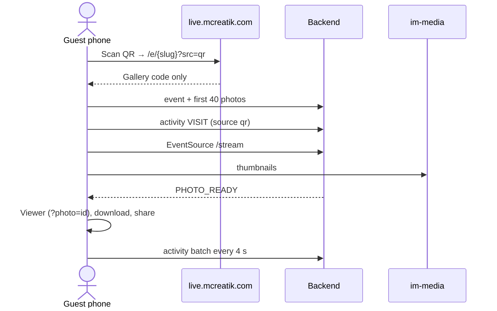
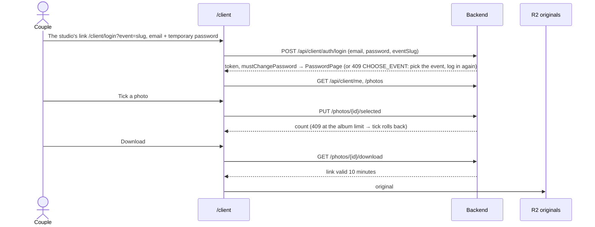
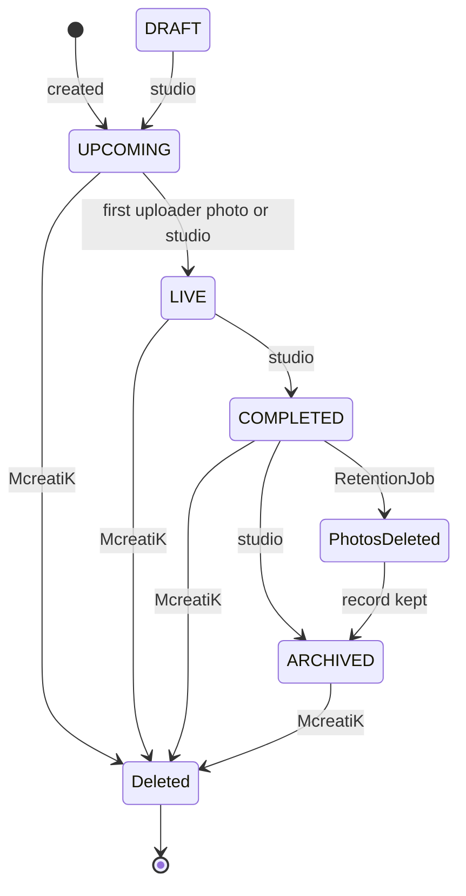

# User journeys

Each journey follows one person from the screen, through the API and backend, to the table or file storage it touches.

## McreatiK onboards a studio

1. `AdminBootstrap` creates McreatiK's own account on first boot.
2. `StudioAccordionItem` (one row per studio on `StudiosPage`) holds the plan, monthly quota, credits and `BrandingCard`, with Reset password, Disable and Delete.
3. `PricingPage` (menu: Pricing & payments) holds the prices and `PaymentsToCheck`, which lists PENDING UPI payments. McreatiK checks the UTR in the bank app, then approves, which adds credits.
4. `GalleryAccessCard` turns an event's guest or couple gallery off. Open phones get `GALLERY_CLOSED` after the commit.

## A studio runs an event

1. **Prepare.** Print the QR from `QrPanel` or `PrintQrPage`; the link carries `?src=qr` to count scans. Add an uploader in `UploadersPanel` and copy the `MCK1.` connection code, which is shown once.
2. **During the event.** `PhotosPanel` likes, hides, sets the cover, deletes and moves photos. `AnalyticsPanel` refreshes every 30 s.
3. **Afterwards.** Set the status to COMPLETED. Create the couple's login in `ClientsCard` and send it with `SendButtons`. Download the album picks as a ZIP.

## The camera operator at the venue

- **Connection code:** one string, `MCK1.<base64 {server, token}>`, so nobody types a URL and a 48-character token at the venue.
- **No half photos:** `FtpPhotoSource` moves a file into the watched folder only after a complete transfer.
- **Nothing lost:** `UploadEngine` queues first. Network errors retry with backoff. A revoked token or archived event pauses uploading. A restart returns in-flight photos to the queue.
- **Online status:** the dashboard shows the uploader online if a heartbeat arrived in the last 45 s, with its queue counts.

## A guest at the wedding

- **No sign-up.** The browser keeps only a random visitor ID.
- **Possible screens:**
  - not found (draft or archived event)
  - unavailable (McreatiK switched the gallery off)
  - the live grid
- **No jumping grid.** New photos wait behind a "new photos" button when the guest has scrolled down or has a photo open.
- **Removal requests.** Every photo has a "Request removal" email link to connect@mcreatik.com.
- **No originals.** Guests only get gallery copies.

## The couple

Forgot password emails only while the login is active, the event isn't archived and the couple's gallery is on.

## Event life cycle

- Guests can see UPCOMING, LIVE and COMPLETED events (`EventStatus.isPubliclyVisible`).
- Every status except ARCHIVED accepts uploads.

> **Note** The automatic switch to LIVE (`promoteToLive`) does not send `EVENT_STATUS`. A guest who opened the gallery early keeps the "Upcoming" badge until they reload, even while photos arrive.
