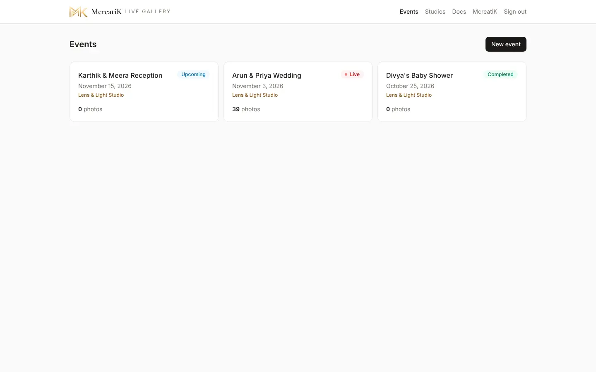
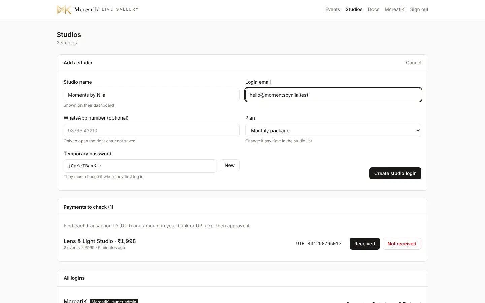
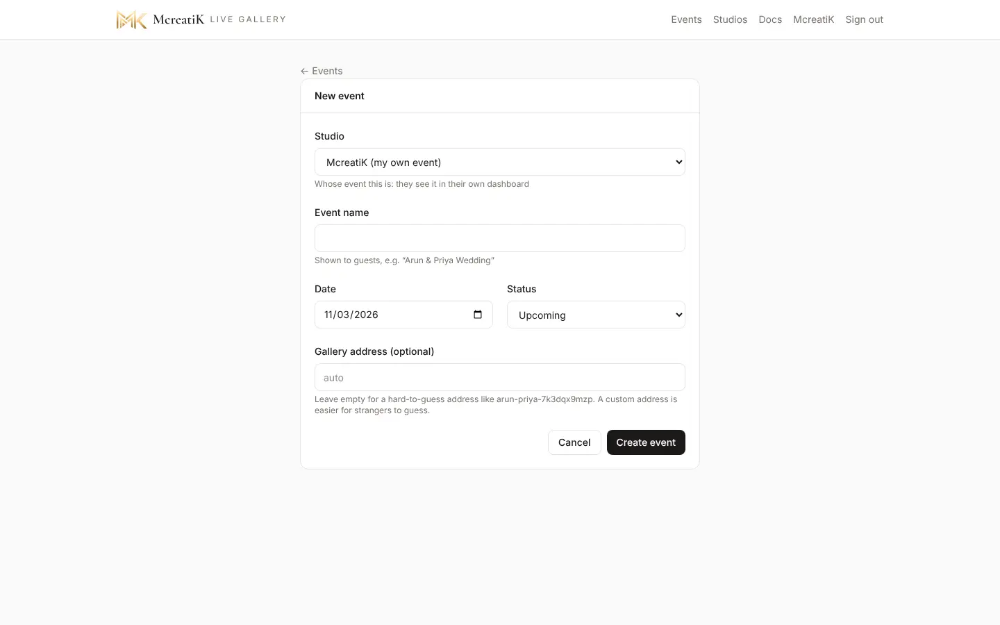
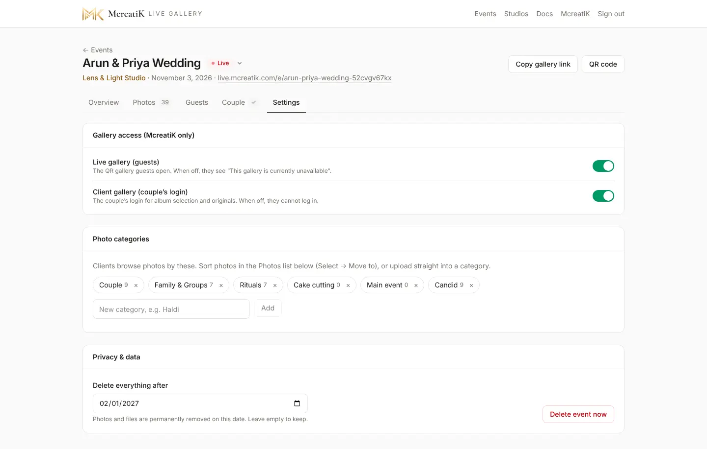
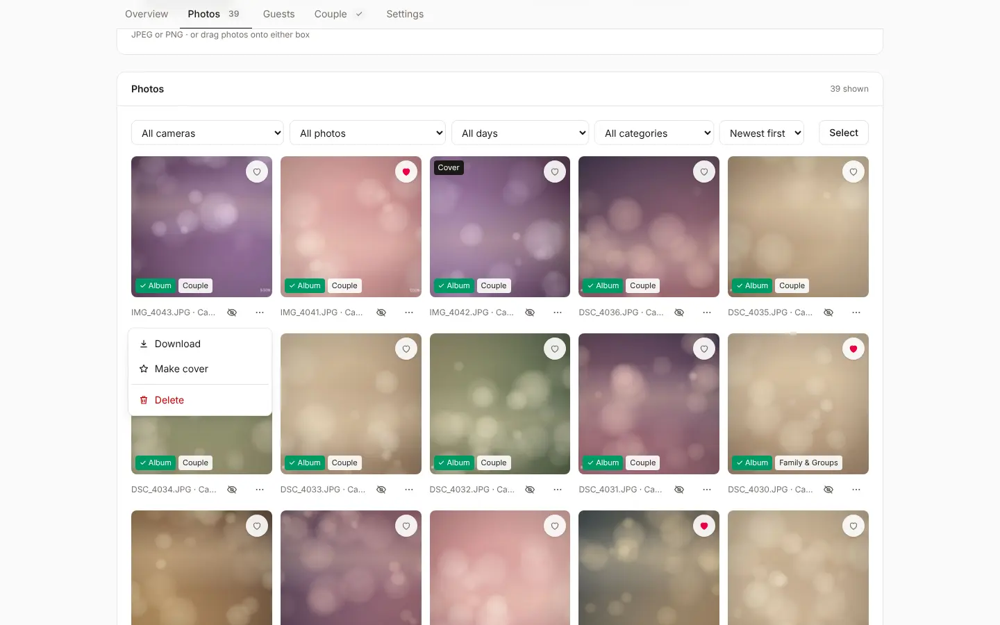

# McreatiK admin SOP

This is the standard operating procedure for the **McreatiK super admin**: the person who signs studios up, approves payments, keeps galleries healthy and handles guest requests. Studios, couples and guests each have their own SOP in this section. Hand them those pages, not this one.

## At a glance

| Task | Where | How often |
| --- | --- | --- |
| Add a studio and send its login | Studios → Add studio | Each new studio |
| Approve a UPI payment | Pricing & payments → Payments to check | Same day |
| Change a studio's plan or events | Studios → open the studio → Give / take events | When agreed |
| Turn a gallery off or on | Event → Settings → Gallery access | On request |
| Remove a photo after a request | Event → Photos → More → Delete | Within 3 working days |
| Reset a studio's password | Studios → open the studio → Reset password | On request |
| Update the server | Deployment page (`deploy.sh`) | After each backend change |

> **Note** Every screenshot in this section comes from a demo studio ("Lens & Light Studio") with generated sample photos. No client photos are used anywhere in these docs.

## 1. Sign in

1. Open **live.mcreatik.com/admin**.
2. Enter the McreatiK email and password and press **Sign in**.

As the super admin you see extra menu items that studios never see: **Studios**, **Pricing & payments**, the full **Docs** (studios get **Guides**: only the pages tagged "Studios" in the sidebar), and the events of *every* studio.

## 2. See every event

**Events** lists all events of all studios. Each card shows the studio name in gold, the date, the status and the photo count. As McreatiK you also get a **Studio** filter next to the studio's own Sort and filters.

| Status | What guests see | When to use it |
| --- | --- | --- |
| Draft | Nothing (404) | Setting up, not ready |
| Upcoming | The gallery opens; it says photos will appear | Before the event |
| Live | Photos stream in | During the event (turns on by itself with the first camera photo) |
| Completed | The gallery stays; no "live" badge | After the event |
| Archived | Hidden from guests; uploads stop | Finished and closed |

## 3. Add a studio

1. Go to **Studios** and press **Add studio**.
2. Fill in **Studio name** (shown on their dashboard) and **Login email**.
3. Optional: **WhatsApp number**. It is only used to open the chat for you; it is not saved.
4. Choose the **Plan**: Per event, a monthly pack, or Unlimited. It can be changed any time.
5. Keep the generated **Temporary password**, or press **New** for another.
6. Press **Create studio login**.

7. Send the login with the **WhatsApp** or **Open in mail app** button that appears. **The password is shown only now.**
8. The studio must choose its own password at first login, so the temporary one stops working after that.

> **Tip** Before sending the login, agree the plan and price on a call. Lead every pricing conversation to a 10-minute demo.

## 4. Manage studios, plans and payments

The **Studios** page has one row for each studio. Press a row to open it: you see its plan, usage, events, photos and storage, and the buttons **Edit branding**, **Reset password**, **Disable** or **Enable**, and **Delete**. Payments to check and all prices are on the separate **Pricing & payments** page in the menu.

### 4.1 Approve a payment

Studios buy extra events from their Events page (see the Studio SOP) by UPI QR.

Payments arrive in **Pricing & payments → Payments to check** with the amount and the **UTR** (UPI transaction ID). What the studio bought is usable at once; you only confirm the money arrived.

1. Open your bank or UPI app and find a credit with **the same UTR and amount**.
2. Found it → press **Received**. The events are added to the studio straight away.
3. Not found after a reasonable wait → press **Not received**. No events are added; message the studio to sort it out.

> **Warning** Never approve on a screenshot alone. Match the UTR and the amount in your bank app.

### 4.2 Plans and events

Open a studio on the **Studios** page to see its events, photos and storage.

- **Plan:** Per event, one of the four monthly packs (Main or Quick, 2 or 4 events a month) or Unlimited.
- **Packs:** the line shows this month's usage and the **paid until** date. Moving a studio onto a pack counts as its first month paid. If they renewed outside the app, set the date by hand. A pack whose date has passed (plus 3 days) shows **ended**, and new events are charged one by one.
- **Available:** each studio shows the events it can still use (bought Main and Quick events plus what is left in this month's pack) and its client galleries. Press **+** or **−** beside **Main**, **Quick** or **Client** to give or take back one at a time (for example a free first event, or a refund). A count never goes below 0.
- **Storage and open dates:** studios buy storage and months per event themselves with **Change storage & months**. Your own and Unlimited studios have no storage limits and can set an event's open-until date by hand in Settings → Privacy & data.
- **Edit branding:** fix the studio's name, Instagram or logo size if they need help.
- **McreatiK's own branding:** edit it from **Account**, or from the McreatiK row on the Studios page. Fields left empty keep the built-in McreatiK design. On the guest cover, the McreatiK logo sits without a card; a studio's logo sits on a light card.
- **Reset password:** creates a new temporary password to send them.
- **Disable:** blocks the studio's login. Their galleries keep working for guests and couples. To remove a studio for good, use **Delete** (see the end of this page).

### 4.3 Payment settings and prices

On the **Pricing & payments** page, under **Payments & prices**, set your **UPI ID**, the **name shown in the UPI app**, and every price: Main and Quick single events, the four monthly packs and each pack's extra-event price (a Main pack's covers Quick events too), the upgrade price, after how many guests a Quick event is offered the upgrade, the storage price per GB per month, the GB included with live events, the client gallery setup price and how many months a gallery stays open. Studios see the prices in Buy events, the new-event form and the public pricing page. Press **Save**.

## 5. Create an event for a studio

Studios normally create their own events. To create one for them:

1. **Events → New event**.
2. Choose the **Studio** at the top. "McreatiK (my own event)" is for McreatiK Studios' own shoots.
3. Enter the name, date and status, then **Create event**.

## 6. Turn a gallery off or on

Use this when a couple asks to stop guest access, when a studio hasn't paid, or for any privacy concern.

1. Open the event → **Settings**.
2. Under **Gallery access (McreatiK only)**:
   - **Live gallery (guests):** off means the QR link shows "This gallery is currently unavailable".
   - **Client gallery (couple's login):** off means the couple can't log in.

This is what guests then see:

## 7. Handle a photo removal request

Guests ask with **Request removal** in the photo viewer, or by email to connect@mcreatik.com. The email includes the gallery and the photo.

1. Reply the same day to confirm you received it.
2. Open the event → **Photos** and find the photo (the email names the file; use the filters).
3. Fastest: **Hide** it. It disappears from every open phone at once.
4. If the person wants it gone for good: **More → Delete**.
5. Tell the studio, and reply to the person. The promise is **within 3 working days**.

## 8. Event-day support

Have this ready on any event day:

- Your phone with WhatsApp (+91 99527 58545) and email.
- These docs open: [Event-day checklist and troubleshooting](/admin/docs/guide-event-day).
- The event dashboard open on **Overview** to watch **cameras online** and the latest photo.

| The studio says | Check first | Guide |
| --- | --- | --- |
| "The camera won't connect" | Same Wi-Fi? Address and port 2121 typed exactly? Firewall allowed? | [Canon](/admin/docs/guide-canon) · [Sony](/admin/docs/guide-sony) |
| "Photos stopped" | Uploader amber (no internet) or the laptop slept | [Uploader](/admin/docs/guide-uploader) |
| "Guests can't open it" | Event status not Draft or Archived; gallery access on | Section 6 |
| "Wrong photo is showing" | Hide it from the Photos tab | Section 7 |

> **Warning** Never update the server during a live event. A deploy takes the gallery offline while Java starts.

## 9. Keep the service healthy

| Check | When | How |
| --- | --- | --- |
| Pending payments | Daily | Pricing & payments → Payments to check |
| Server update after code changes | When a backend PR is merged | [Deployment](/admin/docs/deployment) |
| Rollback if an update breaks | Immediately | `deploy/oracle/rollback.sh` (see Deployment) |
| Security and findings | Monthly | [Findings and next actions](/admin/docs/findings) |
| Answers to customer questions | When a feature changes | [Instant Memories Q&A](/admin/docs/qa-how-to-use) |

## Deleting a studio, and event deletion

- **Studios → open the studio → Delete** removes a studio for good: its login, every event with its photos and galleries, its logo and its payment history. You type the studio's name to confirm. To only stop a studio logging in, use **Disable**.
- **Studios cannot delete events** or change an event's name or date after creating it. They can delete photos. Only McreatiK can delete an event (**Settings → Delete event now**) or correct its name or date.
- **Package and event counts:** change the package and the Main / Quick / Client counts, then press **Save changes**. Nothing changes for the studio until you save. Picking a pack shows its events per month.
- **Photos and event records:** the daily job deletes a gallery's photos 30 days after it closes. The event stays as a record (archived), with its payments and charges. Only McreatiK deletes events.
