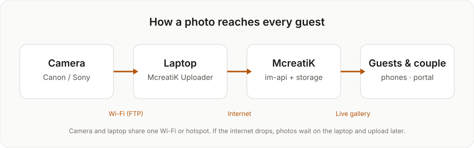
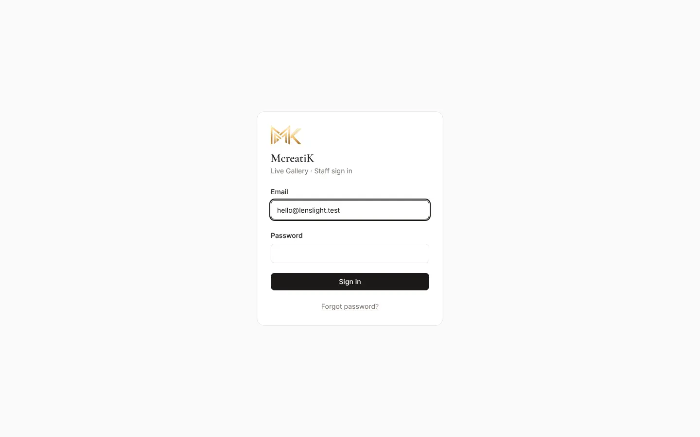
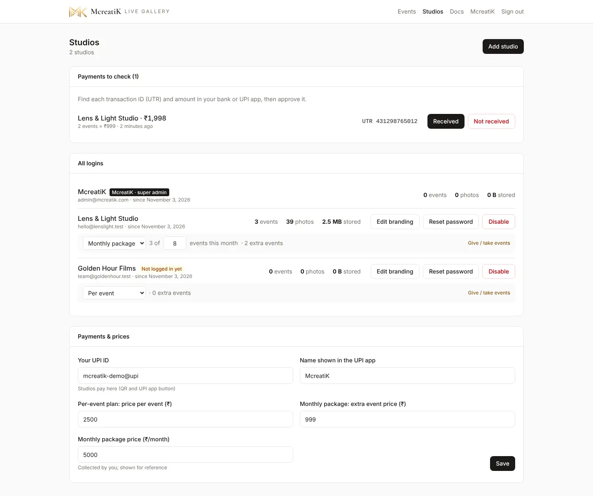
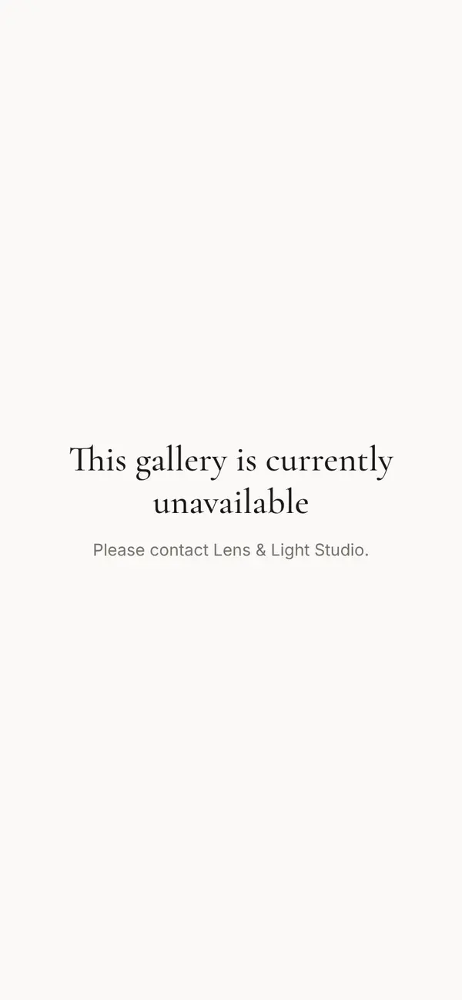
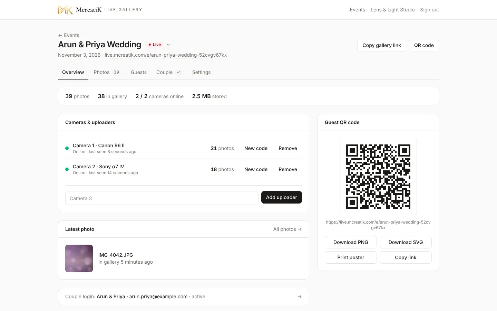

# McreatiK admin SOP

This is the standard operating procedure for the **McreatiK super admin**: the person who signs studios up, approves payments, keeps galleries healthy and handles guest requests. Studios, couples and guests each have their own SOP in this section. Hand them those pages, not this one.

## At a glance

| Task | Where | How often |
| --- | --- | --- |
| Add a studio and send its login | Studios → Add studio | Each new studio |
| Approve a UPI payment | Studios → Payments to check | Same day |
| Change a studio's plan or events | Studios → All logins → Give / take events | When agreed |
| Turn a gallery off or on | Event → Settings → Gallery access | On request |
| Remove a photo after a request | Event → Photos → More → Delete | Within 3 working days |
| Reset a studio's password | Studios → Reset password | On request |
| Update the server | Deployment page (`deploy.sh`) | After each backend change |

> **Note** Every screenshot in this section comes from a demo studio ("Lens & Light Studio") with generated sample photos. No client photos are used anywhere in these docs.

## 1. Sign in

1. Open **live.mcreatik.com/admin**.
2. Enter the McreatiK email and password and press **Sign in**.

As the super admin you see four extra menu items that studios never see: **Studios**, **Docs**, and the events of *every* studio.

## 2. See every event

**Events** lists all events of all studios. Each card shows the studio name in gold, the date, the status and the photo count.

| Status | What guests see | When to use it |
| --- | --- | --- |
| Draft | Nothing (404) | Setting up, not ready |
| Upcoming | The gallery opens; it says photos will appear | Before the event |
| Live | Photos stream in | During the event (turns on by itself with the first camera photo) |
| Completed | The gallery stays; no "live" badge | After the event |
| Archived | Hidden from guests; uploads stop | Finished and closed |

## 3. Add a studio

1. Go to **Studios** and press **Add studio**.
2. Fill in **Studio name** (shown on their dashboard) and **Login email**.
3. Optional: **WhatsApp number**. It is only used to open the chat for you; it is not saved.
4. Choose the **Plan**: Monthly package, Per event or Unlimited. It can be changed any time.
5. Keep the generated **Temporary password**, or press **New** for another.
6. Press **Create studio login**.

7. Send the login with the **WhatsApp** or **Open in mail app** button that appears. **The password is shown only now.**
8. The studio must choose its own password at first login, so the temporary one stops working after that.

> **Tip** Before sending the login, agree the plan and price on a call. Lead every pricing conversation to a 10-minute demo.

## 4. Manage studios, plans and payments

### 4.1 Approve a payment

Studios buy extra events by UPI from their Events page (see the Studio SOP). Each payment arrives in **Payments to check** with the amount and the **UTR** (UPI transaction ID).

1. Open your bank or UPI app and find a credit with **the same UTR and amount**.
2. Found it → press **Received**. The events are added to the studio straight away.
3. Not found after a reasonable wait → press **Not received**. No events are added; message the studio to sort it out.

> **Warning** Never approve on a screenshot alone. Match the UTR and the amount in your bank app.

### 4.2 Plans and events

Under **All logins**, each studio shows its events, photos and storage.

- **Plan:** change between Monthly package, Per event and Unlimited.
- **Monthly package:** set how many events are included per month. The line shows how many are used and how many extra events are available.
- **Give / take events:** add or remove extra events (for example a free first event, or a refund).
- **Edit branding:** fix the studio's name, Instagram or logo size if they need help.
- **Reset password:** creates a new temporary password to send them.
- **Disable:** blocks the studio's login. Their galleries keep working for guests and couples. Studios are never deleted.

### 4.3 Payment settings and prices

Under **Payments & prices**, set your **UPI ID**, the **name shown in the UPI app**, and the three prices: per-event plan price, monthly package extra-event price and monthly package price. Studios see these in the Buy events dialog. Press **Save**.

## 5. Create an event for a studio

Studios normally create their own events. To create one for them:

1. **Events → New event**.
2. Choose the **Studio** at the top. "McreatiK (my own event)" is for McreatiK Studios' own shoots.
3. Enter the name, date and status, then **Create event**.

## 6. Turn a gallery off or on

Use this when a couple asks to stop guest access, when a studio hasn't paid, or for any privacy concern.

1. Open the event → **Settings**.
2. Under **Gallery access (McreatiK only)**:
   - **Live gallery (guests):** off means the QR link shows "This gallery is currently unavailable".
   - **Client gallery (couple's login):** off means the couple can't log in.

This is what guests then see:

## 7. Handle a photo removal request

Guests ask with **Request removal** in the photo viewer, or by email to connect@mcreatik.com. The email includes the gallery and the photo.

1. Reply the same day to confirm you received it.
2. Open the event → **Photos** and find the photo (the email names the file; use the filters).
3. Fastest: **Hide** it. It disappears from every open phone at once.
4. If the person wants it gone for good: **More → Delete**.
5. Tell the studio, and reply to the person. The promise is **within 3 working days**.

## 8. Event-day support

Have this ready on any event day:

- Your phone with WhatsApp (+91 99527 58545) and email.
- These docs open: [Event-day checklist and troubleshooting](/admin/docs/guide-event-day).
- The event dashboard open on **Overview** to watch **cameras online** and the latest photo.

| The studio says | Check first | Guide |
| --- | --- | --- |
| "The camera won't connect" | Same Wi-Fi? Address and port 2121 typed exactly? Firewall allowed? | [Canon](/admin/docs/guide-canon) · [Sony](/admin/docs/guide-sony) |
| "Photos stopped" | Uploader amber (no internet) or the laptop slept | [Uploader](/admin/docs/guide-uploader) |
| "Guests can't open it" | Event status not Draft or Archived; gallery access on | Section 6 |
| "Wrong photo is showing" | Hide it from the Photos tab | Section 7 |

> **Warning** Never update the server during a live event. A deploy takes the gallery offline while Java starts.

## 9. Keep the service healthy

| Check | When | How |
| --- | --- | --- |
| Pending payments | Daily | Studios → Payments to check |
| Server update after code changes | When a backend PR is merged | [Deployment](/admin/docs/deployment) |
| Rollback if an update breaks | Immediately | `deploy/oracle/rollback.sh` (see Deployment) |
| Security and findings | Monthly | [Findings and next actions](/admin/docs/findings) |
| Answers to customer questions | When a feature changes | [Instant Memories Q&A](/admin/docs/qa-how-to-use) |
