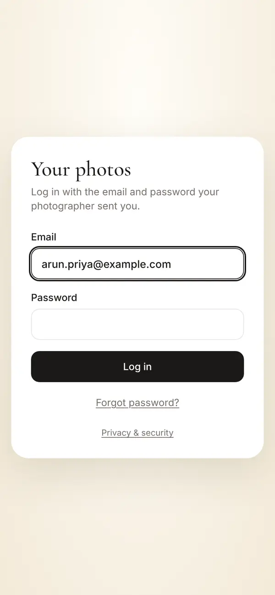
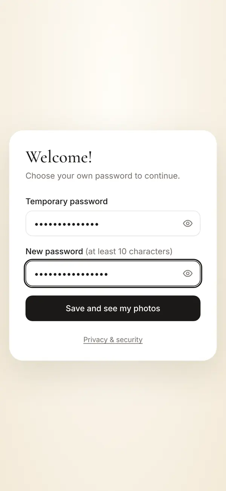
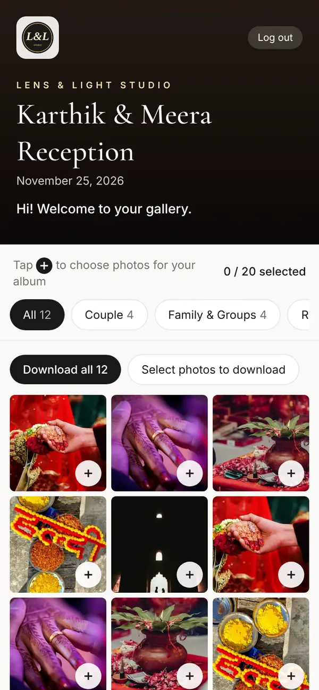
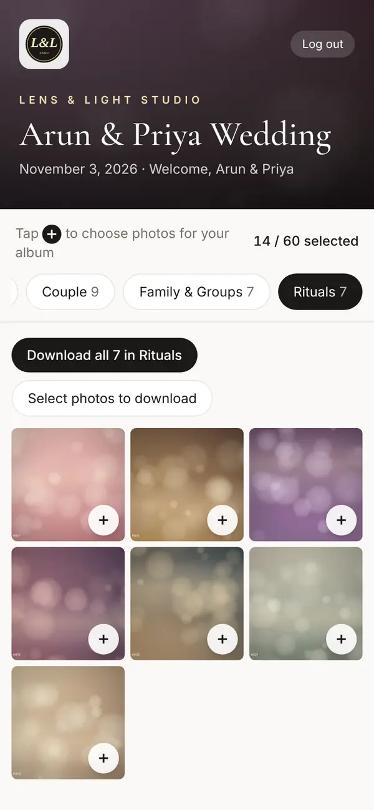
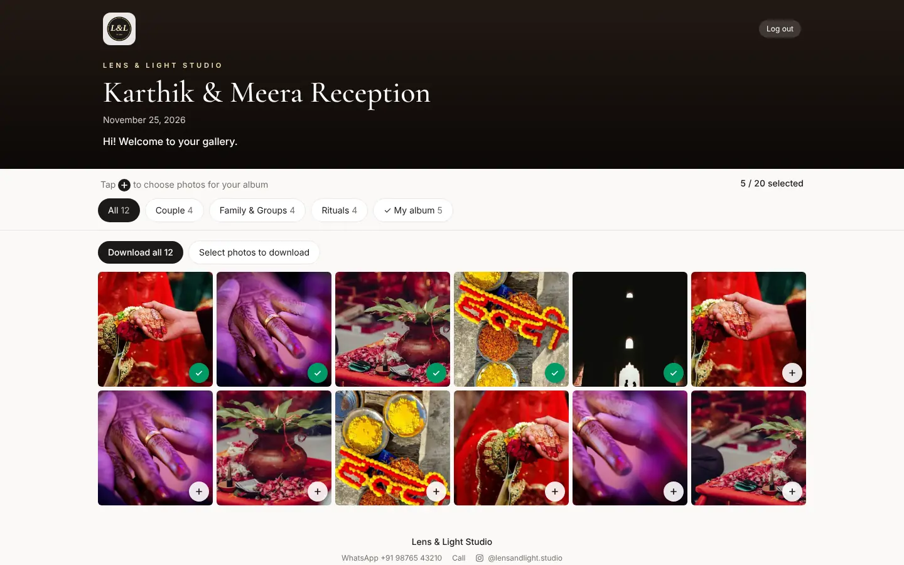
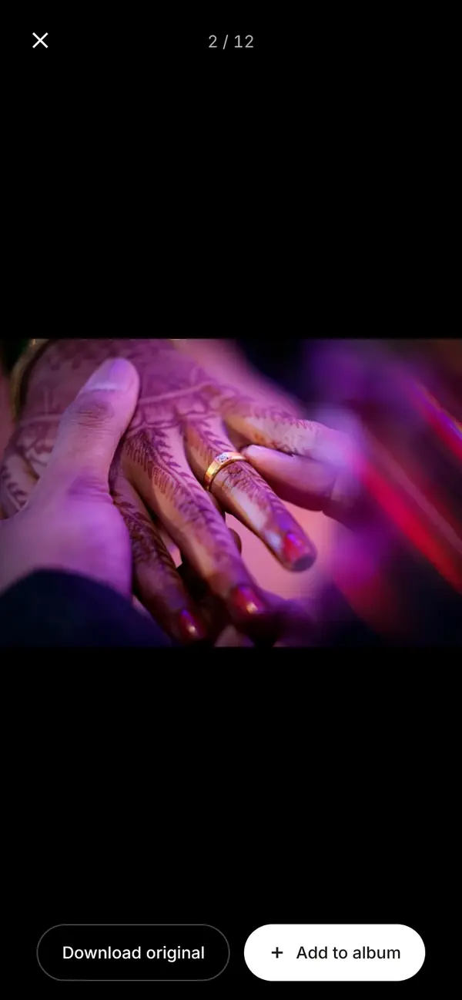
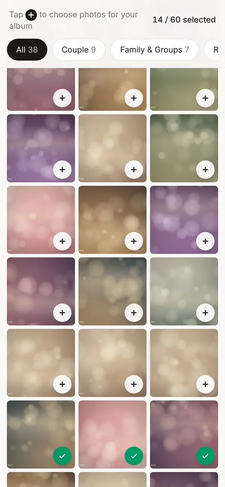
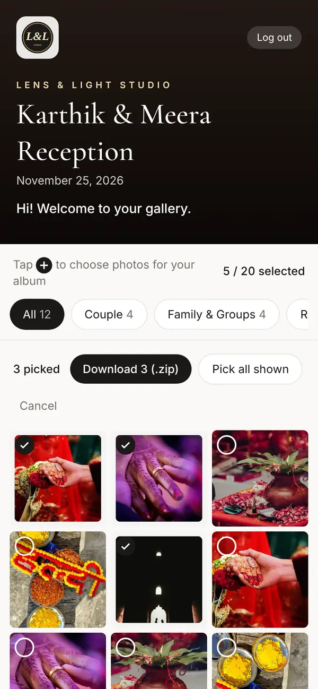
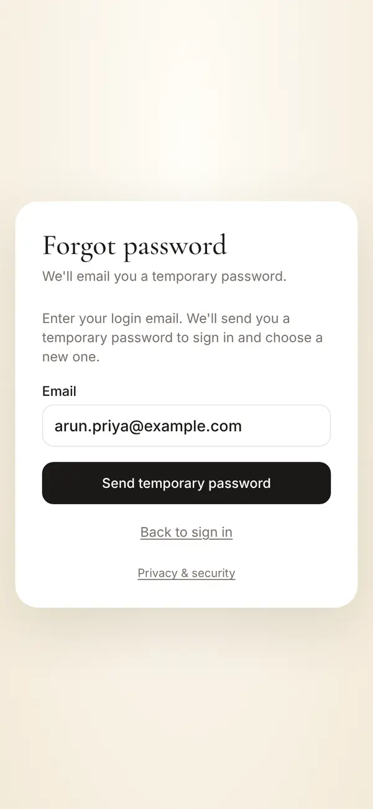

# Your photo gallery: a guide for couples

Your photographer has set up a private photo gallery for your event. This guide covers getting into your login, picking your album photos and downloading everything.

## What you get

| Feature | What it means for you |
| --- | --- |
| A private login | Only the two of you and your studio can open it, on as many phones as you like |
| Your photos, by moment | Couple, Family & Groups, Rituals, Cake cutting, Main event, Candid |
| Album picking | Tap + on your favourites; your photographer sees the picks straight away |
| Full-quality downloads | Single photos, or everything as ZIP files |

## 1. Log in for the first time

1. Your photographer sends a message with your **login email** and a **temporary password**. The link is **live.mcreatik.com/client**.
2. Enter both and tap **Log in**.

3. Choose your own password: enter the temporary password, then a new one of at least 10 characters. Tap **Save and see my photos**.

> **Tip** Add it to your home screen so it opens like an app called "My Photos": in Chrome, ⋮ → **Add to Home screen**; on iPhone Safari, Share → **Add to Home Screen**.

## 2. Find your photos

Your gallery opens with your names, the date and the studio's logo. Use the tabs to switch between moments; the number shows how many photos each has.

On a laptop it's the same, with more photos per row:

Tap any photo to see it full screen. Swipe for the next one, and pinch to zoom.

## 3. Pick your album photos

1. Tap the **+** on a photo, or **Add to album** when it's open. It turns into a green ✓.
2. The counter at the top shows how many you've picked, for example **14 / 60 selected**, if your studio set a limit.
3. Changed your mind? Tap the ✓ again to remove it. You can swap photos any time.

Your photographer sees your picks straight away. There's no need to send file numbers.

## 4. Download

- **One photo:** open it and tap **Download**.
- **A whole moment:** open its tab and tap **Download all … in [category]**.
- **Everything:** **Download all** on the All tab.
- **Some photos:** tap **Select photos to download**, tick the ones you want, then tap **Download (.zip)**. **Pick all shown** selects the whole tab.

A ZIP holds up to 1,000 photos. Very large weddings download in parts, one category at a time. A percentage shows while the ZIP is being prepared; keep the page open.

Your studio uploads your photos here in full quality, so you get the full file.

> **Warning** Photos are kept only until the **delete date** your studio set, usually 90 days after the event. Download everything you want to keep before then.

## 5. Forgot your password?

Tap **Forgot password?** on the login page and enter your login email. A temporary password arrives from connect@mcreatik.com (check spam) and works for 30 minutes. Your old password keeps working until you use the new one.

## Troubleshooting

| Problem | What to do |
| --- | --- |
| "Wrong email or password" | Check the email is the one your studio used. Use **Forgot password?**. |
| No email arrives | Check spam. Wait a few minutes, then ask your studio to tap **Send login again**. |
| "This gallery is unavailable" | Access has been switched off for now. Contact your studio. |
| Can't pick more photos | You've reached the album limit. Untick some, or ask your studio to raise it. |
| A photo we saw at the event is missing | The studio may have hidden it (blurry or a duplicate). Ask them. |
| The ZIP is slow | Big events take a few minutes. Keep the page open, or download one category at a time. |

Questions or login problems? Contact your studio: they can resend your login, raise your album limit and help with anything else.
