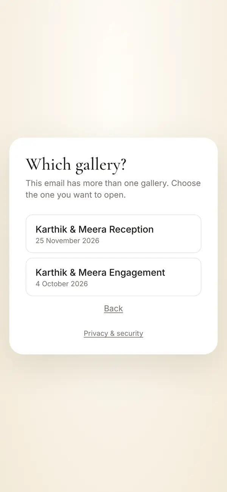
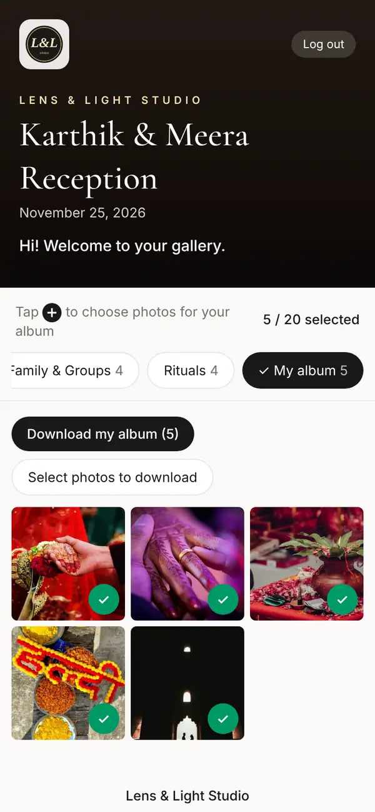
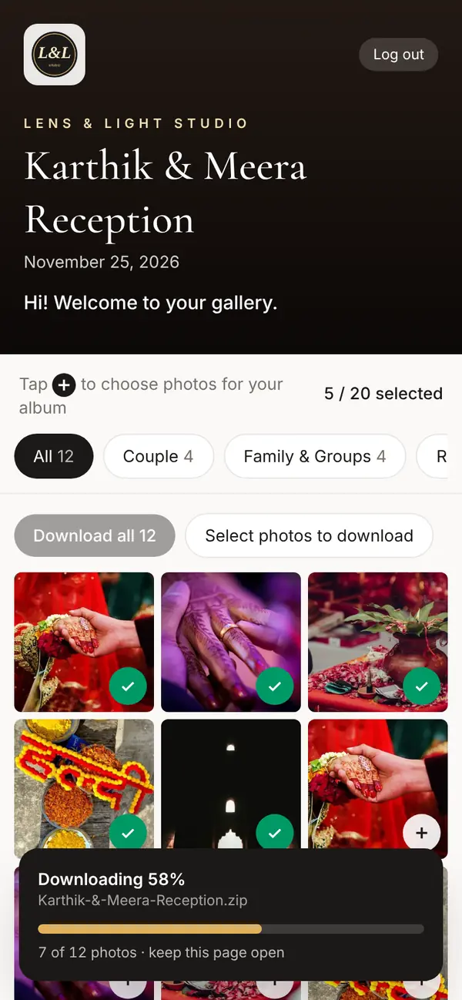
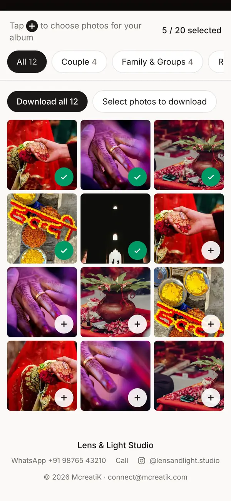

# Your private photo gallery: a guide for clients · உங்கள் தனிப்பட்ட புகைப்பட கேலரி

Your studio has made a private gallery for you. This guide shows you, step by step, how to log in, see your photos, pick your album photos and download them. It is written in English and in Tamil. Under each step you will find the Tamil version.

> **தமிழ்**
>
> உங்கள் ஸ்டுடியோ உங்களுக்காக ஒரு தனிப்பட்ட கேலரியை உருவாக்கியிருக்கிறது. உள்ளே செல்வது, புகைப்படங்களைப் பார்ப்பது, ஆல்பத்துக்குப் புகைப்படங்களைத் தேர்ந்தெடுப்பது, அவற்றைப் பதிவிறக்குவது எப்படி என்பதை இந்த வழிகாட்டி படிப்படியாகக் காட்டுகிறது. இது ஆங்கிலத்திலும் தமிழிலும் எழுதப்பட்டுள்ளது. ஒவ்வொரு படிக்கும் கீழே தமிழ் விளக்கம் உள்ளது.

## 1. What your private gallery is · தனிப்பட்ட கேலரி என்றால் என்ன

- It holds your finished photos from your studio, in full quality.
- Only you and your studio can open it. You need your login.
- It stays open for the time your studio chose.
- Your guests have a different gallery with smaller photos. They cannot see this one.

> **தமிழ்**
>
> - இதில் உங்கள் ஸ்டுடியோ கொடுத்த, முடிந்த புகைப்படங்கள் முழுத் தரத்தில் இருக்கும்.
> - நீங்களும் உங்கள் ஸ்டுடியோவும் மட்டுமே இதைத் திறக்க முடியும். இதற்கு உங்கள் உள்நுழைவு (login) தேவை.
> - உங்கள் ஸ்டுடியோ தேர்ந்தெடுத்த காலம் வரை இது திறந்திருக்கும்.
> - உங்கள் விருந்தினர்களுக்கு, சிறிய புகைப்படங்களுடன் வேறு ஒரு கேலரி உண்டு. அவர்களால் இதைப் பார்க்க முடியாது.

## 2. Log in for the first time · முதல் முறை உள்ளே செல்வது

1. Your studio sends you a message. It has three things: a **link**, your **email** and a **temporary password**.
2. Tap the link. It opens the login page for your event.
3. Type your email and the temporary password. Tap **Log in**.

4. A **Welcome!** page opens. Type the temporary password again. Then type a new password of your own. It must have at least 10 characters.
5. Tap **Save and see my photos**. Your gallery opens.

6. Next time, log in with your own password.

**Do you have more than one gallery?** For example, an engagement and a wedding with the same email. If you opened the link from your studio, that gallery opens straight away. If not, a **Which gallery?** page shows after you log in. Tap the one you want.

Good to know:

- Your partner can use the same login on their phone too.
- When you change the password, other phones are logged out. They need the new password.
- To leave, tap **Log out** at the top right.

> **Tip** Add the gallery to your home screen, so it opens like an app called "My Photos". On Android Chrome, tap the ⋮ menu, then **Add to Home screen**. On iPhone Safari, tap Share, then **Add to Home Screen**.

> **தமிழ்**
>
> 1. உங்கள் ஸ்டுடியோ ஒரு செய்தி அனுப்பும். அதில் மூன்று விஷயங்கள் இருக்கும்: ஒரு **link**, உங்கள் **email**, ஒரு **தற்காலிக password**.
> 2. அந்த link-ஐத் தொடுங்கள். உங்கள் நிகழ்வுக்கான login பக்கம் திறக்கும்.
> 3. உங்கள் email-ஐயும் தற்காலிக password-ஐயும் உள்ளிடுங்கள். **"Log in"** தொடுங்கள்.
> 4. **"Welcome!"** பக்கம் திறக்கும். தற்காலிக password-ஐ மீண்டும் உள்ளிடுங்கள். பிறகு உங்களுக்குப் பிடித்த புதிய password-ஐ உள்ளிடுங்கள். அதில் குறைந்தது 10 எழுத்துகள் இருக்க வேண்டும்.
> 5. **"Save and see my photos"** தொடுங்கள். உங்கள் கேலரி திறக்கும்.
> 6. அடுத்த முறை, உங்கள் சொந்த password-ஐப் பயன்படுத்துங்கள்.
>
> **ஒன்றுக்கு மேற்பட்ட கேலரி உள்ளதா?** உதாரணமாக, ஒரே email-இல் நிச்சயதார்த்தம், திருமணம் என இரண்டு கேலரிகள். ஸ்டுடியோ அனுப்பிய link-ஐத் திறந்தால், அந்த கேலரி நேராகத் திறக்கும். இல்லையென்றால், உள்ளே சென்றதும் **"Which gallery?"** பக்கம் வரும். உங்களுக்கு வேண்டிய கேலரியைத் தொடுங்கள்.
>
> தெரிந்துகொள்ளுங்கள்:
>
> - உங்கள் துணையும் அதே login-ஐத் தங்கள் போனில் பயன்படுத்தலாம்.
> - password-ஐ மாற்றினால், மற்ற போன்கள் வெளியேறிவிடும். அவற்றில் புதிய password-ஐ உள்ளிட வேண்டும்.
> - வெளியேற, மேலே வலது பக்கம் உள்ள **"Log out"** தொடுங்கள்.
>
> **குறிப்பு:** கேலரியை உங்கள் போனின் முகப்புத் திரையில் சேர்த்தால், அது "My Photos" என்ற app போலத் திறக்கும். Android Chrome-இல் ⋮ பட்டியைத் தொட்டு **"Add to Home screen"** தேர்ந்தெடுங்கள். iPhone Safari-இல் Share தொட்டு **"Add to Home Screen"** தேர்ந்தெடுங்கள்.

## 3. Forgot your password · password மறந்துவிட்டால்

1. On the login page, tap **Forgot password?**
2. Type your email. Tap **Send temporary password**.
3. Check your email. If you cannot see it, look in spam. The email has a new temporary password. It works for 30 minutes.
4. Log in with it. The **Welcome!** page opens. Choose a new password.

Your old password still works until you use the temporary one. If you ask again, please wait 2 minutes.

> **தமிழ்**
>
> 1. login பக்கத்தில் **"Forgot password?"** தொடுங்கள்.
> 2. உங்கள் email-ஐ உள்ளிட்டு **"Send temporary password"** தொடுங்கள்.
> 3. உங்கள் email-ஐப் பாருங்கள். காணவில்லை என்றால் spam பெட்டியைப் பாருங்கள். அந்த email-இல் ஒரு புதிய தற்காலிக password இருக்கும். அது 30 நிமிடங்கள் வேலை செய்யும்.
> 4. அதைக் கொண்டு உள்ளே செல்லுங்கள். **"Welcome!"** பக்கம் திறக்கும். புதிய password-ஐத் தேர்ந்தெடுங்கள்.
>
> தற்காலிக password-ஐப் பயன்படுத்தும் வரை உங்கள் பழைய password தொடர்ந்து வேலை செய்யும். மீண்டும் கேட்க வேண்டுமானால், 2 நிமிடம் காத்திருங்கள்.

## 4. Look at your photos · புகைப்படங்களைப் பார்ப்பது

1. At the top you see your event name and date.
2. Below that are **tabs**. Tap a tab to see one part of the day, such as Couple or Rituals. The number tells you how many photos are in it.
3. **All** shows every photo. **More** shows photos that are not in any tab. **My album** shows the photos you picked.
4. Scroll down to see more. The photos are in the order the day happened.

5. Tap a photo to open it full screen.
6. **Swipe** left or right to see the next or the earlier photo. **Pinch** with two fingers to zoom in.
7. Tap the **✕** at the top left to go back.

On a laptop, it is the same, with more photos in each row. Click a photo to open it. Use the arrow keys to move to the next photo.

> **தமிழ்**
>
> 1. மேலே உங்கள் நிகழ்வின் பெயரும் தேதியும் தெரியும்.
> 2. அதற்குக் கீழே **tabs** இருக்கும். ஒரு tab-ஐத் தொட்டால், நாளின் ஒரு பகுதியை மட்டும் பார்க்கலாம், உதாரணமாக Couple அல்லது Rituals. அதில் எத்தனை புகைப்படங்கள் உள்ளன என்பதை எண் காட்டும்.
> 3. **"All"** எல்லாப் புகைப்படங்களையும் காட்டும். **"More"** எந்த tab-இலும் சேராத புகைப்படங்களைக் காட்டும். **"My album"** நீங்கள் தேர்ந்தெடுத்த புகைப்படங்களைக் காட்டும்.
> 4. மேலும் பார்க்க கீழே நகருங்கள். புகைப்படங்கள் அன்றைய நிகழ்வு நடந்த வரிசையில் இருக்கும்.
> 5. ஒரு புகைப்படத்தைத் தொட்டால் முழுத் திரையில் திறக்கும்.
> 6. அடுத்த அல்லது முந்தைய புகைப்படத்தைப் பார்க்க இடப்பக்கம் அல்லது வலப்பக்கம் **swipe** செய்யுங்கள். பெரிதாக்க இரண்டு விரல்களால் **pinch** செய்யுங்கள்.
> 7. திரும்பிச் செல்ல மேலே இடது பக்கம் உள்ள **✕** தொடுங்கள்.
>
> லேப்டாப்பில் இதே போலத்தான், ஒவ்வொரு வரிசையிலும் அதிகப் புகைப்படங்கள் தெரியும். புகைப்படத்தைத் திறக்க அதன் மீது click செய்யுங்கள். அடுத்த புகைப்படத்துக்குச் செல்ல அம்புக்குறி விசைகளைப் பயன்படுத்துங்கள்.

## 5. Pick your album photos · ஆல்பத்துக்குப் புகைப்படங்களைத் தேர்ந்தெடுப்பது

1. Tap the round **+** button on a photo. It turns into a green **✓**. The photo is now in your album. You can also tap **Add to album** when a photo is open full screen.
2. Changed your mind? Tap the green **✓** again. The photo leaves your album.
3. At the top right, a counter shows how many you picked. For example, **5 / 20 selected** means you picked 5 and your studio allows 20. If your studio did not set a limit, it only shows the number you picked.
4. Tap the **My album** tab to see only your picks.

**If your studio set a limit:** when you reach it, the **+** buttons turn grey. You cannot add more. The page says: "Your album already has 20 photos. Unselect one to choose another." Take one photo out, and then you can add another.

**Your studio sees your picks at once.** You do not need to send photo numbers. You and your partner share one album list, so if one of you picks a photo, the other sees it too.

> **தமிழ்**
>
> 1. புகைப்படத்தின் மேல் உள்ள வட்டமான **+** பொத்தானைத் தொடுங்கள். அது பச்சை **✓** ஆக மாறும். அந்தப் புகைப்படம் இப்போது உங்கள் ஆல்பத்தில் உள்ளது. புகைப்படம் முழுத் திரையில் இருக்கும்போது **"Add to album"** தொடுவதும் வேலை செய்யும்.
> 2. மனம் மாறிவிட்டதா? பச்சை **✓** ஐ மீண்டும் தொடுங்கள். அந்தப் புகைப்படம் ஆல்பத்திலிருந்து நீங்கிவிடும்.
> 3. மேலே வலது பக்கம் ஒரு எண் காட்டி, நீங்கள் எத்தனை தேர்ந்தெடுத்தீர்கள் என்று காட்டும். உதாரணமாக, **"5 / 20 selected"** என்றால் நீங்கள் 5 தேர்ந்தெடுத்திருக்கிறீர்கள், உங்கள் ஸ்டுடியோ 20 வரை அனுமதிக்கிறது. ஸ்டுடியோ எந்த வரம்பும் வைக்கவில்லை என்றால், நீங்கள் தேர்ந்தெடுத்த எண்ணிக்கை மட்டும் தெரியும்.
> 4. நீங்கள் தேர்ந்தெடுத்தவற்றை மட்டும் பார்க்க **"My album"** tab-ஐத் தொடுங்கள்.
>
> **உங்கள் ஸ்டுடியோ வரம்பு வைத்திருந்தால்:** அந்த வரம்பை அடைந்ததும் **+** பொத்தான்கள் சாம்பல் நிறமாகிவிடும். மேலும் சேர்க்க முடியாது. "Your album already has 20 photos. Unselect one to choose another." என்று செய்தி வரும். ஒரு புகைப்படத்தை நீக்கினால், வேறொன்றைச் சேர்க்கலாம்.
>
> **உங்கள் தேர்வுகளை ஸ்டுடியோ உடனே பார்க்கும்.** புகைப்பட எண்களை அனுப்ப வேண்டியதில்லை. நீங்களும் உங்கள் துணையும் ஒரே ஆல்பம் பட்டியலைப் பகிர்கிறீர்கள். ஒருவர் ஒரு புகைப்படத்தைத் தேர்ந்தெடுத்தால், மற்றவருக்கும் அது தெரியும்.

## 6. Download your photos · புகைப்படங்களைப் பதிவிறக்குவது

Your photos are in full quality. What you download is the same file your studio made.

**One photo**

1. Tap the photo to open it.
2. Tap **Download original**. The photo saves to your phone or laptop. (If the button says only **Download**, you get the gallery copy of that photo. Ask your studio for the full-quality file.)

**Many photos as a ZIP file.** A ZIP file is one file that holds many photos. Choose what you want:

- **Everything:** on the **All** tab, tap **Download all**.
- **One part of the day:** open its tab, then tap **Download all … in** that tab.
- **Your album:** open **My album**, then tap **Download my album**.
- **Some photos:** tap **Select photos to download**. Tap the photos you want. Then tap **Download (.zip)**. **Pick all shown** picks every photo on the screen. **Cancel** stops.

What happens next:

1. A card appears at the bottom: **Preparing your download…**
2. Then the download starts by itself. The card shows a percentage, for example **Downloading 58%**. If your phone asks, tap **Download**.
3. Keep the page open until the card says **Download complete ✓**.
4. If the card says **Waiting for other downloads to finish…**, just wait. It starts by itself.
5. If it says **Download stopped**, tap **✕** and try again.

One ZIP holds up to 1,000 photos. If a tab has more, download it in parts: pick photos with **Select photos to download**, or use the smaller tabs.

**On a phone**

- The ZIP saves in your **Downloads** folder. On iPhone, open the **Files** app.
- Tap the ZIP file once to open it. Your phone makes a folder of photos.
- Use Wi-Fi for big downloads. Keep the screen on and the page open.

**On a laptop**

- The ZIP saves in your **Downloads** folder.
- Double-click it to open. On Windows, right-click it and choose **Extract All**.
- A laptop is best for a big download, such as all your photos.

> **தமிழ்**
>
> உங்கள் புகைப்படங்கள் முழுத் தரத்தில் உள்ளன. நீங்கள் பதிவிறக்குவது, உங்கள் ஸ்டுடியோ உருவாக்கிய அதே கோப்புதான்.
>
> **ஒரு புகைப்படம்**
>
> 1. புகைப்படத்தைத் தொட்டுத் திறங்கள்.
> 2. **"Download original"** தொடுங்கள். புகைப்படம் உங்கள் போனில் அல்லது லேப்டாப்பில் சேமிக்கப்படும். (பொத்தானில் **"Download"** என்று மட்டும் இருந்தால், அந்தப் புகைப்படத்தின் கேலரி நகல் கிடைக்கும். முழுத் தரக் கோப்புக்கு உங்கள் ஸ்டுடியோவிடம் கேளுங்கள்.)
>
> **பல புகைப்படங்களை ZIP கோப்பாக.** ZIP கோப்பு என்பது பல புகைப்படங்களை ஒரே கோப்பாக வைத்திருக்கும். உங்களுக்கு வேண்டியதைத் தேர்ந்தெடுங்கள்:
>
> - **எல்லாம்:** **"All"** tab-இல் **"Download all"** தொடுங்கள்.
> - **நாளின் ஒரு பகுதி:** அதன் tab-ஐத் திறந்து, **"Download all … in"** அந்த tab-ஐத் தொடுங்கள்.
> - **உங்கள் ஆல்பம்:** **"My album"** திறந்து, **"Download my album"** தொடுங்கள்.
> - **சில புகைப்படங்கள்:** **"Select photos to download"** தொடுங்கள். வேண்டிய புகைப்படங்களைத் தொடுங்கள். பிறகு **"Download (.zip)"** தொடுங்கள். **"Pick all shown"** திரையில் உள்ள எல்லாவற்றையும் தேர்ந்தெடுக்கும். **"Cancel"** நிறுத்தும்.
>
> அடுத்து என்ன நடக்கும்:
>
> 1. கீழே ஒரு அட்டை தோன்றும்: **"Preparing your download…"**
> 2. பிறகு பதிவிறக்கம் தானாகவே தொடங்கும். அட்டையில் சதவீதம் தெரியும், உதாரணமாக **"Downloading 58%"**. உங்கள் போன் கேட்டால், **"Download"** தொடுங்கள்.
> 3. அட்டையில் **"Download complete ✓"** என்று வரும் வரை பக்கத்தைத் திறந்தே வைத்திருங்கள்.
> 4. அட்டையில் **"Waiting for other downloads to finish…"** என்று இருந்தால், காத்திருங்கள். அது தானாகத் தொடங்கும்.
> 5. **"Download stopped"** என்று வந்தால், **✕** தொட்டு மீண்டும் முயற்சி செய்யுங்கள்.
>
> ஒரு ZIP-இல் 1,000 புகைப்படங்கள் வரை இருக்கலாம். ஒரு tab-இல் அதற்கு மேல் இருந்தால், பகுதி பகுதியாகப் பதிவிறக்குங்கள்: **"Select photos to download"** மூலம் தேர்ந்தெடுங்கள், அல்லது சிறிய tab-களைப் பயன்படுத்துங்கள்.
>
> **போனில்**
>
> - ZIP உங்கள் **Downloads** folder-இல் சேமிக்கப்படும். iPhone-இல் **Files** app-ஐத் திறங்கள்.
> - ZIP கோப்பை ஒரு முறை தொட்டால் திறக்கும். உங்கள் போன் புகைப்படங்களுக்கான ஒரு folder-ஐ உருவாக்கும்.
> - பெரிய பதிவிறக்கங்களுக்கு Wi-Fi பயன்படுத்துங்கள். திரையை அணைக்காமல், பக்கத்தைத் திறந்தே வையுங்கள்.
>
> **லேப்டாப்பில்**
>
> - ZIP உங்கள் **Downloads** folder-இல் சேமிக்கப்படும்.
> - அதன் மீது double-click செய்தால் திறக்கும். Windows-இல் right-click செய்து **"Extract All"** தேர்ந்தெடுங்கள்.
> - எல்லாப் புகைப்படங்களும் போன்ற பெரிய பதிவிறக்கத்துக்கு லேப்டாப் சிறந்தது.

## 7. How long it stays open · எவ்வளவு காலம் திறந்திருக்கும்

Your gallery stays open for the time your studio chose. Ask your studio for the exact last day.

> **Warning** Your photos are deleted 30 days after the gallery period ends. After that, nobody can get them back. Download everything you want to keep before then. We suggest you also save a copy on a second place, such as a hard drive or Google Drive.

If you open the gallery after the last day, you see "This gallery has expired". Please contact your studio.

> **தமிழ்**
>
> உங்கள் ஸ்டுடியோ தேர்ந்தெடுத்த காலம் வரை உங்கள் கேலரி திறந்திருக்கும். கடைசி நாள் எது என்பதை உங்கள் ஸ்டுடியோவிடம் கேளுங்கள்.
>
> **எச்சரிக்கை:** கேலரி காலம் முடிந்து 30 நாட்களுக்குப் பிறகு உங்கள் புகைப்படங்கள் நீக்கப்படும். அதன் பிறகு யாராலும் அவற்றை மீட்க முடியாது. அதற்கு முன்பே, நீங்கள் வைத்திருக்க விரும்பும் எல்லாவற்றையும் பதிவிறக்குங்கள். ஹார்டு டிரைவ் அல்லது Google Drive போன்ற இன்னொரு இடத்திலும் ஒரு நகல் வைத்துக்கொள்ளுங்கள்.
>
> கடைசி நாளுக்குப் பிறகு கேலரியைத் திறந்தால், "This gallery has expired" என்று வரும். உங்கள் ஸ்டுடியோவைத் தொடர்பு கொள்ளுங்கள்.

## 8. Need help · உதவி வேண்டுமா

Please contact your studio. They can send your login again, change your album limit, and answer any question about your photos.

At the bottom of your gallery you find your studio's name, **WhatsApp**, **Call** and Instagram. Tap one to reach them.

Common problems:

- **"Email or password is not correct":** check that you typed the email your studio used. Or tap **Forgot password?**
- **No email after "Forgot password?":** look in spam. Wait a few minutes. Then ask your studio to send your login again.
- **"This gallery is unavailable":** your studio has switched it off for now. Contact your studio.
- **The gallery is empty:** your studio adds your finished photos after the event. Ask when they will be ready.
- **A photo you saw at the event is missing:** guests see the live photos. This gallery has the finished photos. Ask your studio.
- **I cannot add more photos to my album:** you reached the limit. Take one out, or ask your studio to raise the limit.
- **The download is slow:** big downloads take a few minutes. Keep the page open, or download one tab at a time.

> **தமிழ்**
>
> உங்கள் ஸ்டுடியோவைத் தொடர்பு கொள்ளுங்கள். அவர்கள் உங்கள் login-ஐ மீண்டும் அனுப்பலாம், ஆல்பம் வரம்பை மாற்றலாம், உங்கள் புகைப்படங்கள் பற்றிய எந்தக் கேள்விக்கும் பதில் சொல்லலாம்.
>
> கேலரியின் கீழே உங்கள் ஸ்டுடியோவின் பெயர், **WhatsApp**, **Call**, Instagram இருக்கும். அவற்றில் ஒன்றைத் தொட்டு அவர்களைத் தொடர்பு கொள்ளலாம்.
>
> பொதுவான பிரச்சினைகள்:
>
> - **"Email or password is not correct":** உங்கள் ஸ்டுடியோ பயன்படுத்திய email-ஐத்தான் உள்ளிட்டிருக்கிறீர்களா என்று பாருங்கள். அல்லது **"Forgot password?"** தொடுங்கள்.
> - **"Forgot password?" பிறகும் email வரவில்லை:** spam பெட்டியைப் பாருங்கள். சில நிமிடங்கள் காத்திருங்கள். பிறகும் வரவில்லை என்றால், login-ஐ மீண்டும் அனுப்பச் சொல்லி ஸ்டுடியோவிடம் கேளுங்கள்.
> - **"This gallery is unavailable":** உங்கள் ஸ்டுடியோ இப்போதைக்கு அதை நிறுத்தி வைத்திருக்கிறது. ஸ்டுடியோவைத் தொடர்பு கொள்ளுங்கள்.
> - **கேலரி காலியாக உள்ளது:** நிகழ்வுக்குப் பிறகு உங்கள் ஸ்டுடியோ முடிந்த புகைப்படங்களைச் சேர்க்கும். எப்போது தயாராகும் என்று கேளுங்கள்.
> - **நிகழ்வில் பார்த்த ஒரு புகைப்படம் இல்லை:** விருந்தினர்கள் நேரடிப் புகைப்படங்களைப் பார்க்கிறார்கள். இந்த கேலரியில் முடிந்த புகைப்படங்கள் உள்ளன. உங்கள் ஸ்டுடியோவிடம் கேளுங்கள்.
> - **ஆல்பத்தில் மேலும் சேர்க்க முடியவில்லை:** வரம்பை அடைந்துவிட்டீர்கள். ஒன்றை நீக்குங்கள், அல்லது வரம்பை உயர்த்தச் சொல்லி ஸ்டுடியோவிடம் கேளுங்கள்.
> - **பதிவிறக்கம் மெதுவாக உள்ளது:** பெரிய பதிவிறக்கங்களுக்குச் சில நிமிடங்கள் ஆகும். பக்கத்தைத் திறந்தே வையுங்கள், அல்லது ஒரு tab-ஆக ஒவ்வொன்றாகப் பதிவிறக்குங்கள்.
