# Your private photo gallery: a guide for clients

Your studio has made a private gallery for you. This guide shows you, step by step, how to log in, see your photos, pick your album photos and download them.

## 1. What your private gallery is

- It holds your finished photos from your studio, in full quality.
- Only you and your studio can open it. You need your login.
- It stays open for the time your studio chose.
- Your guests have a different gallery with smaller photos. They cannot see this one.

## 2. Log in for the first time

1. Your studio sends you a message. It has three things: a **link**, your **email** and a **temporary password**.
2. Tap the link. It opens the login page for your event.
3. Type your email and the temporary password. Tap **Log in**.

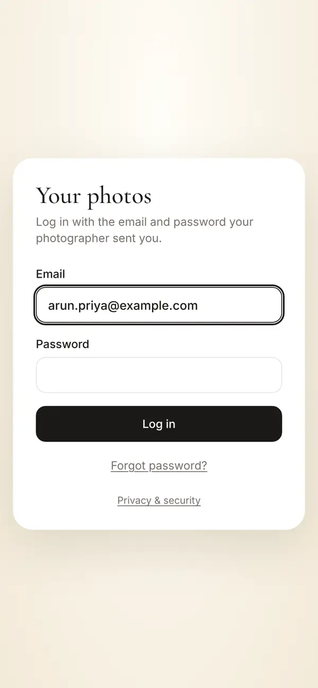

4. A **Welcome!** page opens. Type the temporary password again. Then type a new password of your own. It must have at least 10 characters.
5. Tap **Save and see my photos**. Your gallery opens.

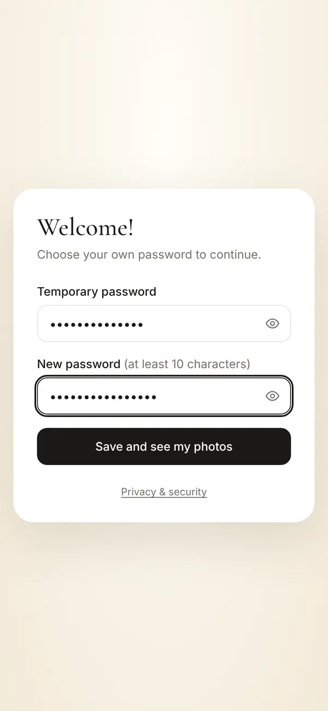

6. Next time, log in with your own password.

**Do you have more than one gallery?** For example, an engagement and a wedding with the same email. If you opened the link from your studio, that gallery opens straight away. If not, a **Which gallery?** page shows after you log in. Tap the one you want.

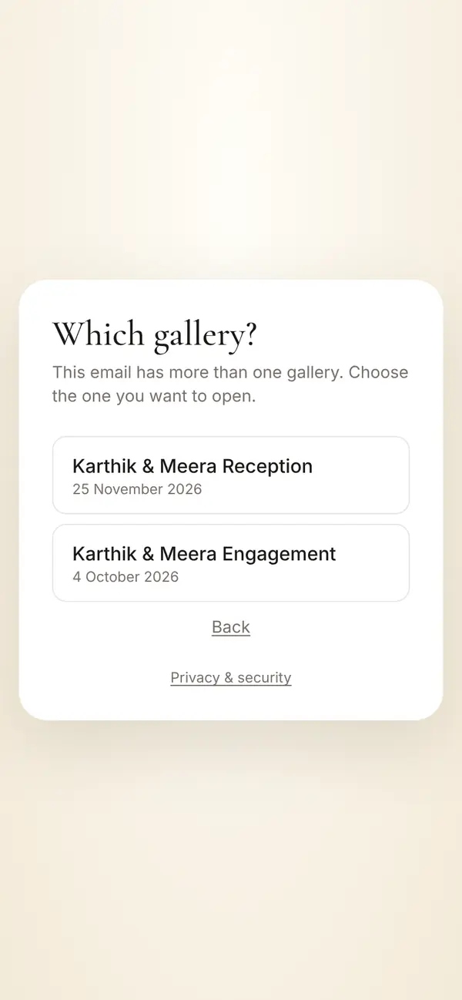

Good to know:

- Your partner can use the same login on their phone too.
- When you change the password, other phones are logged out. They need the new password.
- To leave, tap **Log out** at the top right.

> **Tip** Add the gallery to your home screen, so it opens like an app called "My Photos". On Android Chrome, tap the ⋮ menu, then **Add to Home screen**. On iPhone Safari, tap Share, then **Add to Home Screen**.

## 3. Forgot your password

1. On the login page, tap **Forgot password?**
2. Type your email. Tap **Send temporary password**.
3. Check your email. If you cannot see it, look in spam. The email has a new temporary password. It works for 30 minutes.
4. Log in with it. The **Welcome!** page opens. Choose a new password.

Your old password still works until you use the temporary one. If you ask again, please wait 2 minutes.

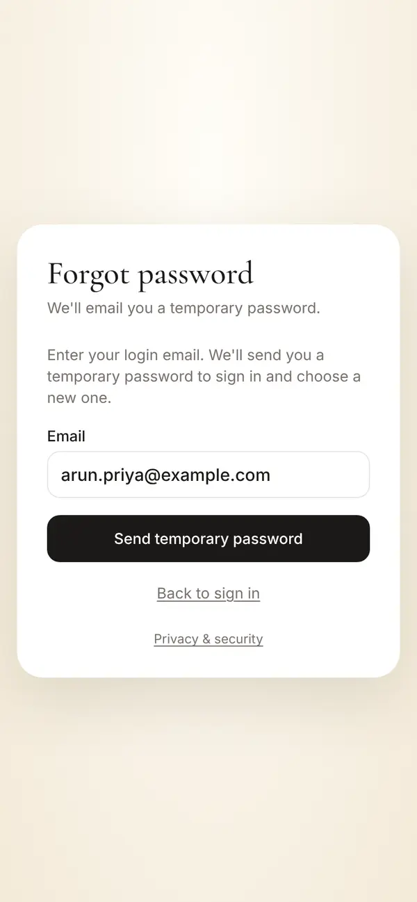

## 4. Look at your photos

1. At the top you see your event name and date.
2. Below that are **tabs**. Tap a tab to see one part of the day, such as Couple or Rituals. The number tells you how many photos are in it.
3. **All** shows every photo. **More** shows photos that are not in any tab. **My album** shows the photos you picked.
4. Scroll down to see more. The photos are in the order the day happened.

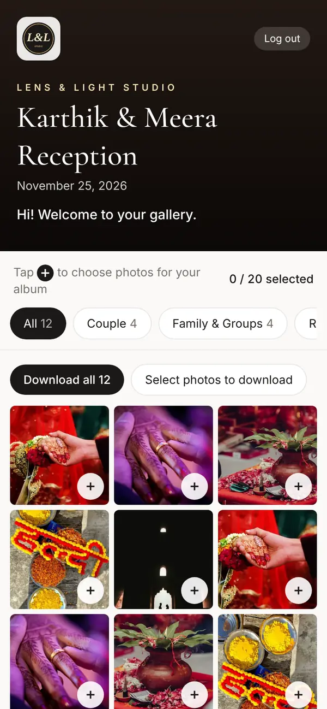

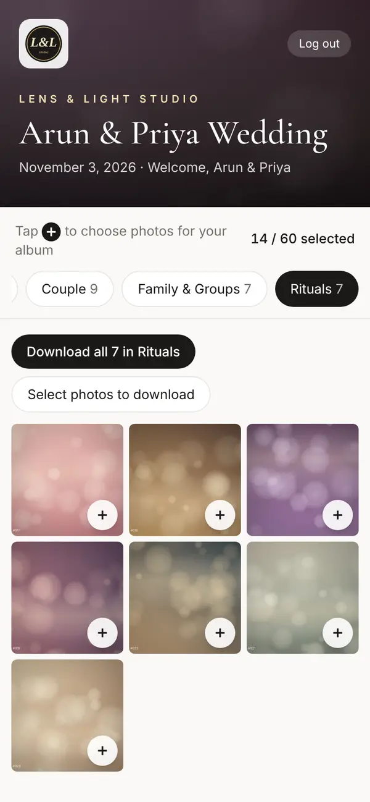

5. Tap a photo to open it full screen.
6. **Swipe** left or right to see the next or the earlier photo. **Pinch** with two fingers to zoom in.
7. Tap the **✕** at the top left to go back.

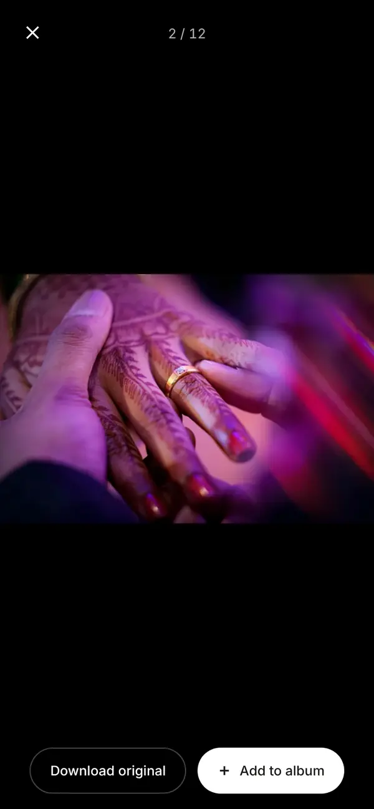

On a laptop, it is the same, with more photos in each row. Click a photo to open it. Use the arrow keys to move to the next photo.

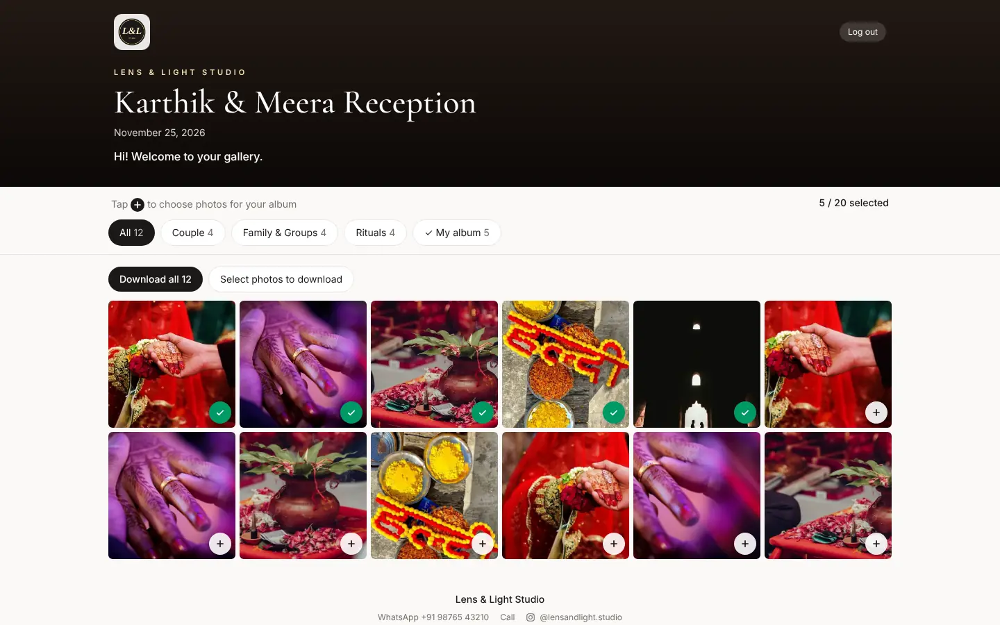

## 5. Pick your album photos

1. Tap the round **+** button on a photo. It turns into a green **✓**. The photo is now in your album. You can also tap **Add to album** when a photo is open full screen.
2. Changed your mind? Tap the green **✓** again. The photo leaves your album.
3. At the top right, a counter shows how many you picked. For example, **5 / 20 selected** means you picked 5 and your studio allows 20. If your studio did not set a limit, it only shows the number you picked.
4. Tap the **My album** tab to see only your picks.

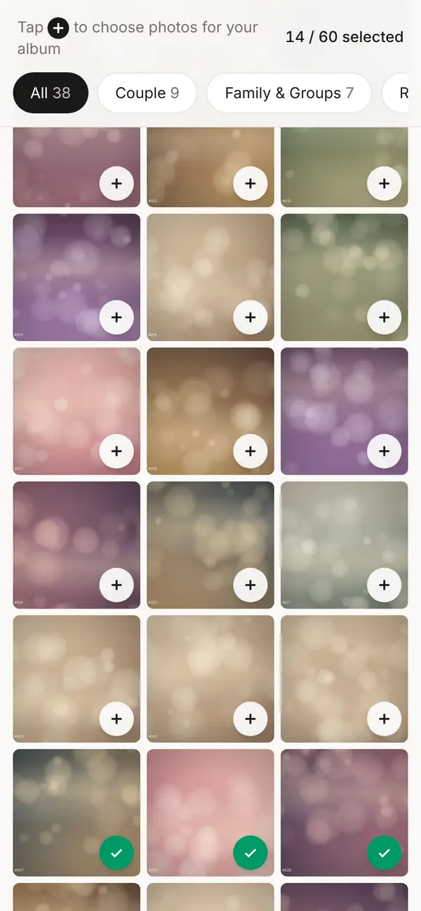

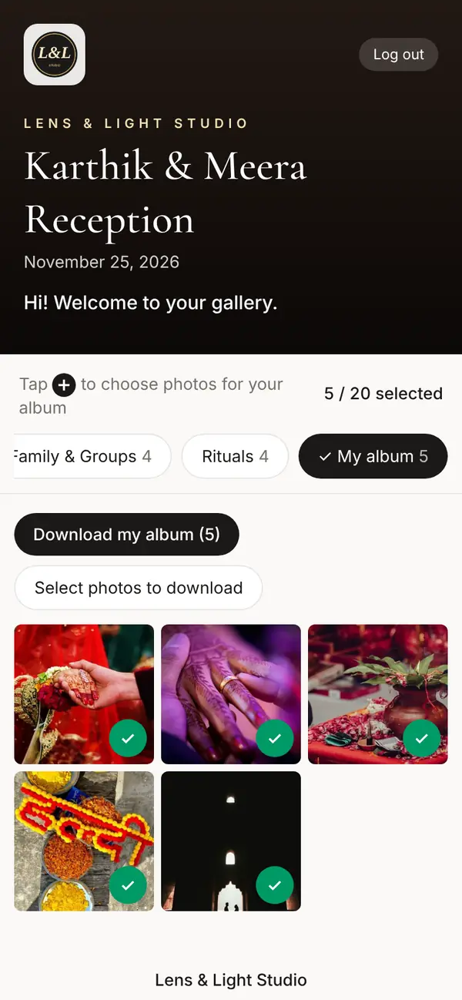

**If your studio set a limit:** when you reach it, the **+** buttons turn grey. You cannot add more. The page says: "Your album already has 20 photos. Unselect one to choose another." Take one photo out, and then you can add another.

**Your studio sees your picks at once.** You do not need to send photo numbers. You and your partner share one album list, so if one of you picks a photo, the other sees it too.

## 6. Download your photos

Your photos are in full quality. What you download is the same file your studio made.

**One photo**

1. Tap the photo to open it.
2. Tap **Download original**. The photo saves to your phone or laptop. (If the button says only **Download**, you get the gallery copy of that photo. Ask your studio for the full-quality file.)

**Many photos as a ZIP file.** A ZIP file is one file that holds many photos. Choose what you want:

- **Everything:** on the **All** tab, tap **Download all**.
- **One part of the day:** open its tab, then tap **Download all … in** that tab.
- **Your album:** open **My album**, then tap **Download my album**.
- **Some photos:** tap **Select photos to download**. Tap the photos you want. Then tap **Download (.zip)**. **Pick all shown** picks every photo on the screen. **Cancel** stops.

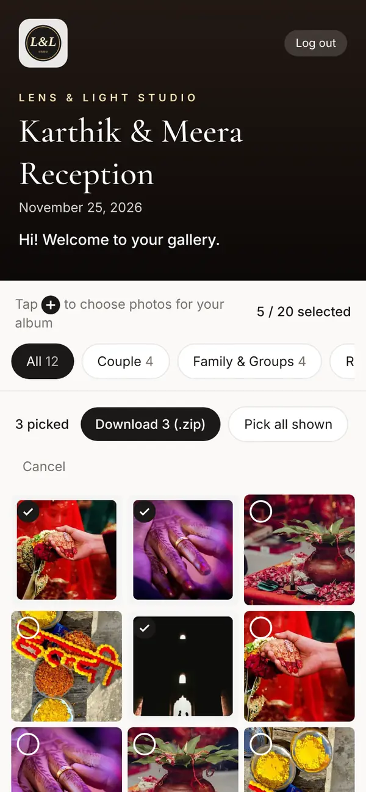

What happens next:

1. A card appears at the bottom: **Preparing your download…**
2. Then the download starts by itself. The card shows a percentage, for example **Downloading 58%**. If your phone asks, tap **Download**.
3. Keep the page open until the card says **Download complete ✓**.
4. If the card says **Waiting for other downloads to finish…**, just wait. It starts by itself.
5. If it says **Download stopped**, tap **✕** and try again.

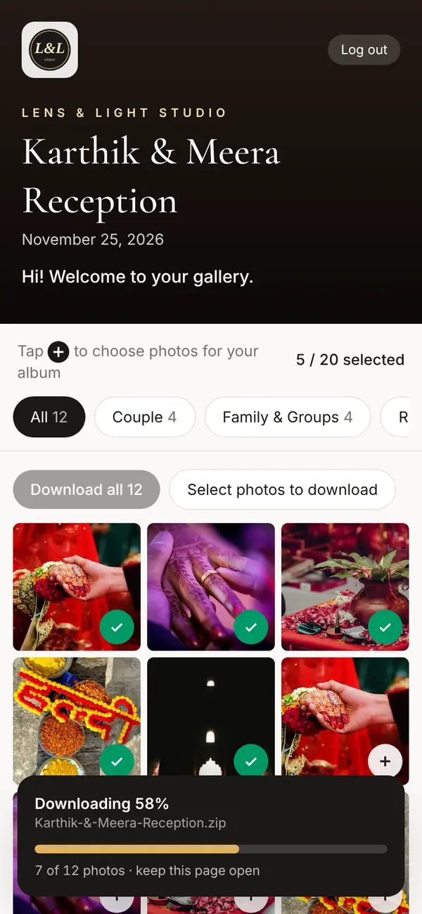

One ZIP holds up to 1,000 photos. If a tab has more, download it in parts: pick photos with **Select photos to download**, or use the smaller tabs.

**On a phone**

- The ZIP saves in your **Downloads** folder. On iPhone, open the **Files** app.
- Tap the ZIP file once to open it. Your phone makes a folder of photos.
- Use Wi-Fi for big downloads. Keep the screen on and the page open.

**On a laptop**

- The ZIP saves in your **Downloads** folder.
- Double-click it to open. On Windows, right-click it and choose **Extract All**.
- A laptop is best for a big download, such as all your photos.

## 7. How long it stays open

Your gallery stays open for the time your studio chose. Ask your studio for the exact last day.

> **Warning** Your photos are deleted 30 days after the gallery period ends. After that, nobody can get them back. Download everything you want to keep before then. We suggest you also save a copy on a second place, such as a hard drive or Google Drive.

If you open the gallery after the last day, you see "This gallery has expired". Please contact your studio.

## 8. Need help

Please contact your studio. They can send your login again, change your album limit, and answer any question about your photos.

At the bottom of your gallery you find your studio's name, **WhatsApp**, **Call** and Instagram. Tap one to reach them.

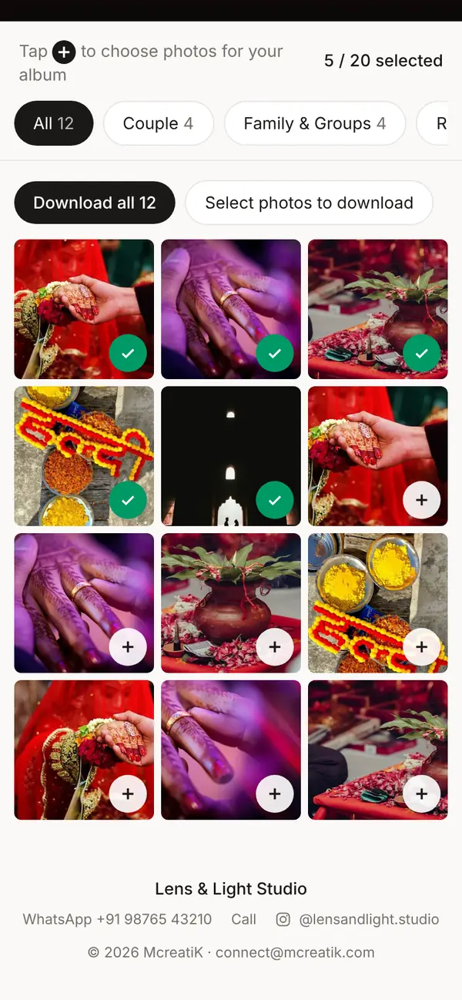

Common problems:

- **"Email or password is not correct":** check that you typed the email your studio used. Or tap **Forgot password?**
- **No email after "Forgot password?":** look in spam. Wait a few minutes. Then ask your studio to send your login again.
- **"This gallery is unavailable":** your studio has switched it off for now. Contact your studio.
- **The gallery is empty:** your studio adds your finished photos after the event. Ask when they will be ready.
- **A photo you saw at the event is missing:** guests see the live photos. This gallery has the finished photos. Ask your studio.
- **I cannot add more photos to my album:** you reached the limit. Take one out, or ask your studio to raise the limit.
- **The download is slow:** big downloads take a few minutes. Keep the page open, or download one tab at a time.
