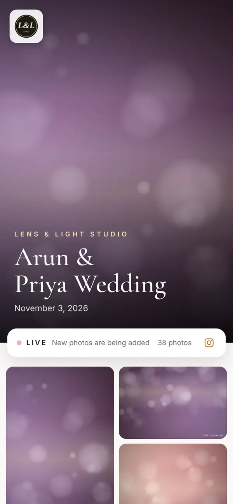
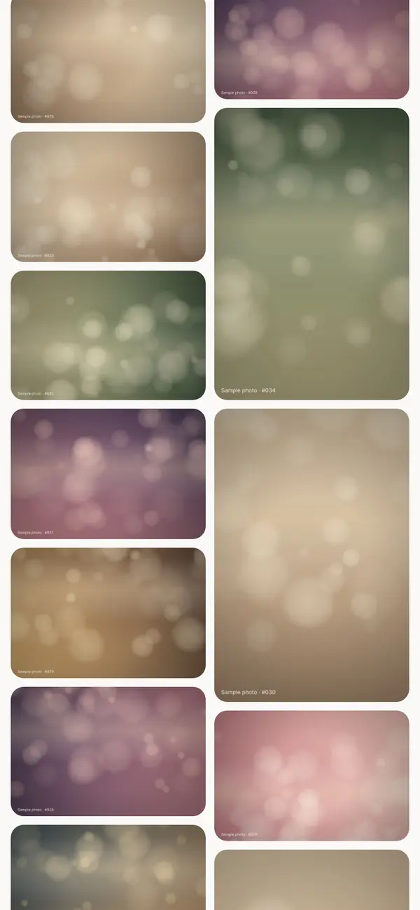
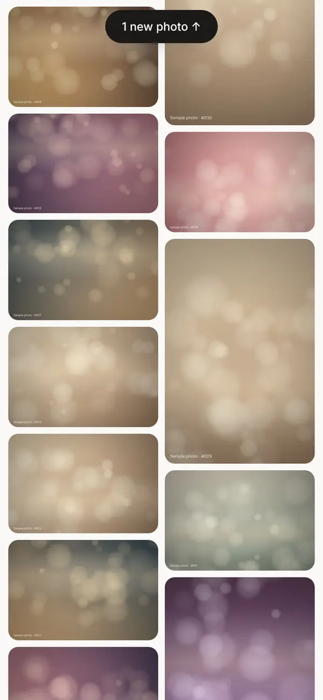
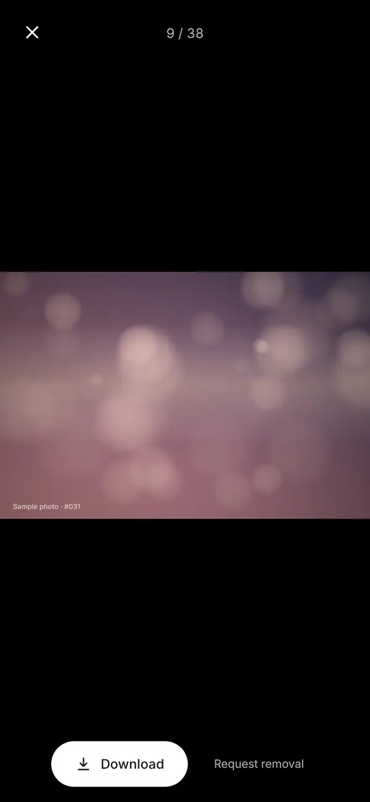
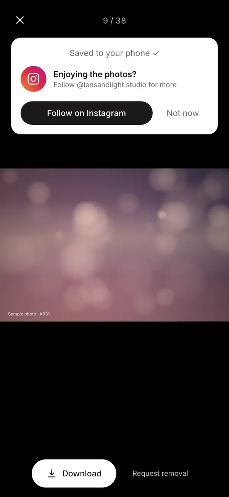
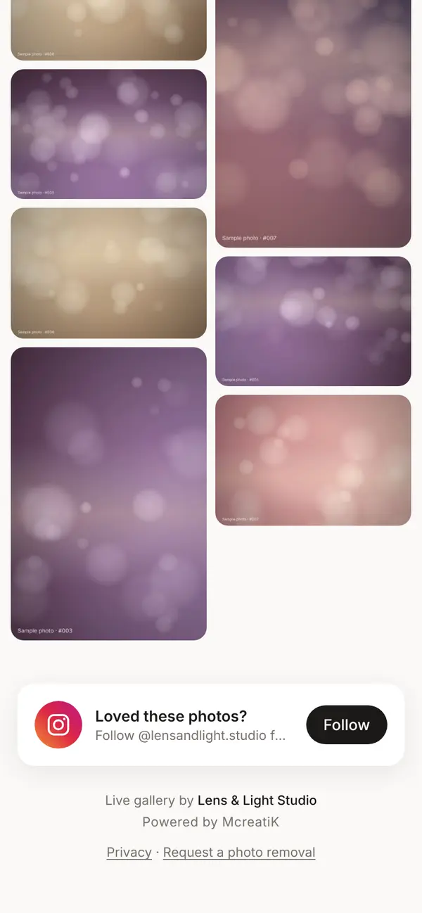
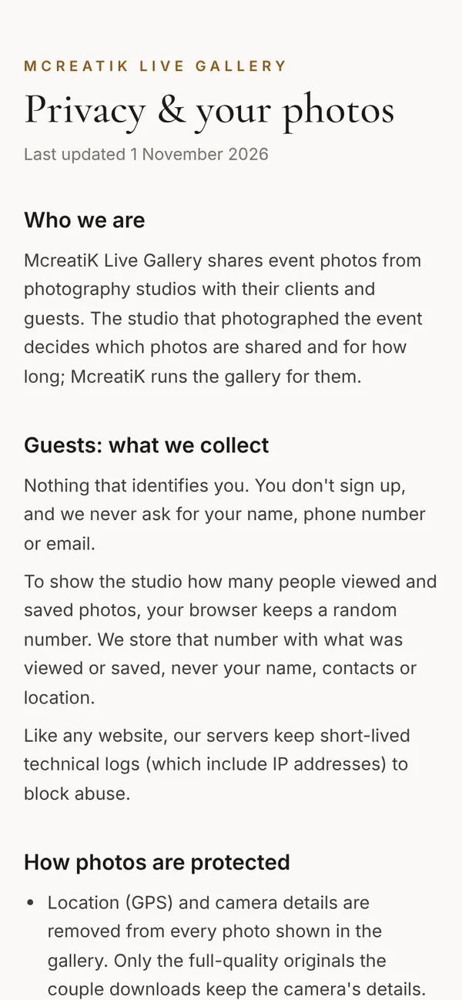
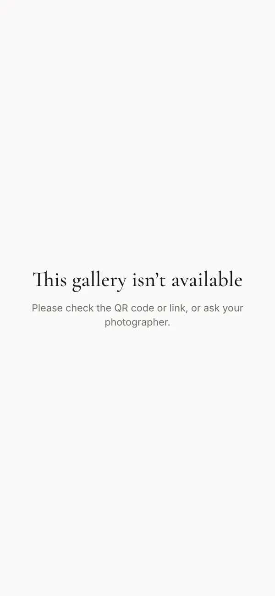
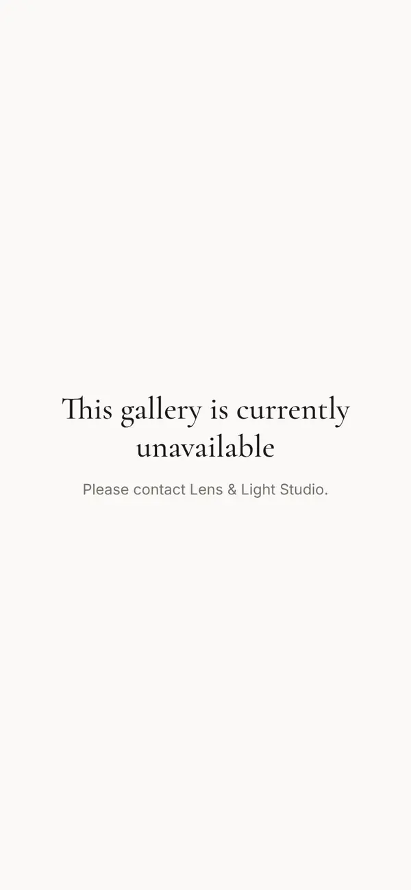

# Guest SOP

This is the guide for **guests**: everyone at the event who scans the QR code. There's no app, no sign-up and no login. Studios can share this page with event planners, or print its key lines on table cards. "You" means the guest.

> **Tip** Table card text you can copy: "**Scan to see the photos live.** Point your phone camera at the code. No app needed. New photos appear on their own."

## 1. Open the gallery

1. Point your phone's camera at the **QR code** on the poster or table card, and tap the link that appears.
2. The gallery opens in your browser with the couple's names, the studio's logo and a **LIVE** badge while photos are being added.

There's nothing to install, and you're never asked for your name, number or email.

## 2. Watch photos arrive

Keep the page open. New photos appear by themselves, usually within seconds of being taken. If you've scrolled down, a **new photo** button appears at the top; tap it to jump to the newest.

## 3. View and save a photo

1. Tap a photo to see it full screen. Swipe for the next one, and pinch to zoom.
2. Tap **Download** to save it to your phone, or **Share** to send it.

> **Note** Opened the link inside Instagram or WhatsApp? If Download doesn't save, open the link in Safari or Chrome. On some iPhones, press and hold the photo and tap **Save image**.

**Share** sends the photo straight to WhatsApp, Instagram or any app, with the studio's name as the caption. Only the photo is shared, never the gallery link, so the gallery stays private to the guests. On a laptop, Share saves the photo and copies the caption for you to paste.

## 4. Photos after the event

The same link keeps working after the event, until the gallery's delete date (usually 90 days after the event). Bookmark it or keep the WhatsApp message.

At the bottom of the gallery you'll find who took the photos (tap **Follow** to see more of their work), the privacy notice and a photo-removal link.

## 5. Your privacy

- Only people with the link or QR code can open the gallery. It isn't on Google.
- Location (GPS) data is removed from every photo.
- We keep only a random number in your browser to count views and downloads for the studio, never your name or contacts.

The full notice: **live.mcreatik.com/privacy**.

## 6. Ask for a photo to be removed

Open the photo and tap **Request removal**, or email **connect@mcreatik.com** with the gallery link. We pass it to the studio and aim to remove it within **3 working days**. The studio can also hide it instantly.

## Troubleshooting

| You see | What to do |
| --- | --- |
| "This gallery isn't available" | The link is incomplete or wrong. Scan the QR code again. |
| "This gallery is currently unavailable" | The gallery is switched off for now. Contact the studio named on the page. |
| No new photos for a while | Keep the page open, or pull down to refresh. On weak venue Wi-Fi, switch to mobile data. |
| Download doesn't save | Open the link in Safari or Chrome, or press and hold the photo and tap **Save image**. |

