# Studio SOP

This is the standard operating procedure for a **photography studio** using Instant Memories, from the first login to delivering the album photos. Send it to every studio you sign up. It is written for them, so "you" means the studio.

## The whole job on one page

| When | What you do | Section |
| --- | --- | --- |
| Once | Log in, set your own password, add your logo and Instagram | 1–2 |
| Per event, a few days before | Create the event, connect each camera, print the QR poster | 3–5 |
| Event day | Start the uploader, test one shot, put the posters out | 6 |
| During the event | Watch the dashboard; hide anything that shouldn't be shown | 7 |
| After the event | Upload edited photos, give the couple their login, collect album picks | 8–9 |

## 1. First login

1. Open **live.mcreatik.com/admin**, then sign in with the email and temporary password McreatiK sent you.

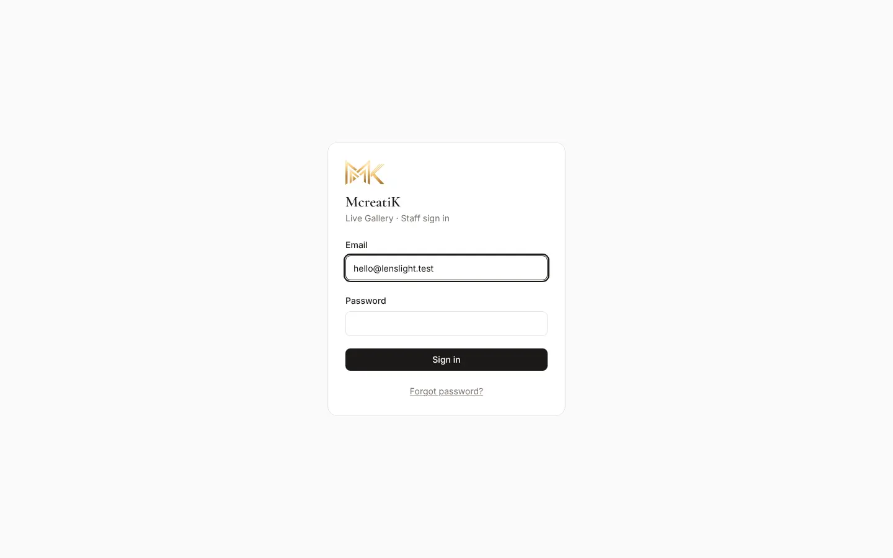

2. You're asked to choose your own password straight away (at least 10 characters). Enter the temporary password once, then the new one twice, and press **Save password**.

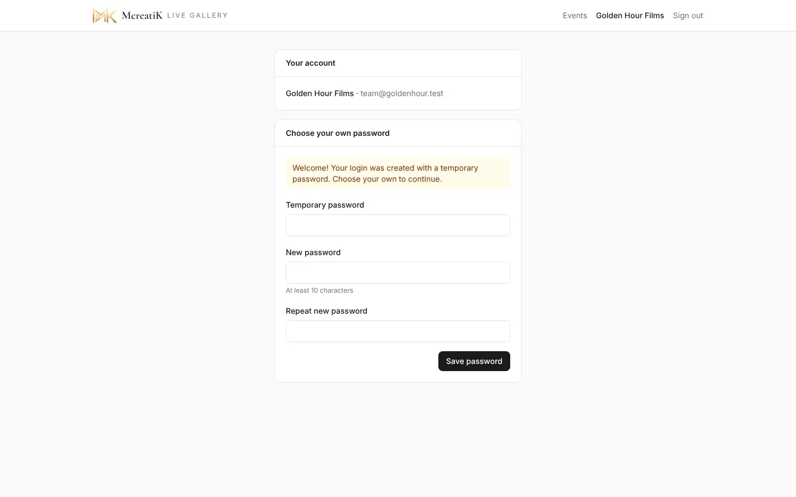

> **Tip** Forgot it later? Press **Forgot password?** on the sign-in page. A temporary password arrives by email from connect@mcreatik.com and works for 30 minutes.

## 2. Your branding

Open your studio name at the top right (**Account**).

1. **Logo:** press **Change logo**. A PNG with a transparent background looks best.
2. **Logo size on the QR poster:** drag until the preview looks right.
3. **Studio name** and **Instagram** (without the @), then **Save**.

Guests see your name, logo and Instagram on the gallery and on the printed QR poster.

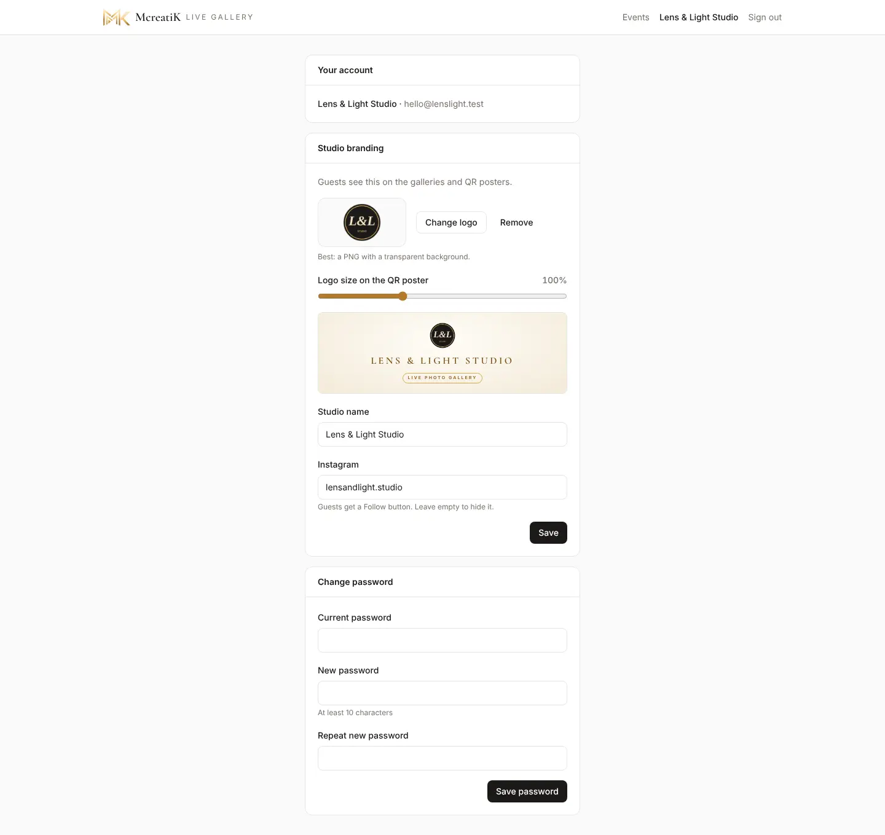

## 3. Create an event

1. **Events** shows all your events and, at the top, your plan: events left this month, any carried over from last month, and events you've bought.

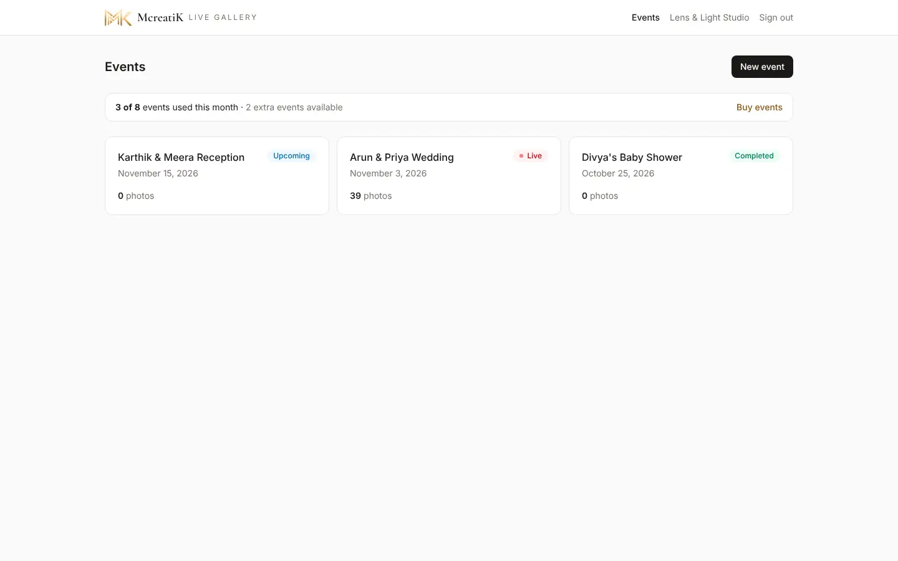

2. Press **New event** and choose the **Event type**:
   - **Main event:** weddings, receptions, big birthdays, big traditional functions and large corporate events.
   - **Quick event:** engagements, small birthdays, baby showers and small corporate events, up to about 300 guests. If more guests turn up, the gallery keeps working and the event page offers **Upgrade to Main**.

   Under the choice, the form tells you how this event is paid for: by your pack, by an event you bought, or the price to pay.
3. Enter the **Event name** guests will see (for example "Rahul & Sneha Engagement"), the **Date** and the **Status** (Upcoming for future events).
4. **Gallery address** is optional. Leave it empty and you get a hard-to-guess address.
5. Press **Create event**.

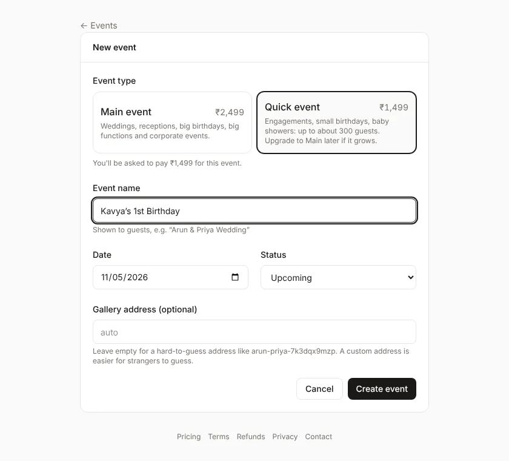

### Packages and prices

| | One event | 2 events a month | 4 events a month |
| --- | --- | --- | --- |
| **Main** | ₹2,499 | ₹3,499 | ₹4,999 |
| **Quick** | ₹1,499 | ₹2,499 | ₹3,999 |

- **Monthly packs:** a Main pack also covers Quick events; a Quick pack covers Quick events only.
- **Carry-over:** unused events carry over to the next month (one month only).
- **Renewing:** packs are renewed month by month from **Events → Renew pack** (you get an email and a banner a few days before). If you don't renew, nothing stops: new events are charged one by one.
- **Upgrades:** a Quick event that grows past about 300 guests can be upgraded to Main for ₹1,000.
- **Bought events** never expire.

Current prices are always on [the pricing page](https://live.mcreatik.com/pricing).

### Need more events?

Press **Buy events**, choose **Main** or **Quick** and how many. **Monthly packs** (or **Renew or change pack**) opens the same window for a pack. Then pay one of two ways:

- **Card, netbanking, UPI** (fastest): press **Pay ₹…**. A secure Razorpay window opens; pay by card, netbanking, UPI or wallet. The events are added **straight away** and your new event carries on. Closing the window without paying changes nothing.
- **UPI QR**: press **Show UPI QR for ₹…**, then scan it with GPay, PhonePe, Paytm or any UPI app (on a phone, tap **Pay with UPI app**). The events are added **automatically within seconds** of paying; there is nothing to type. The QR works for 15 minutes; if it runs out, press **New UPI QR**.

The price is the same both ways. Bought events never expire. If a card or bank payment fails, no events are added; any money taken is returned by your bank, or by us (see **Refunds** at the foot of the dashboard).

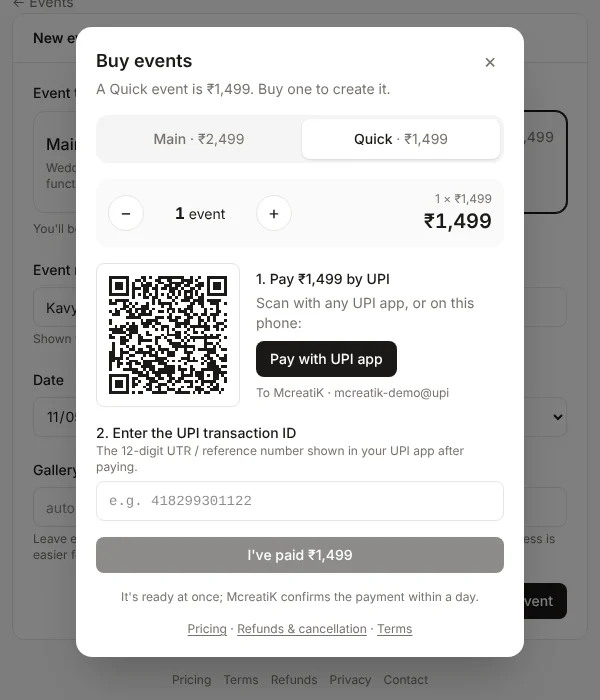

## 4. Connect your cameras

Setting up a new laptop? Press **Install uploader** in the top bar of the dashboard and download the Windows or Mac version.

Every camera needs its own **uploader**. One laptop with the McreatiK Instant Memories Uploader app can serve up to 4 cameras: add the extra cameras in the app with **+ Add camera** (you name each one there), and each appears here by itself. On the laptop, each event gets one folder with a sub-folder per camera.

1. Open the event. On **Overview**, under **Cameras & uploaders**, type a name such as "Camera 1 · Canon R6 II" and press **Add camera & get code**.
2. A **connection code** appears. **It's shown only once**, so press **Copy code** and paste it into the uploader (see the [Uploader guide](/admin/docs/guide-uploader)). A laptop already used for an earlier event: press **Change event…** in the uploader and paste the new code ([Switching to another event](/admin/docs/guide-uploader#4-switching-to-another-event)).

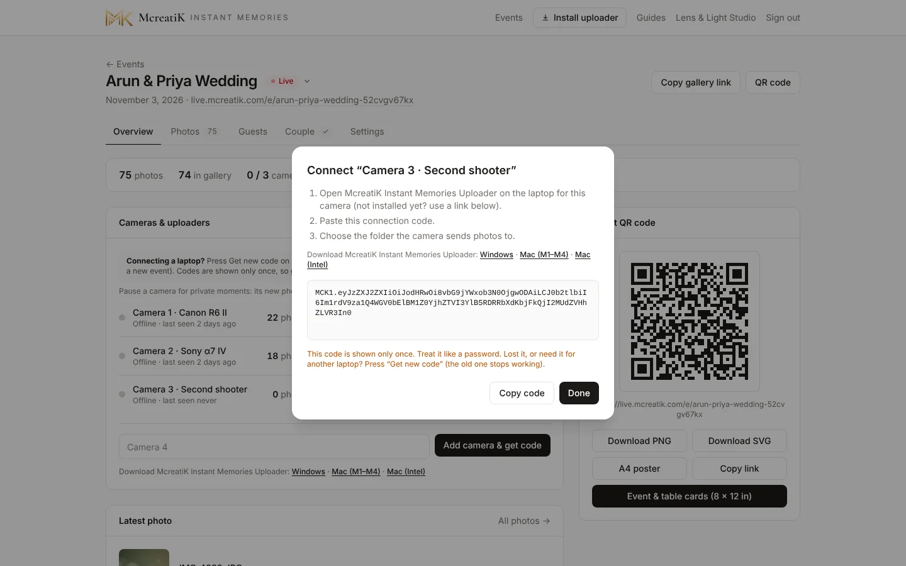

3. When the uploader is running, the camera shows **Online** with a green dot and its photo count.

- **Pause / Resume:** a privacy pause for moments that shouldn't go live (for example the bride getting ready). While paused, that camera's photos stay on the laptop and **never** reach the gallery, even after you resume. The camera shows **Paused** in amber here and in the uploader. You can also pause it in the uploader.
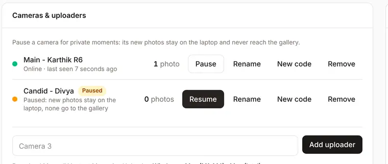

- **Rename:** for example "Main - Karthik" or "Candid - Divya". The name shows here, in the uploader and on its photo folder.
- **Get new code:** the code is shown only once, so use this whenever you need it again: a lost code, a new laptop, or an event you set up earlier and are moving the laptop to now. The old code stops working.
- **Remove:** disconnects that camera.

Then set up the camera itself: [Canon EOS R6 Mark II](/admin/docs/guide-canon) · [Sony α7 IV](/admin/docs/guide-sony).

## 5. QR code, studio board and cards

**Print your studio board once.** Go to **Account → Studio board** and pick a design: **Cream**, **Dark** or **White**. Then press **Download board (18 × 24 in)**. The board has your logo, studio name and Instagram, "Every moment, live." and a frame for the event card. It has no event details, so you can reuse it at every event. Have it printed on foam board or sunboard.

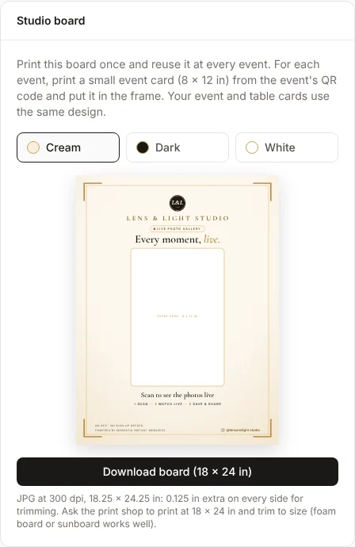

**For each event, print the cards.** On the event's Overview, the **Guest QR code** card gives you:

- **Event & table cards (8 × 12 in):** opens the cards page.
  - The **event card** (the couple's names, the date and the QR code) goes in your board's frame.
  - The **table card** adds "Scan to see the photos live", so it can stand on its own on guest tables.

  Both use your board's design. 8 × 12 in is a standard photo print size, so your photo lab can print them.
- **Download PNG / SVG:** the QR code alone, for invitations, screens or your own designs.
- **A4 poster:** the classic one-page poster, for an office printer.
- **Copy link:** to share in WhatsApp groups.

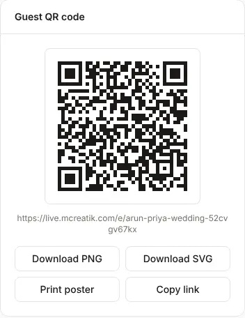

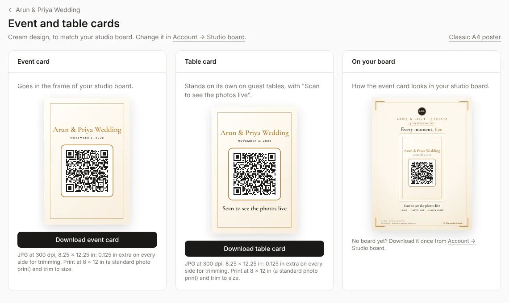

All downloads are JPG files at 300 dpi, with 0.125 in extra on every side for trimming: the board file is 18.25 × 24.25 in and the cards are 8.25 × 12.25 in. Ask the printer to **print at 18 × 24 in (or 8 × 12 in) and trim to size**. All text is kept well inside the edges, so a slightly off cut won't touch it.

> **Tip** Put the board at the entrance and a table card on every few tables. That's where most guests scan.

## 6. Event day

1. Set the event to **Live**, or leave it Upcoming: it turns Live by itself with the first camera photo. Use the status menu next to the event name.

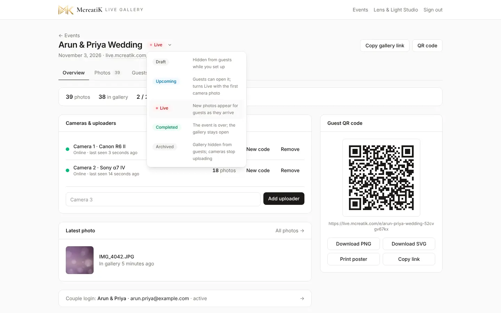

2. Start the uploader on each laptop and check it shows **Online** and **this event's name** (see the [Uploader guide](/admin/docs/guide-uploader)).
3. Take one test shot per camera. It should appear in the gallery within seconds.
4. Put the QR posters out.
5. Follow the [Event-day checklist](/admin/docs/guide-event-day).

## 7. During the event: curate live

Open **Photos**. Every photo the cameras send appears here and in the guest gallery.

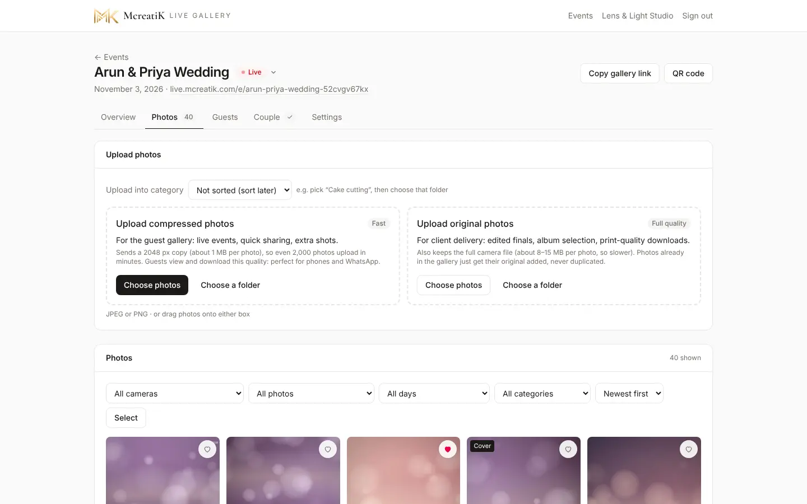

- **Filters:** camera, liked or hidden, day, category, and newest or oldest first.
- **On each tile:** the heart marks a **Like** (your favourites; filter by them later); the eye **hides** it from guests at once.
- **More (⋯):** Download, **Make cover** (the gallery's top image), Download original, Delete.
- **Select:** tap several photos, then Move to category, Like, Hide, Download (.zip) or Delete them all at once. **Select all** and **Clear** help with big batches.

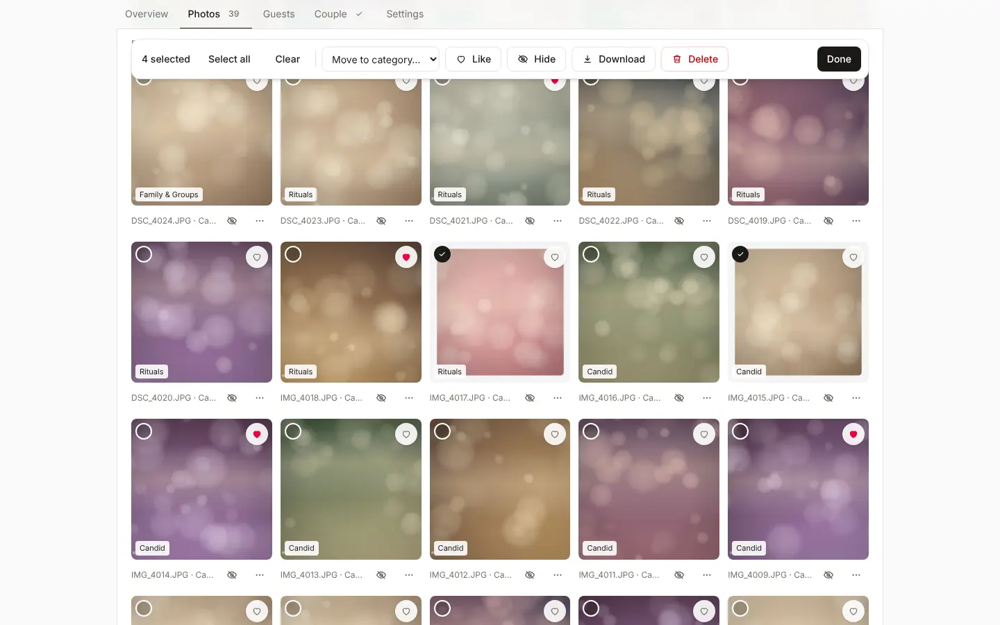

> **Warning** Delete is permanent. Prefer **Hide** during the event; delete afterwards if needed.

## 8. After the event

### 8.1 Upload edited photos and originals

At the top of **Photos**:

- **Upload compressed photos:** for the guest gallery. They're resized to 2048 px (about 1 MB each), so they upload quickly.
- **Upload original photos:** full quality, for the couple's downloads and album. The gallery still gets a fast copy.

Choose a category first if the batch belongs to one (for example "Cake cutting"), then **Choose photos** or **Choose a folder**.

### 8.2 Sort into categories

**Settings → Photo categories** lists the albums couples browse by (Couple, Family & Groups, Rituals, Cake cutting, Main event, Candid). Add your own, or remove one with ×. To sort photos: **Photos → Select → Move to category**.

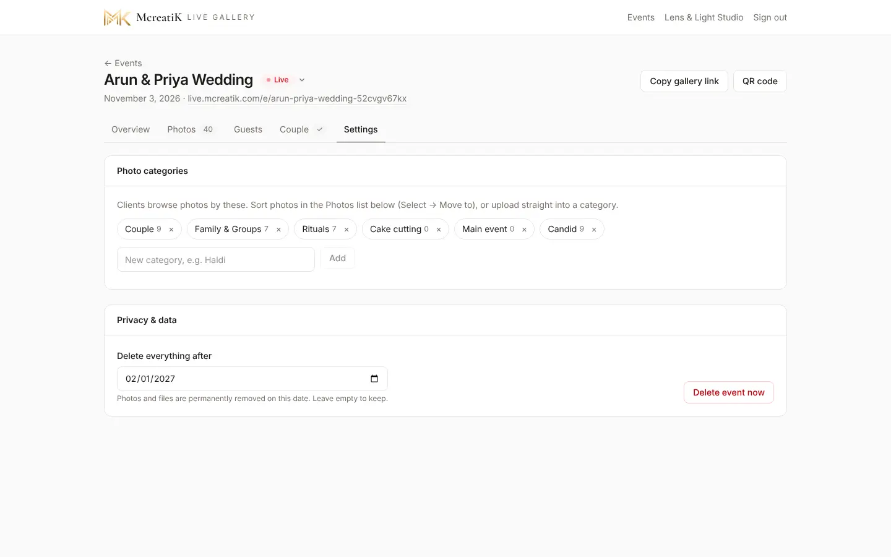

### 8.3 Delete date

**Settings → Privacy & data → Delete everything after** sets when the event's photos are deleted permanently. The default is 90 days after the event. Tell the couple the date so they download in time.

## 9. Give the couple their login

1. Open **Couple** and press **Create client login**: name, email and phone (for WhatsApp).
2. Send it with **WhatsApp** or **Open in mail app**. The temporary password is shown only now.
3. **Album limit (optional):** for example 60. The couple can't pick more than this.
4. Their picks appear under **Album selection** as they choose. Press **Download all (.zip)** for your album designer, or use **Copy file names** or **Download list (.txt)** to find them in Lightroom.

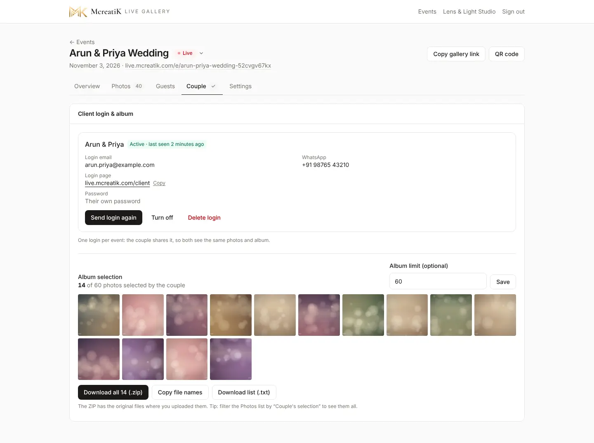

- **Send login again:** resends the login with a new temporary password.
- **Turn off:** blocks the couple's login without deleting anything.
- **Delete login:** removes it. Their picks are kept with the event.

Then send them the couple guide: **Guides → Couples (clients) → Download PDF** (see [Guides for your clients](#11-guides-for-you-and-your-clients)).

## 10. See how guests used it

**Guests** shows people, QR scans, gallery visits, photo views and downloads, an hourly chart and the most-loved photos. Guests stay anonymous. Use it in your marketing ("312 guests watched live").

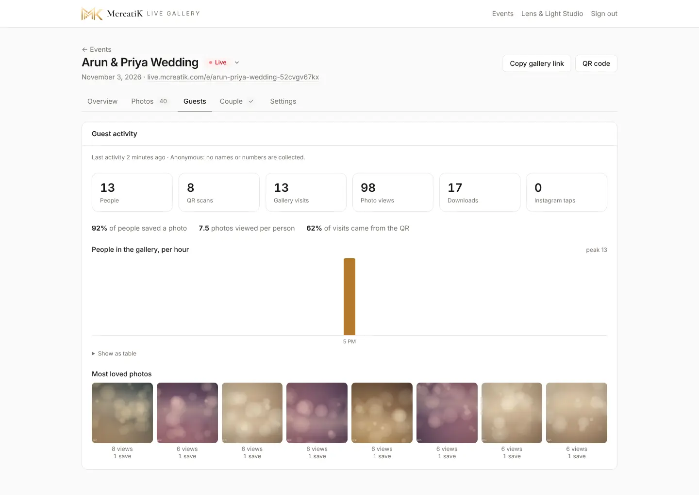

## 11. Guides for you and your clients

**Guides** in the top menu has every guide for you, plus guides to send your clients. Each page has a **Download PDF** button: choose **Save as PDF** in the print window. The PDF always matches the current app.

| Send this | To | When |
| --- | --- | --- |
| [Couples (clients)](/admin/docs/sop-couple) | The couple | With their login (step 9) |
| [Guests](/admin/docs/sop-guest) | The event planner or family | A few days before the event |
| [Couples Q&A](/admin/docs/qa-couples) and [Guests Q&A](/admin/docs/qa-guests) | Anyone with questions | Any time |

The client guides show **your studio's name, logo and Instagram** (set in **Account**, step 2), with a small "Live photos by McreatiK Instant Memories" line at the end. Send the PDF on WhatsApp or email: your clients don't need a login to read it.

The client guides send couples and guests to **you** for help, never to McreatiK. If you can't solve something (a login that won't work, a gallery that is switched off, a bug), contact McreatiK and we sort it out with you. The one exception: a guest who asks to have their own photo removed can also email McreatiK. We pass it to you, as privacy law requires.

Table card text you can copy: "**Scan to see the photos live.** Point your phone camera at the code. No app needed. New photos appear on their own."

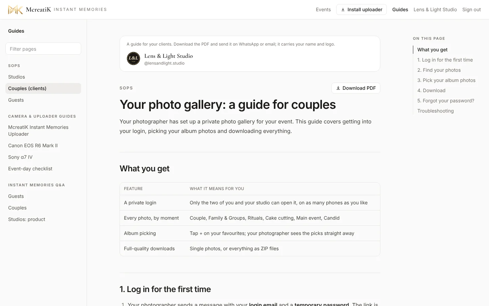

## Troubleshooting

| Problem | Fix |
| --- | --- |
| A camera shows Offline on the dashboard | The uploader on that laptop is closed, asleep or has no internet. Check its window. |
| The uploader shows an earlier event's name | Press **Change event…** in the uploader and paste this event's code. |
| The camera can't connect to the laptop | See the camera guide's troubleshooting ([Canon](/admin/docs/guide-canon#troubleshooting) · [Sony](/admin/docs/guide-sony#troubleshooting)). |
| Guests say the page is empty | Status is Draft or Archived, or no photos yet. Set Upcoming or Live. |
| "This gallery is currently unavailable" | McreatiK turned the gallery off. Contact McreatiK. |
| Can't create an event (payment needed) | Your pack's events are used up, your pack has ended (renew it), or it's a Main event on a Quick pack. The message says which. Use **Buy events** or **Renew pack**. |
| Couple says the album limit is reached | Raise the **Album limit** on the Couple tab, or ask them to untick some. |

More: [Event-day checklist and troubleshooting](/admin/docs/guide-event-day).
