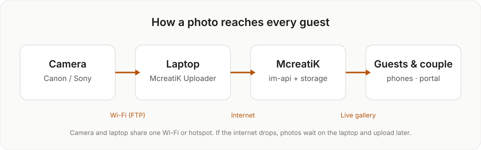
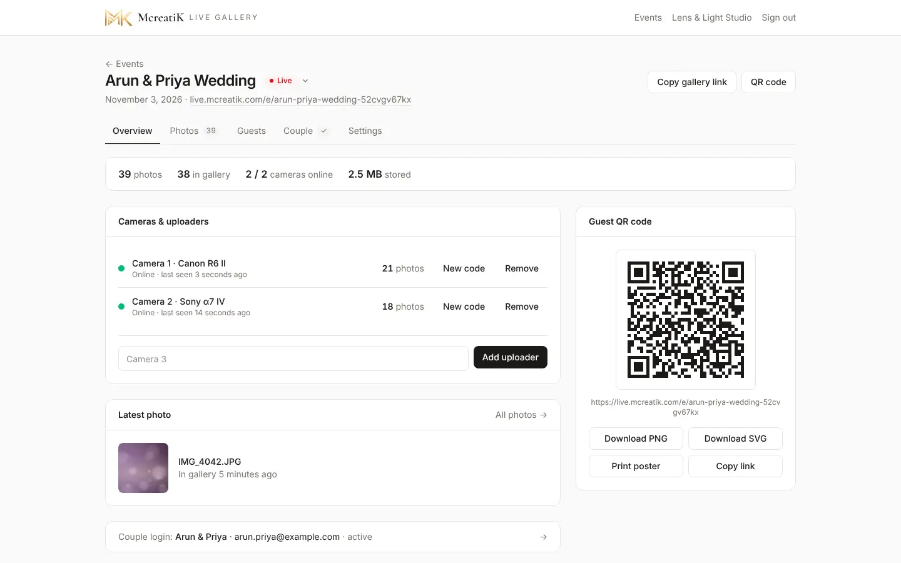
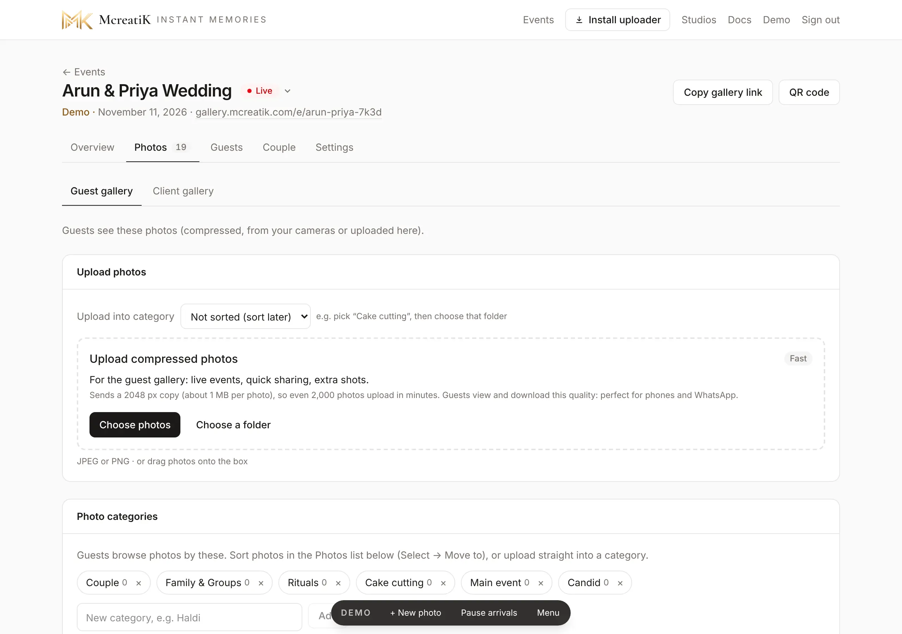
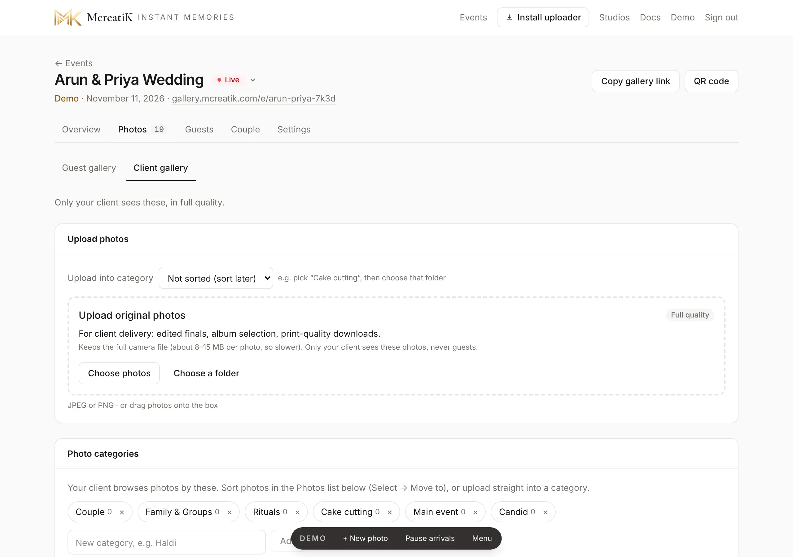

# Studio SOP

This is the standard operating procedure for a **photography studio** using Instant Memories, from the first login to delivering the album photos. Send it to every studio you sign up. It is written for them, so "you" means the studio.

## The whole job on one page

| When | What you do | Section |
| --- | --- | --- |
| Once | Log in, set your own password, add your logo and Instagram | 1–2 |
| Per event, a few days before | Create the event, connect each camera, print the QR poster | 3–5 |
| Event day | Start the uploader, test one shot, put the posters out | 6 |
| During the event | Watch the dashboard; hide anything that shouldn't be shown | 7 |
| After the event | Upload full-quality finals to the Client gallery, give the couple their login, collect album picks | 8–9 |
| Any time | See who loved and asked for photos | 10 |

## 1. First login

1. Open **live.mcreatik.com/admin**, then sign in with the email and temporary password McreatiK sent you. The page checks the email and password as you fill them in.

2. You're asked to choose your own password straight away (at least 10 characters). Enter the temporary password once, then the new one twice, and press **Save password**.

> **Tip** Forgot it later? Press **Forgot password?** on the sign-in page. A temporary password arrives by email from connect@mcreatik.com and works for 30 minutes.

## 2. Your branding

Open your studio name at the top right (**Account**).

1. **Logo:** press **Change logo**. A PNG with a transparent background looks best.
2. **Logo size on the QR poster:** drag until the preview looks right.
3. **Studio name** and **Instagram** (without the @). Under the studio name you see that guests get to see it on your galleries, QR posters and printed cards.
4. **Contact number (WhatsApp):** your booking number, for example 98765 43210 (+91 is added for you). It is checked as you type. Then press **Save**, or **Cancel** to undo your changes.

The preview follows the board design you pick.

Guests see your name, logo and Instagram on the gallery and on the printed QR poster. With a contact number, the gallery also shows a **"Book … for your event"** bar right under the live bar, with **WhatsApp** and **Call** buttons, and the number is printed on your studio board and A4 poster. Every guest at the event is a possible client: **Guests → Contacted you** counts how many tapped it. Leave the number empty to hide it.

## 3. Create an event

1. **Events** shows all your events and, at the top, your plan: events left this month, any carried over from last month, and events you've bought.
   - Use **Sort** and the filters (type, status, year, month, from and to date) to find an event fast.

2. Press **New event** and choose the **Event type**:
   - **Main event:** weddings, receptions, big birthdays, big traditional functions and large corporate events.
   - **Quick event:** engagements, small birthdays, baby showers and small corporate events, up to about 200 guests. If more guests turn up, the gallery keeps working and the event page offers **Upgrade to Main**.
   - **Client gallery only:** no live guest gallery and no camera. You upload the edited photos from the dashboard and the couple gets a private gallery to view, select and download. ₹250 per client gallery, plus storage for the months you choose (see 3.1).

   Under the choice, the form tells you how this event is paid for: by your pack, by an event you bought, or the price to pay.
3. Enter the **Event name** guests will see (for example "Rahul & Sneha Engagement"), the **Date** and the **Status** (Upcoming for future events).
4. **Gallery open for:** how many months the gallery stays open. Main and Quick events include 3 months. Each extra month costs ₹75. You pay for it right after creating the event, in the **Change storage & months** window. A client gallery starts at 1 month, and its price is the setup plus the storage for those months.
5. **Gallery address** is optional. Leave it empty and you get a hard-to-guess address.
6. Press **Create event**.

### Packages and prices

| | One event | 2 events a month | 4 events a month |
| --- | --- | --- | --- |
| **Main** | ₹2,499 | ₹3,499 | ₹4,999 |
| **Quick** | ₹1,499 | ₹2,499 | ₹3,999 |
| **Extra event on a Main pack** (Main or Quick) | | ₹1,499 | ₹999 |
| **Extra Quick event on a Quick pack** | | ₹999 | ₹799 |

- **Monthly packs:** a Main pack also covers Quick events; a Quick pack covers Quick events only.
- **Extra events:** once this month's pack events (and any carried over) are used, each extra event costs the pack's extra price above, as long as the pack is paid up. **Buy events** and the new-event form show it. A Main event on a Quick pack is the normal ₹2,499. If the pack lapses, events go back to the normal prices.
- **Carry-over:** unused events carry over to the next month (one month only).
- **Renewing:** packs are renewed month by month from **Events → Renew pack** (you get an email and a banner a few days before). If you don't renew, nothing stops: new events are charged one by one.
- **Upgrades:** a Quick event that grows past about 200 guests can be upgraded to Main for ₹1,000.
- **Bought events** never expire.
- **Main event on a Quick pack:** while your Quick pack is paid up, a Main event costs ₹1,499 instead of ₹2,499.
- **Check the event name and date before creating an event.** They are printed on your QR cards and can't be changed afterwards (contact McreatiK if you made a mistake). Studios can't delete events; you can delete photos. Only McreatiK can delete an event.
- **Client gallery storage:** when you pay the ₹250 setup, you pay for the gallery's storage and months in the same payment.

### 3.1 Storage and how long galleries stay open

| | Price |
| --- | --- |
| **Client gallery only** | ₹250 setup per gallery + storage, for 1 month unless you choose more |
| **Storage** | ₹15 per GB per month (1 GB ≈ 80 full-quality photos) |
| **Main or Quick event** | 5 GB for 3 months included free; extra storage starts at 5 GB (5, 10, 25, 50 or your own number), ₹15 per GB per month |
| **Change storage & months** | One button: add GB, add months, or both. You see one total and make one UPI payment |
| **One more month on a Main or Quick event** | 5 GB × ₹15 = ₹75 |

- **What counts:** everything stored for the event, both the gallery versions and the full-quality originals. A typical wedding of 2,000 photos with originals is about 25 GB.
- **Event page → Overview → Gallery & storage** shows what the event uses, how many more photos fit, and when it closes. **Change storage & months** is the one button for more space or more time. Choose the GB to add (5, 10, 25, 50 or your own number, at least 5), the months to add, or both.
- **Client galleries** start with 0 GB. Choose the storage when you create it; when it is full, uploads stop with "storage is full" until you add more.
- **Main and Quick events** are never stopped during the event. If the event uses more than 5 GB, add the extra GB within **14 days of the event date**. If you don't, the couple's gallery is paused (the guests' gallery keeps working) until you add it.
- **Main and Quick galleries are open 3 months (about 90 days)** from the event date. A client gallery is open for the months you chose, 1 by default, from the day it was created. After that, guests and the couple see "This gallery has expired", and the photos are **deleted for good 30 days later**. The event stays in your list as a record (archived). Studios can't delete events; only McreatiK can. We email you 14 days before and on the day.
- **More months:** use **Change storage & months** on the same card. You can use it as many times as you need, any time until the deletion date.
- **How it is charged:** the GB you add are charged for the months the gallery has left (rounded up to whole months), plus all the gallery's GB for the months you add, at ₹15 per GB per month. The free 5 GB for 3 months is never charged. A client gallery has no free storage: you choose its months when you create it (setup + GB × ₹15 × months).
- **Selling it on:** you decide what to charge your couple for the digital gallery. For example, a 25 GB wedding gallery for 3 months is ₹250 + 25 × ₹15 × 3 = ₹1,375 to you (for 1 month it is ₹625), so you could charge your couple ₹2,500 or more for a private online album. Uploading only the edited finals (not every original) keeps the GB, and your cost, down.

Current prices are always on [the pricing page](https://live.mcreatik.com/pricing).

### Need more events?

Press **Buy events**, choose **Main** or **Quick** and how many. **Monthly packs** (or **Renew or change pack**) opens the same window for a pack. Then pay:

Pay with the **UPI QR**: scan it with GPay, PhonePe, Paytm or any UPI app (on a phone, tap **Pay with UPI app**), then type the **UTR** (the UPI transaction ID in your app) and press **I have paid**. The events are ready **at once**; McreatiK confirms the payment within a day. Bought events never expire. If a payment is not received, it is taken back and we contact you (see **Refunds** at the foot of the dashboard).

## 4. Connect your cameras

Setting up a new laptop? Press **Install uploader** in the top bar of the dashboard and download the Windows or Mac version.

Every camera needs its own **uploader**. One laptop with the McreatiK Instant Memories Uploader app can serve up to 4 cameras: add the extra cameras in the app with **+ Add camera** (you name each one there), and each appears here by itself. On the laptop, each event gets one folder with a sub-folder per camera.

1. Open the event. On **Overview**, under **Cameras & uploaders**, type a name such as "Camera 1 · Canon R6 II" and press **Add camera & get code**.
2. A **connection code** appears. **It's shown only once**, so press **Copy code** and paste it into the uploader (see the [Uploader guide](/admin/docs/guide-uploader)). The code is all the uploader needs. There is no studio sign-in in the app. 

   After installing, in short (full steps in the [Uploader guide](/admin/docs/guide-uploader#2-start-and-connect-to-the-event)):

   - **First open:** Windows → More info → Run anyway; Mac → System Settings → Privacy & Security → Open Anyway.
   - **Connect:** in the uploader press **Paste**, choose the photo folder, choose camera Wi-Fi (FTP) or folder, then **Connect**.
   - **Camera Wi-Fi:** type the Server, Port, User and Password shown on the uploader's **Camera Wi-Fi settings** card (Live Upload page) into the camera's FTP settings, then take a test shot and check it appears.
   - **Change to another event:** wait until everything is uploaded (the queue is empty), then **Events → Change event…**, paste the new event's code and press **Connect**. The uploader restarts on the new event ([Switching to another event](/admin/docs/guide-uploader#4-switching-to-another-event)).

3. When the uploader is running, the camera shows **Online** with a green dot and its photo count.

- **Pause / Resume:** a privacy pause for moments that shouldn't go live (for example the bride getting ready). While paused, that camera's photos stay on the laptop and **never** reach the gallery, even after you resume. The camera shows **Paused** in amber here and in the uploader. You can also pause it in the uploader.

- **Rename:** for example "Main - Karthik" or "Candid - Divya". The name shows here, in the uploader and on its photo folder.
- **Get new code:** the code is shown only once, so use this whenever you need it again: a lost code, a new laptop, or an event you set up earlier and are moving the laptop to now. The old code stops working.
- **Freelancers and second shooters:** add a camera for each person, then send them the code on WhatsApp together with the uploader download link (**Install uploader** in the top bar). They need nothing else. When their job is done, press **Get new code**. Their old code stops working, so they can no longer send photos to the event.
- **Remove:** disconnects that camera.

Then set up the camera itself (any camera with FTP transfer (Wi-Fi/FTP upload) works; examples): [Canon EOS R6 Mark II](/admin/docs/guide-canon) · [Sony α7 IV](/admin/docs/guide-sony).

## 5. QR code, studio board and cards

**Print your studio board once.** Go to **Account → Studio board** and pick a design: **Cream**, **Dark** or **White**. Then press **Download board (18 × 24 in)**. The board has your logo, studio name and Instagram, "Every moment, live." and a frame for the event card. It has no event details, so you can reuse it at every event. Have it printed on foam board or sunboard.

**For each event, print the cards.** On the event's Overview, the **Guest QR code** card gives you:

- **Event & table cards (8 × 12 in):** opens the cards page.
  - The **event card** (the couple's names, the date and the QR code) goes in your board's frame.
  - The **table card** adds "Scan to see the photos live", so it can stand on its own on guest tables.

  Both use your board's design. 8 × 12 in is a standard photo print size, so your photo lab can print them.
- **Download PNG / SVG:** the QR code alone, for invitations, screens or your own designs.
- **A4 poster:** the classic one-page poster, for an office printer.
- **Copy link:** to share in WhatsApp groups.
- The A4 poster reads "McreatiK Instant Memories" and also downloads as a **300 dpi JPG** on the cards page, for a print shop.

The board and cards are JPG files at 300 dpi, with 0.125 in extra on every side for trimming: the board file is 18.25 × 24.25 in and the cards are 8.25 × 12.25 in. Ask the printer to **print at 18 × 24 in (or 8 × 12 in) and trim to size**. All text is kept well inside the edges, so a slightly off cut won't touch it.

> **Tip** Put the board at the entrance and a table card on every few tables. That's where most guests scan.

## 6. Event day

1. Set the event to **Live**, or leave it Upcoming: it turns Live by itself with the first camera photo. Use the status menu next to the event name.

2. Start the uploader on each laptop and check it shows **Online** and **this event's name** (see the [Uploader guide](/admin/docs/guide-uploader)).
3. Take one test shot per camera. It should appear in the gallery within seconds.
4. Put the QR posters out.
5. Follow the [Event-day checklist](/admin/docs/guide-event-day). Keep the [Event-day problem playbook](/admin/docs/guide-event-day-problems) open too: it says what to do if anything goes wrong.

## 7. During the event: curate live

Open **Photos**. Every photo the cameras send appears here and in the guest gallery.

At the top of **Photos** you see two tabs: **Guest gallery** and **Client gallery**. During the event you work in **Guest gallery**. The camera photos land there.

- **Filters:** camera, liked or hidden, day, category, and newest or oldest first.
- **Find one photo:** type the camera file name, for example IMG_1234.JPG, in the **Search file name** box.
- **On each tile:** the heart marks a **Like** (your favourites; filter by them later); the eye **hides** it from guests at once.
- **More (⋯):** Download, **Make cover** (the gallery's top image), Download original, Delete.
- **Select:** tap several photos, then Move to category, Like, Hide, Download (.zip) or Delete them all at once. **Select all** and **Clear** help with big batches.

> **Warning** Delete is permanent. Prefer **Hide** during the event; delete afterwards if needed.

### Guest gallery and Client gallery

| | Guest gallery | Client gallery |
| --- | --- | --- |
| **What is in it** | Camera photos and compressed uploads | Full-quality photos you upload from the dashboard: your edited finals |
| **Who sees it** | Only the guests | Only the couple |
| **What the couple does with it** | Nothing. They don't see it. | Views it, picks album photos, downloads photos and ZIPs |

- Each tab has its **own categories**. Add them under **Settings → Photo categories**, one list for each tab.
- If a gallery is turned off, uploads are still saved. Nobody sees them until you turn it on.
- A **Client gallery only** event shows just the Client gallery tab.
- **Old events:** on events created before 11 Nov 2026, the couple still sees every photo, as before. There is no split.

> **Tip** Guests get compressed photos. Your client gets full quality in the Client gallery.

## 8. After the event

### 8.1 Upload the couple's final photos

Open the **Client gallery** tab and upload your edited, full-quality photos there. Choose a category first if the batch belongs to one (for example "Cake cutting"), then **Choose photos** or **Choose a folder**.

- Photos you upload here go **only to the couple**. Guests never see them.
- They stay full quality. The couple can download them as they are.
- To add more photos for guests after the event, use the **Guest gallery** tab. Those are compressed (2048 px, about 1 MB each) so they upload fast.
- If a photo is in the wrong tab, you'll see a message. Open the other tab and upload it there.

### 8.2 Sort into categories

**Settings → Photo categories** lists the albums people browse by (Couple, Family & Groups, Rituals, Cake cutting, Main event, Candid). Guest gallery and Client gallery each have their own list. Add your own, or remove one with ×. To sort photos: **Photos → Select → Move to category**.

### 8.3 How long it stays open

**Settings → Privacy & data** shows when the gallery closes and when its photos are deleted permanently (30 days later). To keep it longer, use **Change storage & months** on the Overview's **Gallery & storage** card (see 3.1). Tell the couple the date so they download in time.

## 9. Give the couple their login

1. Open **Couple** and press **Create client login**: name, email and phone (for WhatsApp).
2. Send it with **WhatsApp** or **Open in mail app**. The message carries the couple's gallery link. The temporary password is shown only now.
3. **Album limit (optional):** for example 60. The couple can't pick more than this.
4. Their picks appear under **Album selection** as they choose. Press **Download all (.zip)** for your album designer, or use **Copy file names** or **Download list (.txt)** to find them in Lightroom.

- **Same email, several events:** the same couple email can have a login on several events. The link is live.mcreatik.com/client/login?event=your-event-address. If they use the plain login page, they choose the event after signing in. A password reset covers all their logins.
- **Send login again:** resends the login with a new temporary password.
- **Turn off:** blocks the couple's login without deleting anything.
- **Delete login:** removes it. Their picks are kept with the event.

Then send them the couple guide: **Guides → Couples (clients) → Download PDF** (see [Guides for your clients](#11-guides-for-you-and-your-clients)).

## 10. See how guests used it

**Guests** shows people, QR scans, gallery visits, photo views and downloads, an hourly chart and **Likes**: how many hearts guests tapped. Guests stay anonymous. Use it in your marketing ("312 guests watched live").

- **Lists:** **Most loved**, **Most downloaded** and **Most viewed** show which photos guests liked, saved and opened most.
- **HD photo requests:** a guest can tap **Get HD photo** and leave an email or a WhatsApp number. Each request shows here with a **WhatsApp** or **email** link, so you can reply in one tap. Send the photo, then tick **Done**. Every request is a possible booking.
- **Removal requests:** a guest who asks to remove a photo sends an email that names the camera file, for example IMG_1234.JPG. Open **Photos**, type that name in **Search file name**, and hide or delete the photo.

## 11. Guides for you and your clients

**Guides** in the top menu has every guide for you, plus guides to send your clients. Each page has a **Download PDF** button: choose **Save as PDF** in the print window. The PDF always matches the current app.

| Send this | To | When |
| --- | --- | --- |
| [Couples (clients)](/admin/docs/sop-couple) | The couple | With their login (step 9) |
| [Guests](/admin/docs/sop-guest) | The event planner or family | A few days before the event |
| [Couples Q&A](/admin/docs/qa-couples) and [Guests Q&A](/admin/docs/qa-guests) | Anyone with questions | Any time |

The client guides show **your studio's name, logo and Instagram** (set in **Account**, step 2), with a small "Live photos by McreatiK Instant Memories" line at the end. Send the PDF on WhatsApp or email: your clients don't need a login to read it.

The client guides send couples and guests to **you** for help, never to McreatiK. If you can't solve something (a login that won't work, a gallery that is switched off, a bug), contact McreatiK and we sort it out with you. The one exception: a guest who asks to have their own photo removed can also email McreatiK. We pass it to you, as privacy law requires.

Table card text you can copy: "**Scan to see the photos live.** Point your phone camera at the code. No app needed. New photos appear on their own."

## Troubleshooting

| Problem | Fix |
| --- | --- |
| A camera shows Offline on the dashboard | The uploader on that laptop is closed, asleep or has no internet. Check its window. |
| The uploader shows an earlier event's name | Press **Change event…** in the uploader and paste this event's code. |
| The camera can't connect to the laptop | See the camera guide's troubleshooting ([Canon](/admin/docs/guide-canon#troubleshooting) · [Sony](/admin/docs/guide-sony#troubleshooting)). |
| Couple says photos are missing | New events: the couple sees only the **Client gallery**. Upload the finals there. |
| Guests say the page is empty | Status is Draft or Archived, or no photos yet. Set Upcoming or Live. |
| "This gallery is currently unavailable" | McreatiK turned the gallery off. Contact McreatiK. |
| Upload says "storage is full" | A client gallery has used its GB. Press **Change storage & months** (Overview → Gallery & storage), then **Retry failed**. |
| Couple says "This gallery has expired" | Its 3 months have passed. Press **Change storage & months** on the Overview before the deletion date shown there. |
| Can't create an event (payment needed) | Your pack's events are used up, your pack has ended (renew it), or it's a Main event on a Quick pack. The message says which. Use **Buy events** or **Renew pack**. |
| Couple says the album limit is reached | Raise the **Album limit** on the Couple tab, or ask them to untick some. |

More: [Event-day checklist and troubleshooting](/admin/docs/guide-event-day) · [Event-day problem playbook](/admin/docs/guide-event-day-problems).
